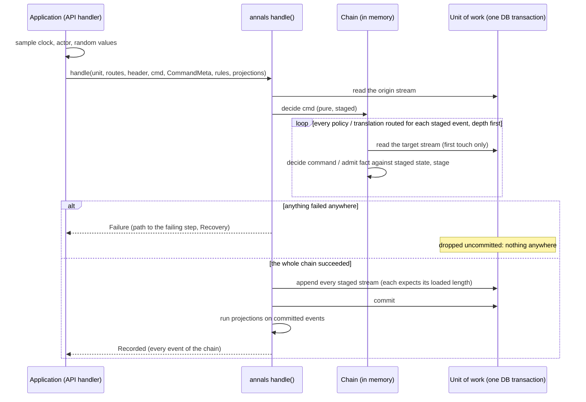

# The audited kernel: design proposal

Status: **proposal**. The signatures are in `crates/annals/src/next/`, with
non-trivial bodies left as `todo!("proposal: ...")`. The behaviour is pinned by
ignored tests in `crates/annals/tests/next/`. The wire form is
`crates/annals-log/proto/annals/event/v1/event.proto`. Nothing here is
implemented until this document has been reviewed.

## Why

People choose event sourcing for different reasons; here the main reason is
**auditability**. Every change should answer who made it, when, on which
request, why (what caused it), and under which code and which rules. Replay
should reproduce exactly what was seen at the time. An architectural review
of annals against CQRS/ES practice found gaps in exactly those places:

| ID | Finding | Resolution here |
|---|---|---|
| A1 | `Envelope` holds only seq, cause and event, with no who, when or why. Consumers put metadata in the payload: hatpick's `Stamp`, annals-sim's `Ticked`. | A kernel-owned `Meta` is stamped on every event. [Metadata](#metadata) |
| A2 | `cause` is only within a stream. `Injected` lacks the source stream's identity. There is no correlation id. | `cause: Option<EventId>` can point at any stream. `CorrelationId` is propagated through every reaction. |
| A3 | `Header.rules` is a free string per stream that replay never checks. The fold code is unversioned. | The rules version is recorded per event and resolved by a `Rulebook` at replay. The caller cannot substitute rules. [Versioning](#versioning) |
| A5 | `Header.schema` is unused, and there is no upcasting. | Schema version is recorded per event. A validated N→N+1 upcast chain runs at read time. Golden replay fixtures pin old logs. |
| A6 | Events emitted before a rejection stay in the `Stream`. | Decide is pure and stages its events. A rejection leaves nothing behind. [Decide](#decide) |
| B1 | The "saga" is really a stateless policy. The target-contiguity invariant is undocumented. `backlog` replays the source once per target. | Three typed reactions share one base. The invariant is documented and checked. Each backlog is one pass for all targets. [Reactions](#reactions) |
| B2 | `Projection::on` gets no stream identity or position. | Every reaction gets a `Committed`: the stream, the seq, the metadata, the event, and the state just after it. |
| B6 | The store port is synchronous, `&mut`, and whole-stream only. `read -> Option` hides I/O failure. `Conflict` is its only error. Its ids are `u64`. Its append checks nothing. | There are sync and async ports and a unit of work. `read_from` is added. Append returns the new length and checks seq continuity and the header. `StoreError` separates conflict, caller bug, duplicate and infrastructure failure. `StreamId` is 128 bits. [Store](#the-store-ports) |
| B8 | The only error channel is `Domain::Rejection`, so kernel faults are folded into business rejections. | `Failure` keeps the domain's rejection apart from kernel faults and from failures further down the chain. Each failure is classified for recovery. [Errors](#errors-and-recovery) |

## Design constraints

- **annals is the in-process core, and distributed runtimes wrap it.**
  angzarr nests annals and adds retries, compensation and idempotent
  redelivery across processes. annals does no I/O, keeps no infrastructure
  and never retries. Its contract makes wrapping possible:
  - Failures say whether to retry (`Recovery`).
  - Command ids are idempotency keys (`CommandId`).
  - Metadata, facts, positions and failures have a wire form
    (`annals.event.v1`).
- **Pure and deterministic.** There is no clock, no randomness, no I/O and
  no hash-map iteration in the kernel. The application samples everything
  and passes it in.
- **The kernel stays synchronous.** The only async parts are the async store
  port beside the sync one, and the command handler over it. Both use native
  `impl Future` in traits, with zero dependencies. The MSRV is 1.77, and
  return-position `impl Trait` in traits needs 1.75.
- **Builds for `wasm32-unknown-unknown`.** It is checked.
- **Must not preclude hash chaining** (deferred). Stored events are never
  rewritten: upcasting happens at read time. Metadata is deterministic. The
  actor is a pseudonymous id, so erasing a person never edits history. A
  later `Meta` field (or `Envelope` field 4 on the wire) can carry the
  previous event's digest without disturbing anything here.

## The flow



1. **The application samples** the instant, the actor, the request id and
   any random values *before* deciding. The first three go in the
   `CommandMeta`. A random value goes in the command, for example
   `Draw { roll }`.
2. **Decide** is pure, over explicit inputs: state, command, `CommandMeta`
   and rules. It stages events. It never changes the stream.
3. **React.** Policies and translations routed for the source's domain run on
   the staged events, in the same `Chain`. Their targets' events set off
   their own reactions, depth first, until nothing more is owed.
   **Everything stays staged in memory**, across every stream involved.
4. **Append, atomically, or not at all.** If anything in the chain failed (a
   policy's command rejected, a fact refused, a gap, the depth limit, a
   store read), the failure goes back to the caller with the path to the
   failing step. Nothing is appended anywhere, not even the originating
   command's events. On success, every staged stream is appended through the
   unit of work. Each append expects the length the stream had when the
   chain loaded it, so optimistic concurrency covers **every stream
   touched**. Then the unit of work is committed: one transaction.
5. **Project.** Projections run after the commit, on committed events only.
   They never see a failed chain.

`handle` is request/response. It returns `Recorded`: every event the chain
recorded, in every stream. An API handler answers with those events; a draw
command answers with its `Drawn`.

**Policies are inside the write-side consistency boundary, by deliberate
choice.** This is the in-process form of the pattern: a reaction's target is
updated in the same transaction as its source, so no draw ever sees a draw
system behind its list. A reaction that must cross a process boundary is not
one of these. A wrapping runtime does that from the committed log
(`Position`, `orders_owed`, `facts_owed`, `Policy::on_rejected`).

## Decide

```rust
pub trait Domain: Sized + 'static {
    type State: Default + Clone + Send + 'static;
    type Command: Send + 'static;
    type Event: Clone + Send + Sync + 'static;
    type Rejection: Diagnostic + Send + 'static;
    type Rules: Send + Sync + 'static;
    const NAME: &'static str;  // written in every stream header
    const SCHEMA: u32;         // the event schema this code writes and apply reads
    fn decide(cmd: &Self::Command, tx: &mut Tx<'_, Self>) -> Result<(), Self::Rejection>;
    fn apply(state: &mut Self::State, event: &Self::Event, rules: &Self::Rules);
    fn admit_fact(state: &Self::State, fact: &Self::Event) -> Result<(), Report> { Ok(()) }
}
```

- **There is no `Ctx`.** Today `Ctx` carries dice and a clock into decide.
  Now the handler samples them and passes them in as plain inputs: the
  instant and actor through `Tx::meta()`, random values in the command.
  Decide copies what the domain's own rules need into the payload. It might
  copy `Drawn { roll, at }`, where `at` is business time, read from
  `meta().recorded_at` when a cooldown or deadline needs it. `apply` sees only
  the payload, as before.
- **A rejection leaves nothing behind (A6).** `Stream::decide(&self, ..)`
  takes `&self`, so the type system guarantees it cannot touch the stream. A
  decide may now reject at any point, even after emitting.
- **Decide still sees its own staged events. This is the choice the brief
  left open.** `Tx` folds each emitted event into a *copy* of the state,
  cloned at the first emit, so `tx.state()` reflects what the decide has
  emitted so far. The alternative is a pure
  `decide(state, cmd) -> Vec<Event>`, which would make every multi-step
  decide re-fold by hand. annals-sim's `advance` and its `Clock::run` loop
  emit, read the state the emit left, and emit again (`tests/toy_domains.rs`
  has a jug that pours the same way), and they would all have to be
  rewritten. The cost is `State: Clone` and one clone per command that emits
  anything. A rejection before the first emit costs nothing.
- **Commit re-applies.** `Stream::commit` applies each staged event to the
  live state, rather than swapping in the staged copy, so that it can give
  each handler the state just after each event. Apply is pure, so the result
  is the same.
- **A fact bypasses decide.** `Stream::admit(fact, meta, rules)` stages an
  event that already happened upstream. The only check is
  `Domain::admit_fact`, an integrity check (retired, never created) that
  returns a `Report`. It is never a business rejection.

The single-stream steps stay public for in-memory use and tests:
`Stream::decide`, which returns a `Decision`; `Stream::commit`;
`Stream::execute`, which does both; `Stream::admit`; `Stream::replay`; and
`Stream::dispatch`.

## Metadata

```rust
pub struct CommandMeta {           // the application's, per command
    pub recorded_at: Timestamp,    // i64 µs since the Unix epoch, UTC; audit time
    pub actor: Option<Actor>,      // opaque, pseudonymous; None = the system
    pub command: CommandId,        // the idempotency key
    pub correlation: CorrelationId,
    pub cause: Option<EventId>,    // in any stream
}
pub struct Meta {                  // stamped on every event; apply never sees it
    /* the five fields above, then: */
    pub schema: u32,               // Domain::SCHEMA when written
    pub rules: RulesVersion,       // the rulebook's current version when decided
}
pub struct EventId { pub stream: StreamId, pub seq: Seq }
pub enum CommandId {
    Origin { request: RequestId, index: u32 },
    Reaction { source: EventId, component: String, index: u32 },
}
```

| Field | Supplied by | Within a chain |
|---|---|---|
| `recorded_at` | the application, per command | kept, so one chain has one instant |
| `actor` | the application | kept: the reaction acts on the original actor's behalf |
| `command` | the application (`Origin`), or the kernel (`Reaction`) | the `index`-th output of reaction `component` for `source`, so it can be recomputed from the log |
| `correlation` | the application; defaults to the request id | kept |
| `cause` | the application (usually `None`), or the kernel | the source event, in its own stream |
| `schema`, `rules` | the kernel | the target domain's |

**Choices.**

- **The event id is `EventId { stream, seq }`, derived and not stored.** It
  is unique as long as stream ids are, never minted, the same on every
  replay, and it is also what a cause points at. A stored random id would add
  randomness to the kernel and a second identity to keep consistent. (Open
  question 1.)
- **`CommandId` is structured, not a single UUID.** One request issues
  several commands, so a request id alone is not an idempotency key. An
  origin command is `(request, index)`. A reaction's command or fact is
  `(source event, reaction name, index)`, deterministic, so a retried chain
  issues the same ids. Every `Reaction` has a stable `NAME` for this.
- **`StreamId` is a `u128`.** A UUID fits exactly (`from_bytes`, big-endian
  as written), and a `u64` converts. It is `Copy` and `Ord`, which a generic
  id parameter would not guarantee, and one concrete type lets a cause point
  across domains. (Open question 2.)
- **Business time stays in payloads.** `recorded_at` is audit time.
  Anything the fold needs, such as an expiry or a tick, is copied into the
  payload by decide. annals-sim's `Ticked` is business time and stays.
- **Actors are pseudonymous.** Erasing a person deletes the
  pseudonym-to-person mapping outside the log. The log is never rewritten,
  which a hash chain would forbid anyway.

## Reactions

Every kind of reaction takes the same input: `Committed<'_, D>`, which holds
the header (stream identity), the envelope (seq, metadata, payload) and the
state just after the event, with `id()`, `seq()`, `meta()` and `event()`.
They share one position contract and one dispatch: each kind becomes a
`Handler<D>`, a plain callback (`FnMut(&Committed<D>)` is one). On top of
that sit **three typed traits**:

| Trait | Vocabulary | Output | Can the target refuse? |
|---|---|---|---|
| `Policy` | Event Storming's *policy*; an *automation* in Event Modeling | event → **commands** to targets | yes: the target decides, and may reject |
| `Translation` | Event Modeling's *translation*; Fowler's *event-carried state transfer* | event → **facts** injected into targets | only for integrity: a gap, a retired target, an unknown target |
| `Projection<D>` | read model | event → fold | produces nothing |

```rust
pub trait Reaction {                       // the base for Policy and Translation
    type Source: Domain; type Target: Domain; type TargetId: Ord + Clone;
    const NAME: &'static str;              // part of every CommandId::Reaction
    fn targets(source: &<Self::Source as Domain>::State) -> Vec<Self::TargetId>;
    fn stream(target: &Self::TargetId) -> StreamId;
    fn position(target: &<Self::Target as Domain>::State) -> Position;
}
pub trait Policy: Reaction {
    fn command(target: &Self::TargetId, c: &Committed<'_, Self::Source>) -> <Self::Target as Domain>::Command;
    fn on_rejected(order: &Order<Self>, rejection: &Report) -> Vec<<Self::Source as Domain>::Command> { vec![] }
}
pub trait Translation: Reaction {
    fn fact(target: &Self::TargetId, c: &Committed<'_, Self::Source>) -> <Self::Target as Domain>::Event;
}
pub trait Projection<D: Domain> { fn project(&mut self, c: &Committed<'_, D>); }
```

- **Names.** I recommend **`Policy`** and **`Translation`**. They are the
  Event Storming and Event Modeling words, they say what is produced
  (commands, facts), and "policy" is already settled for this repo. The
  rejected options are *automation*, which is ambiguous about whether the
  output is a command, *saga* and *process manager*, both stateful in the
  literature, and *event-carried state transfer*, which is too long for a
  trait name.
- **hatpick's list → draw-system propagation is a `Translation`.** A draw
  system cannot refuse a list edit, so the edit is a fact.
- **`Policy::on_rejected`** is a compensation hook with an empty default. It
  is never called in process, because a chain is all or nothing. It exists
  for a wrapping runtime that delivers across a process boundary and must
  undo instead of rolling back.
- **The contiguity invariant** is documented on `Reaction` and checked by
  the backlogs as `KernelError::TargetReturned { left, returned }`. Once a
  target appears in `targets()`, it stays for every source event up to and
  including the one that retires it, and never comes back. A target missing
  for one event would never be delivered that event, and every later
  delivery would be a gap.
- **Backlogs** (`orders_owed::<P>`, `facts_owed::<T>`) are **one fold of the
  source for all targets**, starting from each target's position. A target
  missing from `positions` gets everything from where it first appears.
  Results are grouped by target, each group in source order. In the chain
  model, targets never fall behind. Backlogs are for a reaction added to
  existing data, and for a wrapping runtime's catch-up.
- **In-memory delivery steps** `deliver::<P>` and `inject::<T>` place first,
  then decide or admit. The chain uses the same steps.

### The position contract

```rust
pub struct Position(Option<Seq>);   // the last seq handled; START = none
impl Position {
    pub const START: Position;
    pub const fn at(last: Seq) -> Position;
    pub fn next(self) -> Seq;                               // where a catch-up reads from
    pub fn place(self, seq: Seq) -> Result<Admit, Gap>;     // Next | Redelivery | Gap
    pub fn advance(&mut self, seq: Seq) -> Result<Admit, Gap>;
}
```

There is one contract for every reader: a projection, an application
handler, or a reaction's target, whose position is a fold of its own stream.
The source seq travels in the delivered payload, because `apply` never sees
metadata.

- A **redelivery** does nothing.
- A **gap** is refused, and does not move the position.
- For a target, `START` means **not created**. Nothing is placed against it,
  so the delivery goes to decide or `admit_fact`, which creates the target
  or refuses.
- `Tracked<H>` wraps any handler with a position per stream. It drops
  redeliveries and records the first gap, so a handler fed from anywhere (a
  bus, for instance) sees each event once and in order, and catches up with
  `read_from(position.next())`.

**Read models replay the stream on every read, for now** (`Stream::dispatch`
from 0). No projection tables are persisted. The handler abstraction and
`Tracked` are what a stored read model would use later.

## The command chain

```rust
pub fn handle<D, U, Ps>(unit: U, routes: &Routes<'_, U>, header: &Header, cmd: &D::Command,
    meta: &CommandMeta, rules: &Rulebook<D::Rules>, projections: &mut Ps)
    -> Result<Recorded, Failure<D::Rejection>>
where D: Domain, U: UnitOfWork + EventStore<D::Event>, Ps: Project;
pub async fn handle_async<D, U, Ps>(/* same, with AsyncRoutes */) -> /* same */
where U: AsyncUnitOfWork + AsyncEventStore<D::Event>;

let routes = Routes::new()
    .translation::<ListToDrawSystems>(&list_rules, &draw_rules)
    .policy::<SomePolicy>(&source_rules, &target_rules);
```

- **`Routes` is a table keyed by source domain**, not a static nesting of
  route types. A chain may come back to a stream it already touched
  (A → B → A), which a nested type cannot express. Routes are built per unit
  of work, because their type names the unit's lifetime. They are a few
  boxed closures. (Open question 7.)
- **`Chain`** holds every touched stream as a boxed `Stream<D>`, staged,
  with the length it was loaded at. **A later step sees the staged state of
  any stream an earlier step touched, including the origin's**:
  `tests/next/chain.rs` has a rally in which A's second hit is decided
  against A's own staged first hit.
- **Depth limit.** `Chain::limit`, default `DEFAULT_DEPTH_LIMIT = 8`,
  reported as `KernelError::ChainTooDeep { limit }`. Since a chain can
  legitimately revisit a stream, a depth limit is the cycle check. Detecting
  a repeated (stream, command) pair would also work, but it does not stop a
  cycle that makes progress forever.
- **The failure path.** `Failure::Downstream { path: Vec<Step>, error:
  StepError }`. Each `Step` is `{ stream, domain, kind: Command | Fact,
  cause: EventId }`. The step's command or fact is not carried, because
  reactions are pure and the cause recomputes it. A downstream rejection is
  a `Report` (code, args, English), because it is not the origin domain's
  type.
- **Optimistic concurrency on every stream touched.** A conflict on any
  append is `Failure::Kernel(KernelError::Store(StoreError::Conflict {
  stream, .. }))`, and the unit of work is dropped.

## The store ports

```rust
pub trait EventStore<E> {
    fn append(&mut self, header: &Header, expected: Seq, events: &[Envelope<E>]) -> Result<Seq, StoreError>;
    fn read_from(&mut self, stream: StreamId, from: Seq) -> Result<Option<Slice<E>>, StoreError>;
    fn read(&mut self, stream: StreamId) -> Result<Option<Slice<E>>, StoreError> { self.read_from(stream, 0) }
}
pub trait UnitOfWork { fn commit(self) -> Result<(), StoreError>; }   // dropped = rolled back
pub trait AsyncEventStore<E> {   // the same, each method returning `impl Future<Output = ..> + Send`
}
pub trait AsyncUnitOfWork { fn commit(self) -> impl Future<Output = Result<(), StoreError>> + Send; }
pub struct Slice<E> { pub header: Header, pub len: Seq, pub events: Vec<Envelope<E>> }
pub struct Header { pub id: StreamId, pub domain: String }   // versions moved per event
```

- **The event store is the application's SQL database** (Postgres for
  hatpick) behind this port. There is no other event-store infrastructure.
- **A port value is a unit of work**, a database transaction, so its methods
  take `&mut self` as a transaction does. One adapter type implements
  `EventStore<E>` once per event type, which means once per table, and
  `UnitOfWork` once. This gives a multi-stream atomic append without a
  heterogeneous batch type.
- **`append`** refuses a stale `expected` (`Conflict`), seqs that do not run
  on from `expected` (`Discontinuous`, checked for every event) and a header
  that is not the stream's (`HeaderChanged`). It returns the new length.
- **`read_from`** returns `Ok(None)` for no such stream, and
  `Err(Unavailable)` for an I/O failure. These are never confused.
- **Idempotency is specified, not built.** Every event's `meta.command` names
  the command that recorded it. An adapter that indexes it may refuse a
  repeated command as `StoreError::Duplicate { stream, command, from, to }`,
  so a wrapping runtime's retry becomes a read. annals neither requires nor
  builds this. (Open question 8.)
- **Async futures are `Send`.** tokio's multi-threaded runtime and tonic
  need that. A `!Send` adapter, such as browser IndexedDB, implements the
  sync port instead. The domain's associated types are `Send`, so the
  command handler's future is `Send`, and a chain's staged streams are
  `Box<dyn Any + Send>`. `Ready<S>` serves a sync store through the async
  port. `InMemoryStore::begin()` gives an in-memory unit of work.

## Errors and recovery

`Failure<R>` is what a command returns.

| Variant | Meaning |
|---|---|
| `Rejected(R)` | The origin domain's own rejection, typed for the caller to render. |
| `Downstream { path, error }` | A step further down the chain failed. |
| `Kernel(KernelError)` | A fault at the origin or at commit. |

**No kernel fault is ever folded into a domain's rejection (B8).** A
target's `Rejection` type no longer needs a `Gap` variant; hatpick's
`DrawSystemRejection::Gap` goes away.

Every error has `.recovery() -> Recovery`, which is what angzarr decides on:

| `Recovery` | Errors |
|---|---|
| `Retry` | `StoreError::Conflict` (re-read and re-decide), `Unavailable` (only under an idempotency key, since the append may have landed), `KernelError::Gap` (catch up, then retry) |
| `Done` | `StoreError::Duplicate`: the command is already recorded |
| `Business` | `Rejected`, and `Downstream` with `StepError::Rejected` |
| `Integrity` | `KernelError::FactRefused` |
| `Bug` | `Stale`, `Discontinuous`, `HeaderChanged`, `ChainTooDeep`, `UnknownRules`, `TargetReturned`, `Replay`, `Upcast` |

The new errors become `Diagnostic`s when they are implemented, with messages
in `locales/en-US/annals.ftl` and samples in `diagnostic_samples()`. The
proposed codes are:

- `annals-store-conflict` (reused), `annals-store-discontinuous`,
  `annals-store-header-changed`, `annals-store-duplicate`,
  `annals-store-unavailable`
- `annals-kernel-stale`, `annals-kernel-gap` (was `annals-policy-gap`),
  `annals-kernel-target-returned`, `annals-kernel-fact-refused`,
  `annals-kernel-chain-too-deep`, `annals-kernel-unknown-rules`
- `annals-replay-out-of-sequence`, `annals-replay-cause-not-earlier`
  (both reused), `annals-replay-schema-not-current`,
  `annals-replay-unknown-rules`
- `annals-upcast-too-old`, `annals-upcast-too-new`, `annals-upcast-step`,
  `annals-upcast-decode`
- `annals-upcast-chain-duplicate`, `annals-upcast-chain-beyond-current`,
  `annals-upcast-chain-gap`

The proposal deliberately does not implement `Diagnostic` yet. The catalog
parity check scans for code literals and would demand samples of
`todo!()`s.

## Versioning

- **Rules (A3).** `Rulebook<R>` holds every rules version a log may name,
  plus the current one: `Rulebook::new(v, r).with(old, r_old)`. Decide uses
  the current version and stamps it. `Stream::replay(header, events,
  &rulebook)` folds each event with the rules **its own metadata names**. A
  version the rulebook lacks is `ReplayError::UnknownRules`; the caller
  cannot substitute rules. The fold *code* is versioned by `SCHEMA` and
  upcasting. A change in what `apply` does with the same payload must bump
  the rules version, and the old rules must stay in the rulebook.
- **Schemas (A5).** `Upcasts::new(kind, current).step(from, f).build()`
  mirrors annals-yaml's `Migrations`. `build` checks for duplicates, steps
  at or beyond the current version, and gaps, giving `ChainError`.
  - A step is `fn(&Meta, R) -> Result<R, Report>` over the **stored form**
    `R` (bytes, text, whatever the store holds). It is one event in and one
    event out, keeping the seq and metadata, with only `meta.schema` set to
    the current version at the end.
  - `Upcaster::read(stored, decode)` upcasts, then decodes.
    `replay_stored::<D, R>` adds the replay.
  - **Stored events are never migrated in place.** The store keeps what was
    written.
  - Events older than the oldest step are `UpcastError::TooOld`; events
    newer than the code are `TooNew`.
  - `Stream::replay` refuses any event not at `D::SCHEMA` with
    `SchemaNotCurrent`, so upcasting cannot be skipped by accident.
- **Golden replay fixtures.** `ReplayFixture { name, header, log, states }`
  pairs an old log, kept exactly as written across schemas and rules
  versions, with the states expected after given seqs.
  `assert_replay_fixtures::<D, R>` upcasts, decodes, replays and compares,
  listing every failure, as `assert_fixtures` does for annals-yaml.

## Wire form: `annals.event.v1`

`crates/annals-log/proto/annals/event/v1/event.proto` is a **new package**
beside `annals.log.v1`. It is lint-clean, and `just breaking` passes,
because nothing in `annals.log.v1` changed. The break is deliberate and made
by versioning the package:

- versions move from the header onto every event (`Meta.schema_version`,
  `Meta.rules_version`);
- the stream id widens to 16 bytes;
- the metadata is new.

`annals.log.v1` logs stay readable through the current root API. The new
package has these messages:

- `EventRef`
- `CommandId`, with `Origin` and `Reaction`
- `CommandMeta` and `Meta`
- `StreamHeader` and `Envelope`, which has seq, meta and `bytes event`
- `Position`
- `Fact` and `Order`, each with target, domain, source, meta and payload
- `Diagnostic`, with its args
- `Step` and `StepKind`
- `Recovery`
- `Failure`, with the diagnostic, the step path and the recovery class

Seqs stay `uint64`, and ids are 16 bytes. The Rust types (hand-written prost,
with the codegen check) and the encoder and decoder come with the
implementation. Payloads are `bytes` for now. (Open question 4.)

## Migration

**The annals root API.** At implementation, `annals::next` replaces the root
`Domain`, `Tx`, `Stream`, `Envelope`, `Header`, `EventStore`,
`InMemoryStore`, `Projection` and `policy`, and the `next` module goes away.
`policy::{Injected, admit, backlog, Gap}` are replaced: a target's payload
carries its source seq, `Position::place` does the admitting, the backlogs
are `orders_owed` and `facts_owed`, and `Gap` moves to the kernel.

**hatpick-events** (pinned to an annals rev, so nothing breaks until it
moves). These changes are in `list.rs`, `draw_system.rs`, `saga.rs`, `pb.rs`
and `lib.rs`.

- `type Ctx = Ctx { stamp }` goes. `Stamp.actor` becomes `Meta.actor`, as a
  pseudonymous id. `Stamp.at` becomes `Meta.recorded_at`, and decide copies
  it into a payload only where the fold needs business time: pending-draw
  expiry, cooldowns, snooze until.
- Each domain gains `NAME` and `SCHEMA`, and its `Rules = ()` becomes
  `Rulebook::new("v1", ())`.
- `saga.rs`'s `ListToDrawSystems` becomes a **`Translation`**.
  - `DrawSystemCommand::Instantiate` and `Inject` stop being commands. The
    translation emits the facts `DrawSystemEvent::Instantiated { source_seq,
    list }` and `FromList { source_seq, event }` directly.
  - `Policy::position` becomes `Reaction::position`, which reads the draw
    system's checkpoint.
  - `admit_fact` refuses a retired or unknown draw system.
  - `DrawSystemRejection::Gap` disappears (B8).
  - `just_retired` stays, because it is how the contiguity invariant is kept.
- **The draw lifecycle moves into the draw-system stream.** Draw is a
  command, `Draw { random }`, with the random value sampled by the API
  handler. Its event is `Drawn`. Accept, skip and expiry are the events
  `Accepted`, `Skipped` and `Expired`, instead of updates to a mutable
  `draws` table. The API answers a draw from `handle`'s `Recorded`. Per
  decision 5, draw history and stats are replayed from the stream on read.
  The `draws` table, and the `draws gains draw_system_id ...` line in
  `docs/plan.md` (Storage), are superseded. The "draw audit" replay record
  is the `Drawn` event and its `Meta`.
- **Storage** (`docs/plan.md`, Storage):
  - A Postgres adapter implements `EventStore<ListEvent>`,
    `EventStore<DrawSystemEvent>` and `UnitOfWork` over one sqlx
    transaction.
  - Each event row gains the `Meta` columns: `recorded_at` (was
    `occurred_at`), `actor_id`, the command id, `correlation`,
    `cause_stream`, `cause_seq`, `schema_version` and `rules_version`.
  - The rows stay strictly append-only. The plan's single permitted update
    (`actor_id SET NULL` on account deletion) is replaced by deleting the
    pseudonym mapping, which keeps the log immutable and hash-chainable.
  - Stream ids are the UUIDs, as `StreamId::from_bytes`.
  - The server uses `handle_async`.
- `pb.rs` adopts `annals.event.v1`'s `Meta`, `EventRef` and `CommandId`
  messages for the metadata.

**annals-sim.**

- `schedule::advance(tx: &mut Tx<D>, ..)` and `Clock::run` move to
  `next::Tx` unchanged in shape. The staged-state `Tx` is what keeps them
  working.
- The test domain drops `type Ctx = ()` and gains `NAME` and `SCHEMA`. The
  `rng` module's doc reference to `Domain::Ctx` changes: the per-entity rng
  is already re-derivable from state, so nothing else moves.
- `Ticked<K>` is business time in the payload, and stays.
- `State: Clone` holds already: `Scheduler` is `Clone`.

**annals-log.** `Writer` and `Reader` keep reading `annals.log.v1` for the
root API. The `annals.event.v1` encoder and decoder arrive with the
implementation. There is no automatic conversion of v1 logs. (Open
question 3.)

## Open questions, each with a recommendation

1. **Event id: derived `(stream, seq)`, or a stored random id?** I
   recommend derived. Add an `event_id` field later only if an external
   system needs an id independent of the stream. On the wire that is a new
   field, so the change is non-breaking.
2. **`StreamId` as `u128`, or opaque bytes or a generic parameter?** I
   recommend `u128`. All of hatpick's ids are UUIDs. Natural string keys
   would need hashing or a lookup table.
3. **Old `annals.log.v1` logs: convert them, or leave them?** I recommend
   leaving them. There is no meta to invent, and no consumer stores v1 logs
   long-term (hatpick is pre-launch). If a conversion is ever needed, it
   should be a one-shot tool that writes v1 events with the meta marked
   unknown, rather than a reader that fabricates meta.
4. **Payload encoding: `bytes` plus (domain, schema), or
   `google.protobuf.Any`?** I recommend `bytes`. The type is already named
   by the header's domain and the event's schema version, and `Any` would
   repeat a type URL on every event. Revisit if angzarr's surveyed protos
   standardise on `Any`.
5. **A policy target's rejection fails the whole chain.** This is decided
   (the user's atomic-chain decision), and `on_rejected` covers the
   distributed case. The remaining question is whether the in-process
   handler should ever call `on_rejected`. I recommend never.
6. **`Send` async futures.** I recommend keeping them, as proposed. Add a
   `!Send` twin only if a browser-side store appears.
7. **Routes are per unit of work**, because their type names the
   transaction's lifetime. I recommend accepting this, since they are cheap
   to build. The alternative is a store-family trait with a generic
   associated type, which is more machinery than it is worth now.
8. **Idempotency.** Should the port gain a first-class duplicate check, such
   as `UnitOfWork::record_command(&CommandId) -> Result<(), StoreError>`
   storing one row per origin command? A per-stream unique index on the
   originating command id can be defeated by a chain that touches different
   streams on retry. I recommend specifying it in the port, but optional
   (defaulting to "not checked"), and letting hatpick's adapter keep a
   `commands` table. angzarr would rely on it.
9. **Editions or branching** (angzarr's stream editions): not added. I
   recommend not now. `Header` and `EventRef` can gain an edition later; the
   wire form leaves room.
10. **The default depth limit of 8.** I recommend 8. hatpick's deepest chain
    is two levels.
11. **Should `Tx` keep the staged-copy design, or should decide be a pure
    `(state, cmd, meta, rules) -> Vec<Event>`?** I recommend `Tx`, for the
    reasons given under [Decide](#decide). It costs one state clone per
    emitting command.

## Not now

| Deferred | Why | What revives it |
|---|---|---|
| Hash chaining | Not asked for yet. The design keeps it possible: immutable stored bytes, upcast on read, deterministic meta, pseudonymous actors. | A tamper-evidence requirement. Add a previous-event digest to `Meta`. |
| Snapshots | Folding is cheap at these sizes. | Replay-on-read latency that matters, in hatpick's draw history or stats. |
| Crate split (kernel, store, wire) | Not needed while annals is one crate with one dependency. | angzarr wanting the kernel without prost, or a second store adapter crate. |
| Persisted projections | Decision 5: replay on read. | Read latency. `Tracked` and the handler abstraction are ready for it. |
| A `!Send` async store port | No browser store exists. | A wasm adapter over IndexedDB. |
| Dedup machinery | Specified (`StoreError::Duplicate`), not built. | angzarr wrapping annals, or open question 8 decided. |
| `Diagnostic` impls and catalog entries for the new errors | They would make the catalog check sample `todo!()`s. | The implementation, in the same change. |
| `annals.event.v1` Rust types and codec | They are wire code for a proposal. | The implementation, with the codegen check. |

## The proposal tests

`crates/annals/tests/next/` has 37 tests, all `#[ignore = "proposal: ..."]`.
Each one fails when run (`--ignored`), and each fails on a `todo!`. Three
small tests already pass: one for UUID stream ids, one for rulebook lookup,
and one checking that an unavailable store is not a missing stream.

- **kernel.rs**
  - a rejection leaves nothing behind, before or after emitting (A6)
  - decide stages and commit applies
  - commit refuses a stale decision
  - metadata is stamped on every event (A1)
  - a cause names its stream (A2)
  - replay resolves rules by each event's version, and refuses a rules
    version the rulebook lacks (A3)
  - replay refuses a non-current schema (A5)
  - replay checks in-stream causes only
- **handlers.rs**
  - handlers receive identity, position, metadata and state after (B2)
  - dispatch hands history to handlers from a seq, in one pass
  - a position places next, redelivery and gap
  - a tracked handler drops redeliveries, records gaps, and catches up
- **reactions.rs**
  - one dispatch serves a projection, a policy and a translation
  - reactions keep correlation, point their cause at the source event, and
    carry `CommandId::Reaction`
  - a fact is refused only for integrity, and position is checked first
  - a policy's command may be rejected by its target
  - a backlog serves every target from its own position in one pass (B1)
  - a backlog refuses a target that comes back (B1)
- **chain.rs**
  - a successful chain commits every stream atomically, with causation and
    correlation
  - **a rejection three levels deep leaves every stream untouched and
    returns the path**
  - **projections never see events from a failed chain**
  - a conflict on any stream touched fails the whole chain, as a `Retry`
  - a chain that comes back sees its own staged state
  - a chain deeper than its limit is refused
  - failures are classified for a wrapping runtime
  - the command handler returns what the command recorded (request and
    response, the caller's random value and the handler's clock in the
    payload)
- **store.rs**
  - append returns the new length and refuses a stale `expected`
  - append refuses discontinuous seqs
  - append refuses a changed header
  - `read_from` returns the tail, and a missing stream is `None`
  - a unit of work lands at commit or not at all
  - the async port has the same contract
- **versioning.rs**
  - an upcast chain must be whole
  - upcasting runs each step from the stored version and never touches the
    store
  - golden replay fixtures still replay
  - a drifted fixture fails, naming itself
  - events outside the chain, and failing steps, are typed upcast errors
