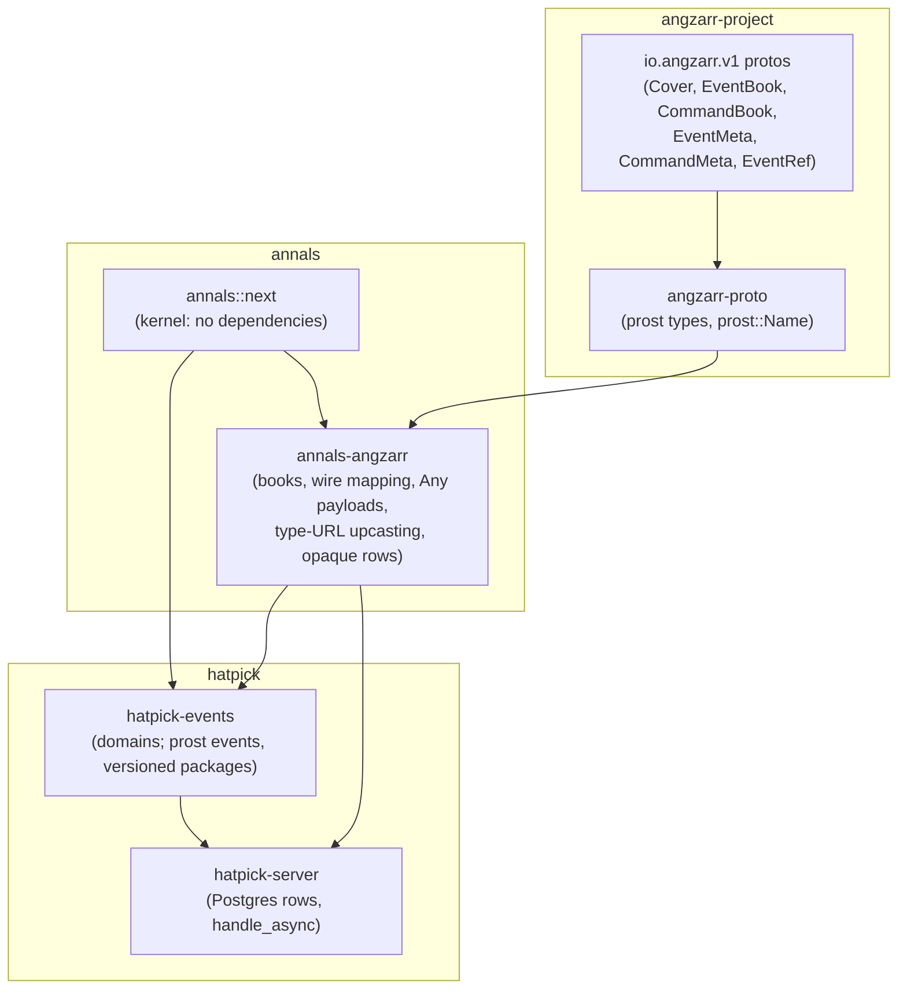

# The audited kernel on angzarr's wire: design proposal

Status: **proposal**. The kernel's signatures are in
`crates/annals/src/next/` and the adapter's in `crates/annals-angzarr/src/`,
with non-trivial bodies left as `todo!("proposal: ...")`. The behaviour is
pinned by ignored tests in `crates/annals/tests/next/` and
`crates/annals-angzarr/tests/angzarr/`. Nothing here is implemented until
this document has been reviewed.

## Why

People choose event sourcing for different reasons; here the main reason is
**auditability**. Every change should answer who made it, when, on which
request, why (what caused it), and under which code and which rules. Replay
should reproduce exactly what was seen at the time. An architectural review
of annals against CQRS/ES practice found gaps in exactly those places:

| ID | Finding | Resolution here |
|---|---|---|
| A1 | `Envelope` holds only seq, cause and event, with no who, when or why. Consumers put metadata in the payload: hatpick's `Stamp`, annals-sim's `Ticked`. | A kernel-owned `Meta` is stamped on every event, field for field angzarr's `EventMeta`. [Metadata](#metadata) |
| A2 | `cause` is only within a stream. `Injected` lacks the source stream's identity. There is no correlation id. | `cause: Option<EventId>` can point at any stream (an `EventRef` on the wire). Correlation is always set and propagated through every reaction. |
| A3 | `Header.rules` is a free string per stream that replay never checks. The fold code is unversioned. | The rules version is recorded per event and resolved by a `Rulebook` at replay. The caller cannot substitute rules. [Rules](#rules) |
| A5 | `Header.schema` is unused, and there is no upcasting. | A payload's type URL is its version. Old types are upcast by type URL at read time, strictly. Golden replay fixtures pin old logs. [Upcasting](#upcasting-by-type-url) |
| A6 | Events emitted before a rejection stay in the `Stream`. | Decide is pure and stages its events. A rejection leaves nothing behind. [Decide](#decide) |
| B1 | The "saga" is really a stateless policy. The target-contiguity invariant is undocumented. `backlog` replays the source once per target. | Three typed reactions share one base. The invariant is documented and checked. Each backlog is one pass for all targets. [Reactions](#reactions) |
| B2 | `Projection::on` gets no stream identity or position. | Every reaction gets a `Committed`: the stream, the seq, the metadata, the event, and the state just after it. |
| B6 | The store port is synchronous, `&mut`, and whole-stream only. `read -> Option` hides I/O failure. `Conflict` is its only error. Its ids are `u64`. Its append checks nothing. | There are sync and async ports and a unit of work. `read_from` is added. Append returns the new length and checks seq continuity. Streams are keyed by (domain, edition, root). `StoreError` separates conflict, caller bug, duplicate, unreadable and infrastructure failure. [Store](#the-store-ports) |
| B8 | The only error channel is `Domain::Rejection`, so kernel faults are folded into business rejections. | `Failure` keeps the domain's rejection apart from kernel faults and from failures further down the chain. Each failure is classified for recovery. [Errors](#errors-and-recovery) |

## Layering



- **angzarr owns the wire contract.** Its protos (`io.angzarr.v1`, in
  angzarr-project) are what an event, a command, a stream and their
  provenance are on the wire. annals and hatpick import them, through
  angzarr-proto, angzarr's own prost crate. annals defines no wire schema of
  its own for events.
- **annals is the in-process runtime**, embedded in hatpick's server, one
  process. A chain's staged events across streams go into one database
  transaction. angzarr's distributed runtime is not used by hatpick.
- **The kernel stays dependency-free.** It knows angzarr's shapes (a stream
  key is a `Cover`'s triple, `Meta` is an `EventMeta`) but not its types.
  **annals-angzarr** is the one crate that knows both, and maps one onto the
  other.
- **Storage is opaque**: the type URL, the encoded page as written, and the
  metadata as typed columns. Typed views are projections; in hatpick they
  are replayed on read, not stored.

## Design constraints

- **annals does no I/O**, keeps no infrastructure and never retries. Its
  contract lets a runtime wrap it: failures say whether to retry
  (`Recovery`), command ids are idempotency keys (`CommandId` with the
  request), and its metadata, keys and books have angzarr's wire form.
- **Pure and deterministic.** There is no clock, no randomness, no I/O and
  no hash-map iteration in the kernel. The application samples everything
  and passes it in. The one value the kernel makes up, a missing
  correlation, it derives from the request.
- **The kernel stays synchronous.** The only async parts are the async store
  port beside the sync one, and the command handler over it. Both use native
  `impl Future` in traits, with zero dependencies. The kernel's MSRV is 1.77;
  annals-angzarr's is 1.85, for prost 0.14.
- **annals and annals-angzarr build for `wasm32-unknown-unknown`.** `just
  wasm` checks it.
- **Must not preclude hash chaining** (deferred). Stored pages are never
  rewritten: upcasting happens at read time. Metadata is deterministic. The
  actor is a pseudonymous id, so erasing a person never edits history.

## The flow

```mermaid
sequenceDiagram
  participant App as Application (API handler)
  participant H as annals handle()
  participant C as Chain (in memory)
  participant U as Unit of work (one DB transaction, via annals-angzarr)
  App->>App: sample clock, actor, request id, random values
  App->>H: handle(registry.store(tx), routes, key, cmd, CommandMeta, rules, projections)
  H->>U: read the origin stream (rows decoded, upcast, unpacked)
  H->>C: decide cmd (pure, staged)
  loop every policy / translation routed for each staged event, depth first
    C->>U: read the target stream (first touch only)
    C->>C: decide command / admit fact against staged state, stage
  end
  alt anything failed anywhere
    H-->>App: Failure (path to the failing step, Recovery)
    Note over U: dropped uncommitted: nothing anywhere
  else the whole chain succeeded
    H->>U: append every staged stream as rows (each expects its loaded length)
    H->>U: commit
    H->>H: run projections on committed events
    H-->>App: Recorded (every event of the chain; registry.event_books for EventBooks)
  end
```

1. **The application samples** the instant, the actor, the request id and
   any random values *before* deciding. The first three go in the
   `CommandMeta`, with a correlation if the request carries one. A random
   value goes in the command, for example `Draw { roll }`.
2. **Decide** is pure, over explicit inputs: state, command, `CommandMeta`
   and rules. It stages events. It never changes the stream.
3. **React.** Policies and translations routed for the source's domain run on
   the staged events, in the same `Chain`. Their targets' events set off
   their own reactions, depth first, until nothing more is owed.
   **Everything stays staged in memory**, across every stream involved.
4. **Append, atomically, or not at all.** If anything in the chain failed (a
   policy's command rejected, a fact refused, a gap, the depth limit, a
   store read), the failure goes back to the caller with the path to the
   failing step. Nothing is appended anywhere, not even the originating
   command's events. On success, every staged stream is appended through the
   unit of work. Each append expects the length the stream had when the
   chain loaded it, so optimistic concurrency covers **every stream
   touched**. Then the unit of work is committed: one transaction.
5. **Project.** Projections run after the commit, on committed events only.
   They never see a failed chain.

`handle` is request/response. It returns `Recorded`: every event the chain
recorded, in every stream. An API handler answers with those events (a draw
command answers with its `Drawn`), or with them as `EventBook`s
(`Registry::event_books`).

**Policies are inside the write-side consistency boundary, by deliberate
choice.** This is the in-process form of the pattern: a reaction's target is
updated in the same transaction as its source, so no draw ever sees a draw
system behind its list. A reaction that must cross a process boundary is not
one of these. A wrapping runtime does that from the committed log
(`Position`, `orders_owed`, `facts_owed`, `Policy::on_rejected`).

## Decide

```rust
pub trait Domain: Sized + 'static {
    type State: Default + Clone + Send + 'static;
    type Command: Send + 'static;
    type Event: Clone + Send + Sync + 'static;
    type Rejection: Diagnostic + Send + 'static;
    type Rules: Send + Sync + 'static;
    const NAME: &'static str;  // the domain of every StreamKey of this domain
    fn decide(cmd: &Self::Command, tx: &mut Tx<'_, Self>) -> Result<(), Self::Rejection>;
    fn apply(state: &mut Self::State, event: &Self::Event, rules: &Self::Rules);
    fn admit_fact(state: &Self::State, fact: &Self::Event) -> Result<(), Report> { Ok(()) }
}
```

- **There is no `Ctx`.** The handler samples dice and the clock and passes
  them in as plain inputs: the instant and actor through `Tx::meta()`,
  random values in the command. Decide copies what the domain's own rules
  need into the payload, such as `Drawn { roll, at }`, where `at` is
  business time read from `meta().recorded_at`. `apply` sees only the
  payload.
- **There is no schema version in the kernel.** An event's payload type is
  its version (see [Upcasting](#upcasting-by-type-url)); the kernel only
  ever sees current events.
- **A rejection leaves nothing behind (A6).** `Stream::decide(&self, ..)`
  takes `&self`, so it cannot touch the stream. A decide may reject at any
  point, even after emitting.
- **Decide sees its own staged events.** `Tx` folds each emitted event into
  a *copy* of the state, cloned at the first emit, so `tx.state()` reflects
  what the decide has emitted so far. Not a pure `decide(state, cmd) ->
  Vec<Event>`, because every multi-step decide would re-fold by hand:
  annals-sim's `advance` and its `Clock::run` loop emit, read the state the
  emit left, and emit again. The cost is `State: Clone` and one clone per
  command that emits anything.
- **Commit re-applies.** `Stream::commit` applies each staged event to the
  live state, so it can give each handler the state just after each event.
- **A fact bypasses decide.** `Stream::admit(fact, meta, rules)` stages an
  event that already happened upstream. The only check is
  `Domain::admit_fact`, an integrity check (retired, never created).

The single-stream steps stay public for in-memory use and tests:
`Stream::new(edition, root)`, `decide`, `commit`, `execute`, `admit`,
`replay` and `dispatch`.

## Stream keys

```rust
pub struct StreamKey { pub domain: String, pub edition: Edition, pub root: Root }
pub struct Edition(Option<String>);       // None = the main timeline
impl Edition {
    pub const MAIN: Edition;
    pub const MAIN_NAME: &'static str = "angzarr";
    pub fn new(name: &str) -> Edition;     // "" and "angzarr" are MAIN
    pub fn name(&self) -> &str;            // "angzarr" for MAIN
}
impl From<Option<&str>> for Edition;      // unset is MAIN
pub struct Root(pub u128);                 // a UUID's 16 bytes, big-endian
pub struct EventId { pub stream: StreamKey, pub seq: Seq }   // Seq = u64
```

- **A stream is the full (domain, edition, root)**, as an angzarr `Cover`
  names one. The same root in another domain or edition is another stream.
- **The main timeline has three spellings** on the wire: an empty name,
  `"angzarr"`, and none at all. `Edition` normalises all three to `MAIN`, and
  its field is private, so no second main timeline can be built and keys
  compare and order correctly.
- **A stream's domain is its type's.** `Stream::<D>::new(edition, root)`
  takes the domain from `D::NAME`. A key of another domain given to
  `handle` is `KernelError::WrongDomain`, and to `Stream::replay`
  `ReplayError::WrongDomain`.
- **A reaction never crosses timelines.** A target's key is
  `(Target::NAME, the source's edition, Reaction::root(target))`
  (`target_key`), so a chain started in edition `v2` touches only `v2`.
- **There is no `Header`.** With the domain in the key, there is nothing
  else a header could say, and nothing for an append to find changed.

## Metadata

```rust
pub struct CommandMeta {           // the application's, per command
    pub recorded_at: Timestamp,    // i64 µs since the Unix epoch, UTC; audit time
    pub actor: Option<Actor>,      // opaque, pseudonymous; None = the system
    pub request: RequestId,        // opaque; a reaction keeps its origin's
    pub command: CommandId,        // with the request, the idempotency key
    pub correlation: Option<Correlation>,   // None: generated from the request
    pub cause: Option<EventId>,    // in any stream
}
pub struct Meta {                  // stamped on every event; apply never sees it
    pub recorded_at: Timestamp, pub actor: Option<Actor>, pub request: RequestId,
    pub command: CommandId,
    pub correlation: Correlation,  // always set
    pub cause: Option<EventId>,
    pub rules: RulesVersion,       // the rulebook's current version when decided
}
pub enum CommandId {
    Origin { index: u32 },
    Reaction { source: EventId, component: String, index: u32 },
}
```

| Field | Supplied by | Within a chain | angzarr |
|---|---|---|---|
| `recorded_at` | the application, per command | kept, so one chain has one instant | `EventMeta.recorded_at` (not on a command: the handler stamps it) |
| `actor` | the application | kept: the reaction acts on the original actor's behalf | `actor` (empty = the system) |
| `request` | the application | kept | `request_id` |
| `command` | the application (`Origin`), or the kernel (`Reaction`) | the `index`-th output of reaction `component` for `source` | `command_index`; a reaction's `component` and `source` on a command's deferred header; see open question 2 for events |
| `correlation` | the application, or generated | kept | see [the adapter](#the-adapter-annals-angzarr) |
| `cause` | the application (usually `None`), or the kernel | the source event, in its own stream | `cause` (`EventRef`) |
| `rules` | the kernel | the target domain's | `rules_version` |

**Choices.**

- **Correlation is an opaque string, always set.** A command that arrives
  without one gets `Correlation::generated(&request)`, the request id's
  text, so the kernel needs no randomness and a retried request gets the
  same correlation. A reaction's outputs keep their source's.
- **Every event names its request**, a reaction's included. Without it, the
  request behind a reaction's event could only be found by walking causes.
- **The event id is `EventId { stream, seq }`, derived and not stored.** It
  is unique as long as stream keys are, never minted, the same on every
  replay, and it is what a cause points at, as angzarr's `EventRef` is.
- **`CommandId` is structured, not a single UUID.** One request issues
  several commands, so a request id alone is not an idempotency key. An
  origin command is `(request, index)`. A reaction's command or fact is
  `(source event, reaction name, index)`, deterministic, so a retried chain
  issues the same ids. Every `Reaction` has a stable `NAME` for this.
- **Business time stays in payloads.** `recorded_at` is audit time.
  Anything the fold needs, such as an expiry or a tick, is copied into the
  payload by decide.
- **Actors are pseudonymous.** Erasing a person deletes the
  pseudonym-to-person mapping outside the log. The log is never rewritten.

## Reactions

Every kind of reaction takes the same input: `Committed<'_, D>`, which holds
the stream key, the envelope (seq, metadata, payload) and the state just
after the event, with `id()`, `seq()`, `meta()` and `event()`. They share one
position contract and one dispatch: each kind becomes a `Handler<D>`, a plain
callback (`FnMut(&Committed<D>)` is one). On top of that sit **three typed
traits**:

| Trait | Vocabulary | Output | Can the target refuse? |
|---|---|---|---|
| `Policy` | Event Storming's *policy*; an *automation* in Event Modeling | event → **commands** to targets | yes: the target decides, and may reject |
| `Translation` | Event Modeling's *translation*; Fowler's *event-carried state transfer* | event → **facts** injected into targets | only for integrity: a gap, a retired target, an unknown target |
| `Projection<D>` | read model | event → fold | produces nothing |

```rust
pub trait Reaction {                       // the base for Policy and Translation
    type Source: Domain; type Target: Domain; type TargetId: Ord + Clone;
    const NAME: &'static str;              // part of every CommandId::Reaction
    fn targets(source: &<Self::Source as Domain>::State) -> Vec<Self::TargetId>;
    fn root(target: &Self::TargetId) -> Root;   // keyed in the source's edition
    fn position(target: &<Self::Target as Domain>::State) -> Position;
}
pub trait Policy: Reaction {
    fn command(target: &Self::TargetId, c: &Committed<'_, Self::Source>) -> <Self::Target as Domain>::Command;
    fn on_rejected(order: &Order<Self>, rejection: &Report) -> Vec<<Self::Source as Domain>::Command> { vec![] }
}
pub trait Translation: Reaction {
    fn fact(target: &Self::TargetId, c: &Committed<'_, Self::Source>) -> <Self::Target as Domain>::Event;
}
pub trait Projection<D: Domain> { fn project(&mut self, c: &Committed<'_, D>); }
```

- **hatpick's list → draw-system propagation is a `Translation`.** A draw
  system cannot refuse a list edit, so the edit is a fact.
- **`Policy::on_rejected`** is a compensation hook with an empty default. It
  is never called in process, because a chain is all or nothing. It exists
  for a wrapping runtime that delivers across a process boundary.
- **The contiguity invariant** is documented on `Reaction` and checked by
  the backlogs as `KernelError::TargetReturned { left, returned }`. Once a
  target appears in `targets()`, it stays for every source event up to and
  including the one that retires it, and never comes back.
- **Backlogs** (`orders_owed::<P>`, `facts_owed::<T>`) are **one fold of the
  source for all targets**, starting from each target's position, grouped by
  target, each group in source order. They are for a reaction added to
  existing data, and for a wrapping runtime's catch-up.
- **In-memory delivery steps** `deliver::<P>` and `inject::<T>` place first,
  then decide or admit. The chain uses the same steps.

### The position contract

```rust
pub struct Position(Option<Seq>);   // the last seq handled; START = none
impl Position {
    pub const START: Position;
    pub const fn at(last: Seq) -> Position;
    pub fn next(self) -> Seq;                               // where a catch-up reads from
    pub fn place(self, seq: Seq) -> Result<Admit, Gap>;     // Next | Redelivery | Gap
    pub fn advance(&mut self, seq: Seq) -> Result<Admit, Gap>;
}
```

There is one contract for every reader: a projection, an application
handler, or a reaction's target, whose position is a fold of its own stream.
The source seq travels in the delivered payload, because `apply` never sees
metadata. Seqs are `u64` throughout, as angzarr's sequences are.

- A **redelivery** does nothing.
- A **gap** is refused, and does not move the position.
- For a target, `START` means **not created**. The delivery goes to decide
  or `admit_fact`, which creates the target or refuses.
- `Tracked<H>` wraps any handler with a position per stream key. It drops
  redeliveries and records the first gap, so a handler fed from anywhere
  sees each event once and in order, and catches up with
  `read_from(position.next())`.

**Read models replay the stream on every read, for now** (`Stream::dispatch`
from 0). No projection tables are persisted.

## The command chain

```rust
pub fn handle<D, U, Ps>(unit: U, routes: &Routes<'_, U>, key: &StreamKey, cmd: &D::Command,
    meta: &CommandMeta, rules: &Rulebook<D::Rules>, projections: &mut Ps)
    -> Result<Recorded, Failure<D::Rejection>>
where D: Domain, U: UnitOfWork + EventStore<D::Event>, Ps: Project;
pub async fn handle_async<D, U, Ps>(/* same, with AsyncRoutes */) -> /* same */
where U: AsyncUnitOfWork + AsyncEventStore<D::Event>;

let routes = Routes::new()
    .translation::<ListToDrawSystems>(&list_rules, &draw_rules)
    .policy::<SomePolicy>(&source_rules, &target_rules);
```

- **`Routes` is a table keyed by source domain**, not a static nesting of
  route types. A chain may come back to a stream it already touched
  (A → B → A). Routes name the unit of work's type, so they are built per
  unit of work: a few boxed closures. (Open question 6.)
- **`Chain`** holds every touched stream, by key, as a boxed `Stream<D>`,
  staged, with the length it was loaded at. **A later step sees the staged
  state of any stream an earlier step touched, including the origin's.**
- **Depth limit.** `Chain::limit`, default `DEFAULT_DEPTH_LIMIT = 8`,
  reported as `KernelError::ChainTooDeep { limit }`. Since a chain can
  legitimately revisit a stream, a depth limit is the cycle check.
- **The failure path.** `Failure::Downstream { path: Vec<Step>, error:
  StepError }`. Each `Step` is `{ stream: StreamKey, kind: Command | Fact,
  cause: EventId }`. The step's command or fact is not carried: reactions
  are pure, so the cause recomputes it. A downstream rejection is a `Report`.
- **Optimistic concurrency on every stream touched.** A conflict on any
  append is `Failure::Kernel(KernelError::Store(StoreError::Conflict {
  stream, .. }))`, and the unit of work is dropped.

## The store ports

```rust
pub trait EventStore<E> {
    fn append(&mut self, key: &StreamKey, expected: Seq, events: &[Envelope<E>]) -> Result<Seq, StoreError>;
    fn read_from(&mut self, key: &StreamKey, from: Seq) -> Result<Option<Slice<E>>, StoreError>;
    fn read(&mut self, key: &StreamKey) -> Result<Option<Slice<E>>, StoreError> { self.read_from(key, 0) }
}
pub trait UnitOfWork { fn commit(self) -> Result<(), StoreError>; }   // dropped = rolled back
pub trait AsyncEventStore<E> { /* the same, each returning impl Future<Output = ..> + Send */ }
pub trait AsyncUnitOfWork { fn commit(self) -> impl Future<Output = Result<(), StoreError>> + Send; }
pub struct Slice<E> { pub key: StreamKey, pub len: Seq, pub events: Vec<Envelope<E>> }
```

- **The event store is the application's SQL database** (Postgres for
  hatpick) behind this port. There is no other event-store infrastructure.
- **A port value is a unit of work**, a database transaction, so its methods
  take `&mut self`. `E` is what the store hands the kernel: current events.
  An opaque store (rows of type URL, page and metadata) implements
  `EventStore<Stored>`, and annals-angzarr's `Opaque` makes it an
  `EventStore<E>` for every registered domain at once.
- **`append`** refuses a stale `expected` (`Conflict`) and seqs that do not
  run on from `expected` (`Discontinuous`, checked for every event). It
  returns the new length.
- **`read_from`** returns `Ok(None)` for no such stream, `Err(Unavailable)`
  for an I/O failure, and `Err(Unreadable { stream, seq, reason })` for an
  event it holds but cannot give back (an unknown type URL). These are never
  confused, and an unreadable event is never skipped.
- **Idempotency is specified, not built.** Every event's `meta.request` and
  `meta.command` name the command that recorded it. An adapter that indexes
  them may refuse a repeated command as `StoreError::Duplicate { stream,
  request, command, from, to }`. (Open question 9.)
- **Async futures are `Send`.** tokio's multi-threaded runtime needs that.
  `Ready<S>` serves a sync store through the async port.
  `InMemoryStore::begin()` gives an in-memory unit of work.

## Errors and recovery

`Failure<R>` is what a command returns.

| Variant | Meaning |
|---|---|
| `Rejected(R)` | The origin domain's own rejection, typed for the caller to render. |
| `Downstream { path, error }` | A step further down the chain failed. |
| `Kernel(KernelError)` | A fault at the origin or at commit. |

**No kernel fault is ever folded into a domain's rejection (B8).**
hatpick's `DrawSystemRejection::Gap` goes away.

Every error has `.recovery() -> Recovery`:

| `Recovery` | Errors |
|---|---|
| `Retry` | `StoreError::Conflict` (re-read and re-decide), `Unavailable` (only under an idempotency key, since the append may have landed), `KernelError::Gap` (catch up, then retry) |
| `Done` | `StoreError::Duplicate`: the command is already recorded |
| `Business` | `Rejected`, and `Downstream` with `StepError::Rejected` |
| `Integrity` | `KernelError::FactRefused` |
| `Bug` | `Stale`, `Discontinuous`, `Unreadable`, `WrongDomain`, `ChainTooDeep`, `UnknownRules`, `TargetReturned`, `Replay` |

The new errors become `Diagnostic`s when they are implemented, with
messages in each crate's `locales/en-US/` catalog and samples in
`diagnostic_samples()`. The proposed codes are:

- annals: `annals-store-conflict` (reused), `annals-store-discontinuous`,
  `annals-store-duplicate`, `annals-store-unavailable`,
  `annals-store-unreadable`; `annals-kernel-stale`, `annals-kernel-gap`
  (from `annals-policy-gap`), `annals-kernel-target-returned`,
  `annals-kernel-fact-refused`, `annals-kernel-chain-too-deep`,
  `annals-kernel-unknown-rules`, `annals-kernel-wrong-domain`;
  `annals-replay-out-of-sequence`, `annals-replay-cause-not-earlier` (both
  reused), `annals-replay-unknown-rules`, `annals-replay-wrong-domain`.
- annals-angzarr: one code per `BookError`, `PayloadError`, `UpcastError`,
  `ChainProblem` and `ReadProblem` variant, named
  `annals-angzarr-<kind>-<variant>` (`annals-angzarr-payload-unknown-type`,
  whose args include `type_url`).

The proposal does not implement `Diagnostic` yet: the catalog parity check
scans for code literals and would demand samples of `todo!()`s.
annals-angzarr is listed in the check's `NO_CODES` until then.

## Rules

`Rulebook<R>` holds every rules version a log may name, plus the current
one: `Rulebook::new(v, r).with(old, r_old)`. Decide uses the current
version and stamps it. `Stream::replay(key, events, &rulebook)` folds each
event with the rules **its own metadata names**. A version the rulebook
lacks is `ReplayError::UnknownRules`; the caller cannot substitute rules. A
change in what `apply` does with the same payload must bump the rules
version, and the old rules must stay in the rulebook.

## The adapter: annals-angzarr

annals-angzarr maps annals onto angzarr's types. It depends on
`angzarr-proto` (a git dependency pinned to rev 9cfed59, whose build needs
`protoc`), `prost` and `prost-types` 0.14 (the versions angzarr-proto
generates for, so the types unify), and annals. It re-exports
angzarr-proto's `io.angzarr.v1` as `annals_angzarr::pb`, so an application
names one pin.

### Mapping

| annals | angzarr | Where |
|---|---|---|
| `StreamKey { domain, edition, root }` | `Cover { domain, edition, root }` | `wire::cover`, `wire::key` |
| `Edition::MAIN` | `Cover.edition` unset; `EventRef.edition = "angzarr"`; read from unset, `""` or `"angzarr"` | `wire::edition`, `wire::key` |
| a named edition | `Edition { name, divergences: [] }`; divergences refused | `wire::key` |
| `Root` (u128) | `UUID { value: 16 bytes, big-endian }`; any other length refused | `wire::uuid`, `wire::root` |
| `EventId { stream, seq }` | `EventRef { domain, edition, root, sequence }` | `wire::event_ref`, `wire::event_id` |
| `Seq` (u64) | `PageHeader.sequence`, `EventRef.sequence`, `source_seq` (uint64) | |
| `Timestamp` (i64 µs) | `google.protobuf.Timestamp`, exact; a sub-µs value refused | `wire::timestamp`, `wire::micros` |
| `Meta` | `EventMeta` on every page: `recorded_at`, `actor`, `request_id`, `command_index`, `correlation_id`, `cause`, `rules_version` | `wire::event_meta` |
| `CommandId::Reaction.component` | a command's `AngzarrDeferredSequence.source_component`; no `EventMeta` field at 9cfed59 (kept in storage) | open question 2 |
| `Correlation` | `Cover.correlation_id` and the page's `correlation_id`, both today | `wire::correlation_to_wire`, `wire::correlation_from_wire` |
| a command's identity and cause | `CommandMeta.command_index` and `cause`, and for a reaction the page header's `AngzarrDeferredSequence { source, source_seq, source_component, command_index }` | `wire::command_cause_to_wire`, `wire::command_cause_from_wire` |
| `Command<C> { key, meta, command }` | a one-page `CommandBook` with `CommandMeta`; `recorded_at` stamped on receipt | `command_book`, `command_from_book::<D>` |
| an event (`Envelope<E>`) | `EventPage { header.sequence, created_at = recorded_at, event: Any, meta }` | `event_page` |
| what a chain recorded (`Recorded`) | one `EventBook` per stream, first-touched order, `next_sequence` = new length, no snapshot | `event_book::<D>`, `Registry::event_books` |
| an event or command payload | `Any`, packed by `prost::Name` (`/pkg.vN.Type`) | `pack`, `Payload`, `Decoder` |
| a payload's version | its type URL | |
| upcasting | `UpcasterDispatch` semantics, mirrored | `Upcaster` |
| the stored form | `Stored { type_url, page }`, with `Meta` as columns | `Stored`, `Opaque` |

**Correlation and a command's cause are each behind one pair of
functions.** angzarr carries correlation twice (`Cover.correlation_id` and
per page) and a reaction command's cause twice (`CommandMeta.cause` /
`command_index` and the header's `AngzarrDeferredSequence`); either may
change in angzarr-proto (open question 3). Every reader and writer goes
through `wire::correlation_to_wire` / `correlation_from_wire` and
`wire::command_cause_to_wire` / `command_cause_from_wire`, so switching the
source is a change to those four functions. No test asserts that a value
sits in both places.

**Refused, never trimmed.** A `CommandBook` of several pages
(`NotOnePage`; angzarr runs only the first and drops the rest), one with no
request id (`NoRequest`: the request is half the idempotency key), one for
another domain (`WrongDomain`), a claim-check payload (`ExternalPayload`),
an external deferred sequence (`ExternalDeferred`), and explicit edition
divergences (`Divergences`) are all errors.

### Key signatures

```rust
pub trait Payload: Sized {
    fn to_any(&self) -> Any;
    fn from_any(any: &Any) -> Result<Self, PayloadError>;   // UnknownType for any other URL
    fn type_urls() -> Vec<String>;                          // the current types
}
pub fn pack<M: Message + Name>(message: &M) -> Any;
pub struct Decoder<E>;   // Decoder::new().on::<v3::Opened>(|_| Event::Opened)...decode(&any)

pub struct Command<C> { pub key: StreamKey, pub meta: CommandMeta, pub command: C }
pub fn command_book<C: Payload>(command: &Command<C>) -> CommandBook;
pub fn command_from_book<D: Domain>(book: &CommandBook, recorded_at: Timestamp)
    -> Result<Command<D::Command>, BookError> where D::Command: Payload;
pub fn event_page<E: Payload>(envelope: &Envelope<E>) -> EventPage;
pub fn event_book<D: Domain>(recorded: &Recorded, key: &StreamKey) -> Option<EventBook>
    where D::Event: Payload;

pub struct Upcaster;     // new(name, domain), on_event(source, thunk), rule::<From, To>(fn),
                         // upcast_event, upcast_page, dispatch, source_types, check
pub struct Registry;     // new().domain::<D>(upcaster), check(), event_books(&recorded), store(s)

pub struct Stored { pub type_url: String, pub page: Vec<u8> }
pub struct Opaque<'r, S>;    // EventStore<E> + UnitOfWork (and async) for S: EventStore<Stored>
pub fn store_event<E: Payload>(envelope: &Envelope<E>) -> Envelope<Stored>;
pub fn read_event<E: Payload>(registry: &Registry, key: &StreamKey, stored: Envelope<Stored>)
    -> Result<Envelope<E>, ReadError>;
pub fn replay_stored<D: Domain>(registry: &Registry, key: StreamKey,
    stored: Vec<Envelope<Stored>>, rules: &Rulebook<D::Rules>) -> Result<Stream<D>, KernelError>;
pub struct ReplayFixture<'a, S> { pub name, pub key, pub log: Vec<Envelope<Stored>>, pub states }
pub fn assert_replay_fixtures<D: Domain>(registry: &Registry, rules: &Rulebook<D::Rules>,
    fixtures: &[ReplayFixture<'_, D::State>]);
```

### The storage shape

The application's database implements the kernel's own port over opaque
rows: `EventStore<Stored>` (and `AsyncEventStore<Stored>`, `UnitOfWork`).
Each `Envelope<Stored>` is one row; it never decodes a payload.

| Column | From |
|---|---|
| `domain`, `edition`, `root` | the stream key; the edition by its canonical name |
| `sequence` | the seq, 64-bit |
| `type_url` | the payload's type URL as written, before any upcast: indexable, to find rows still at an old type |
| `page` | the `EventPage` bytes as written: header, `created_at`, payload, `EventMeta` |
| `recorded_at`, `actor`, `request_id`, `command_index`, `component`, `correlation`, `cause_domain`, `cause_edition`, `cause_root`, `cause_sequence`, `rules_version` | `Meta`, in full |

The page is what an angzarr reader is served, with provenance on it; the
columns are the metadata in full (a reaction's `component` included) and
are what the kernel reads back as `Meta`. Rows are strictly append-only;
erasing a person deletes the pseudonym mapping, never a row.

`Registry::store(unit)` gives `Opaque`, which implements `EventStore<E>`
for every `E: Payload` with one blanket impl, so a chain across several
domains runs over one unit of work. It encodes on append (`store_event`)
and, on read, decodes the page, upcasts its payload with the stream
domain's upcaster and unpacks it (`read_event`).

### Upcasting by type URL

A new version of an event is a new message in a new package
(`pkg.v1.Foo`, then `pkg.v2.Foo`); its type URL is its version. Stored
pages are never migrated: upcasting runs on every read.

**`Upcaster` mirrors angzarr-router's `UpcasterDispatch`** over
angzarr-proto's types. Rules run in registration order; every rule whose
source matches the event's current type applies, and its output feeds the
next, so V1 → V2 → V3 composes; other types and other domains' requests
pass through. It keeps the router's names (`on_event`, `upcast_event`,
`upcast_page`, `dispatch`, `source_types`).

- **Why a mirror, not the router crate.** angzarr-router generates its own
  `pb` types; until it is remapped onto angzarr-proto, its `EventPage` is not
  angzarr-proto's, so its dispatch cannot take ours. Depending on it would
  also pull its dispatch engine, `tracing` and its own protoc build. With
  the names kept, moving onto the router's own is a change of import once it
  builds on angzarr-proto.
- **Typed rules.** `rule::<From, To>(fn(From) -> Result<To, Report>)`
  unpacks, converts and packs, and records the target type, so
  `Registry::check` can refuse a chain that cannot finish: two rules from
  one type (`Duplicate`), a rule registered before the rule producing its
  source (`OutOfOrder`), a chain ending at a type the domain does not decode
  (`DeadEnd`), an upcaster for another domain (`WrongDomain`). Untyped
  `on_event` rules are allowed and not followed.
- **Strict replay.** The router passes an unknown type through and leaves
  the consequence to whoever decodes. annals decodes strictly: after
  upcasting, a type URL no decoder knows is `ReadError` with
  `PayloadError::UnknownType { type_url }`, which reaches the kernel as
  `StoreError::Unreadable`, recovery `Bug`. An event is never skipped.
- **Golden replay fixtures.** `ReplayFixture { name, key, log, states }`
  pairs old rows, kept exactly as stored, with the states expected after
  given seqs. `assert_replay_fixtures::<D>` reads, upcasts, replays and
  compares, listing every failure. With `Registry::check`, CI catches a
  missing upcaster before a replay in production does.

## Migration

**The annals root API.** At implementation, `annals::next` replaces the root
`Domain`, `Tx`, `Stream`, `Envelope`, `Header`, `EventStore`,
`InMemoryStore`, `Projection` and `policy`, and the `next` module goes away.
`policy::{Injected, admit, backlog, Gap}` are replaced: a target's payload
carries its source seq, `Position::place` does the admitting, the backlogs
are `orders_owed` and `facts_owed`, and `Gap` moves to the kernel.

**hatpick-events** (pinned to an annals rev, so nothing breaks until it
moves):

- Events become prost messages with `prost::Name` under versioned packages
  (`hatpick.list.v1`, `hatpick.draw_system.v1`), one message per event
  kind; each domain's `Event` enum implements `Payload` with a `Decoder`.
  Each domain registers an `Upcaster` (empty to start) in one `Registry`.
- `Ctx` and `Stamp` go. `Stamp.actor` becomes `Meta.actor`, a pseudonymous
  id. `Stamp.at` becomes `Meta.recorded_at`, and decide copies it into a
  payload only where the fold needs business time.
- Each domain's `Rules = ()` becomes `Rulebook::new("v1", ())`.
- `saga.rs`'s `ListToDrawSystems` becomes a **`Translation`**, with
  `Reaction::root` the draw system's UUID and `position` its checkpoint;
  `DrawSystemCommand::Instantiate` and `Inject` become the facts
  `Instantiated { source_seq, list }` and `FromList { source_seq, event }`;
  `admit_fact` refuses a retired or unknown draw system;
  `DrawSystemRejection::Gap` disappears.
- **The draw lifecycle moves into the draw-system stream.** Draw is a
  command, `Draw { random }`, sampled by the API handler; its event is
  `Drawn`. Accept, skip and expiry are the events `Accepted`, `Skipped` and
  `Expired`. Draw history and stats replay from the stream on read.

**hatpick-server.**

- One table of opaque rows (the [storage shape](#the-storage-shape)), and a
  sqlx adapter implementing `AsyncEventStore<Stored>` and `AsyncUnitOfWork`
  over one transaction; `registry.store(tx)` and `handle_async`.
- Each HTTP request samples a request id (a UUID's text), the instant and
  the pseudonymous actor, and passes a correlation if the client sent one.

**annals-sim.** `schedule::advance(tx: &mut Tx<D>, ..)` and `Clock::run`
move to `next::Tx` unchanged in shape. The test domain drops `type Ctx = ()`.
`Ticked<K>` is business time in the payload, and stays.

**annals-log.** `Writer` and `Reader` keep reading `annals.log.v1` for the
root API. annals has no wire schema for `next`: its wire form is angzarr's.

## Open questions, each with a recommendation

1. **Event id: derived `(stream, seq)`, or a stored random id?** I
   recommend derived, as angzarr's `EventRef` is.
2. **`EventMeta` has no field for a reaction's component.** At 9cfed59 a
   reaction's event carries its cause, request and command index, but not
   the reaction's name, so its `CommandId::Reaction` cannot be rebuilt from
   the page alone (storage keeps it, in the `component` column). I recommend
   an additive proto edit: `string component = 8` on `EventMeta` and
   `string component = 6` on `CommandMeta`.
3. **Where correlation and a command's cause live.** angzarr carries
   correlation on `Cover` and on every page, and a reaction command's cause
   in `CommandMeta` and in the header's `AngzarrDeferredSequence`; this is
   under review in angzarr. I recommend per-page as the one home for both:
   `EventMeta`/`CommandMeta.correlation_id` (it survives re-booking, as
   `EventMeta` documents), and `CommandMeta.cause` + `command_index` (+
   `component`, question 2) for a command's provenance, leaving the deferred
   header to mean only "no expected version". Either way the adapter changes
   in four functions.
4. **The main timeline's spelling when writing.** I recommend `Cover.edition`
   unset (as angzarr's `Edition` documents), and the canonical `"angzarr"` in
   `EventRef.edition` and the storage column (as `EventRef` documents),
   reading all three spellings everywhere.
5. **A command book without a request id.** I recommend refusing it
   (`NoRequest`): the request is half the idempotency key. The alternative,
   generating one, would make a retried book a different command.
6. **Routes are per unit of work**, because their type names the unit's
   type. The adapter tests build them per command. I recommend accepting
   this; revisit with a store-family trait if hatpick's handlers find it
   noisy.
7. **The workspace build now needs `protoc` and github.com** (angzarr-proto
   is a git dependency with a protoc build). Every other crate still builds
   as a git dependency with plain `cargo`. I recommend keeping annals-angzarr
   a workspace member and installing `protoc` in CI, rather than excluding it
   from `default-members`.
8. **The upcaster: a mirror or the router's.** I recommend the mirror (see
   [Upcasting](#upcasting-by-type-url)), and switching when angzarr remaps the
   router onto angzarr-proto.
9. **Idempotency.** Should the port gain a first-class duplicate check, such
   as `UnitOfWork::record_command(&RequestId, &CommandId)`, one row per
   origin command? A per-stream unique index can be defeated by a chain that
   touches different streams on retry. I recommend specifying it in the
   port, optional, and letting hatpick keep a `commands` table.
10. **`created_at` on an annals page.** I recommend `recorded_at`: annals
    keeps business time in payloads, and angzarr readers expect the field.
11. **Explicit edition divergences** are refused. I recommend keeping that
    until annals models branching.
12. **Old `annals.log.v1` logs: convert them, or leave them?** I recommend
    leaving them: hatpick is pre-launch and stores none.
13. **Should the in-process handler ever call `Policy::on_rejected`?** I
    recommend never: a chain is all or nothing.
14. **The default depth limit of 8.** I recommend 8. hatpick's deepest chain
    is two levels.
15. **`Tx`'s staged copy, or a pure `(state, cmd, meta, rules) ->
    Vec<Event>`?** I recommend `Tx`, for the reasons under
    [Decide](#decide).

## Not now

| Deferred | Why | What revives it |
|---|---|---|
| Hash chaining | Not asked for yet. The design keeps it possible: immutable stored pages, upcast on read, deterministic meta, pseudonymous actors. | A tamper-evidence requirement. |
| Snapshots | Folding is cheap at these sizes. | Replay-on-read latency that matters. |
| Persisted projections | Replay on read. | Read latency. `Tracked` and the handler abstraction are ready for it. |
| A `!Send` async store port | No browser store exists. | A wasm adapter over IndexedDB. |
| Dedup machinery | Specified (`StoreError::Duplicate`), not built. | Open question 9 decided. |
| Reading `EventBook`s from angzarr into annals | annals writes books; nothing yet feeds it angzarr's. | An angzarr runtime delivering to annals. |
| `Diagnostic` impls and catalog entries for the new errors | They would make the catalog check sample `todo!()`s. | The implementation, in the same change. |

## The proposal tests

All ignored (`#[ignore = "proposal: ..."]`), each failing on a `todo!` when
run with `--ignored`, except three kernel tests that already pass (a UUID is
a root, rulebook lookup, an unavailable store is not a missing stream).

**`crates/annals/tests/next/`** (41 tests, 38 ignored)

- **kernel.rs**: a stream key is (domain, edition, root) with the main
  timeline normalised; a rejection leaves nothing behind (A6); decide stages
  and commit applies; commit refuses a stale decision; metadata stamped on
  every event (A1); a command without a correlation gets one generated from
  its request; a cause names its stream, in any domain and edition (A2);
  replay resolves rules by each event's version (A3); replay refuses a log
  of another domain; replay checks in-stream causes only.
- **handlers.rs**: handlers receive identity, position, metadata and state
  after (B2); dispatch from a seq in one pass; a position places next,
  redelivery and gap; a tracked handler drops redeliveries, records gaps and
  catches up; positions place sequences above `u32::MAX`.
- **reactions.rs**: one dispatch serves a projection, a policy and a
  translation; reactions keep correlation and request, point their cause at
  the source event and carry `CommandId::Reaction`; a fact is refused only
  for integrity, position first; a policy's command may be rejected; a
  backlog serves every target from its own position in one pass (B1); a
  backlog refuses a target that comes back (B1); a reaction never crosses
  timelines.
- **chain.rs**: a successful chain commits every stream atomically, with
  causation and correlation; **a rejection three levels deep leaves every
  stream untouched and returns the path**; **projections never see events
  from a failed chain**; a conflict on any stream fails the chain, as
  `Retry`; a chain that comes back sees its own staged state; a chain deeper
  than its limit is refused; failures are classified for a wrapping
  runtime; the command handler returns what it recorded; a chain in an
  edition touches only that edition; a command for a key of another domain
  is refused.
- **store.rs**: append returns the new length and refuses a stale
  `expected`; append refuses discontinuous seqs; the same root in another
  domain or edition is another stream; `read_from` returns the tail and a
  missing stream is `None`; a unit of work lands at commit or not at all;
  the async port has the same contract.

**`crates/annals-angzarr/tests/angzarr/`** (15 tests, all ignored)

- **books.rs**: a command round-trips through a one-page `CommandBook`
  with its meta (origin and reaction); a book annals cannot take is refused;
  a command without a correlation gets one generated; a chain becomes
  `EventBook`s with `EventMeta` on every page and causes as `EventRef`s; a
  cover is a stream key with the main timeline normalised; sequences above
  `u32::MAX` survive every mapping.
- **payload.rs**: payloads are `Any` packed by their `prost::Name`.
- **upcast.rs**: upcasting by type URL runs v1 → v2 → v3 with the router's
  semantics; an upcaster is checked whole.
- **store.rs**: the store keeps opaque rows as written; old rows are upcast
  on read and never rewritten; an unknown type URL is refused, naming it;
  golden replay fixtures still replay; a drifted fixture fails, naming
  itself; the async port reads and writes the same rows.
