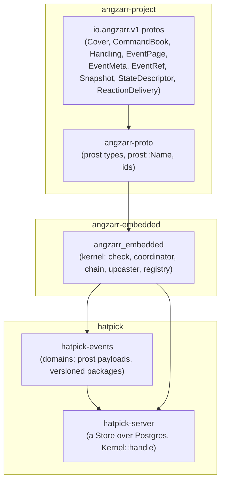

# The audited kernel on angzarr's proto types: design

Status: **implemented** in `crates/angzarr-embedded/src/`, pinned by the tests
beside it (`*.test.rs`). It is angzarr-embedded's one kernel.

The wire contract is angzarr's protos on angzarr-project's spec line
(`spec/20261102-draft`, vendored at **c4b87ed**; the core crates pinned at
**36e59279**): a `CommandBook` is a cover and ONE `CommandPage`, whose body
is a `Command` (its payload and its optional `Handling`) or a `Fact` (its
payload and its `FactOrigin`); `EventMeta.causation` is the event's direct
cause, a command (`CommandCause`) or a fact (`FactCause`, which carries the
fact's origin), so no event is caused by another event; one `command_id`
per input, deduplication on the events, no actor; a state is described by
its message's full name (`StateDescriptor.type_name`); a policy's output
reaches its destination as a `ReactionDelivery`; and the record in angzarr's
`docs/design/audit-meta/` (`decision-log.md`, `idempotency.md`). Where the
kernel and the coordinator contract part is recorded as tags, not here: see
[Where angzarr-embedded and angzarr part](#where-angzarr-embedded-and-angzarr-part).

**Causation is the direct cause** (angzarr decisions 13.1 and 13.3). An
event's `EventMeta.causation` names what produced it: its command
(`CommandCause.command_id`, a policy's included) or its fact
(`FactCause`: the fact's derived command id and its origin). A policy's
output still names its trigger in `ReactionDelivery.causation` (transport
and trace metadata, and the input its derived id hashes), but that is never
copied onto its events: the trigger-to-command edge belongs in tracing and
logs. There is no re-run switch: a policy command's id never names a rules
version, so a re-run deduplicates, and repairs are new commands (decision
13.4; see [Re-runs](#re-runs)).

## Why

People choose event sourcing for different reasons; here the main reason is
**auditability**. Every change should answer when it was made, in which
workflow, why (which command, and what caused it), and under which rules.
Replay should reproduce exactly what was seen at the time. Who made it is a
security question, answered by a separate security log, not by the events.
An architectural review of the root kernel found gaps in exactly those
places:

| ID | Finding | Resolution here |
|---|---|---|
| A1 | `Envelope` holds only seq, cause and event: no when, no why. Consumers put metadata in the payload (hatpick's `Stamp`). | Every event carries angzarr's `EventMeta`, stamped by the kernel. Business code emits payloads only. [Metadata](#metadata) |
| A2 | `cause` is only within a stream; there is no correlation id. | Every event names its direct cause, its command or fact; a reaction names its trigger as its own causation; correlation is always set and kept through every policy step. [Identification](#step-2-identification), [Metadata](#metadata) |
| A3 | `Header.rules` is a free string replay never checks. | The rules version is the build's full version: registered, checked against every answer, stamped per event, and read only to choose which snapshots to offer. [Rules versions](#rules-versions) |
| A5 | `Header.schema` is unused; there is no upcasting. | A payload's type URL is its version. Old types are upcast by type URL, strictly, events at read and (discouraged) commands before decode. [Dispatch](#step-5-dispatch-through-angzarr-router) |
| A6 | Events emitted before a rejection stay in the `Stream`. | Decide is pure and stages its events; a rejection leaves nothing. |
| B1 | The old kernel's policy was a stateless saga with an undocumented target-contiguity invariant, its backlog replaying the source once per target. | One `Policy` trait and one registration list; every step committed on its own, with the policy's position on its source, and resumed by position. [Policies](#policies-and-the-chain) |
| B2 | `Projection::on` gets no stream identity or position. | A projector is handed one stream's book at a time: the cover, each page with its sequence and metadata, the stream's length. [Projectors](#projectors) |
| B6 | The store port is synchronous, whole-stream, `u64`-keyed; `read -> Option` hides I/O failure. | angzarr-ports' async ports over opaque pages keyed by stream, one atomic `write` per step with its positions, `read`, `find_command`, continuity checks; `StoreError` separates conflict, caller bug, unreadable and unavailable. [The store port](#the-store-port) |
| B8 | Kernel faults are folded into business rejections. | `Failure` keeps the rejection apart from malformed input, kernel faults and failures down the chain, each classified for recovery. [Errors](#errors-and-recovery) |

## Layering



- **angzarr owns the wire contract.** angzarr-embedded defines no wire schema of its
  own for the kernel's events: its types are angzarr-proto's.
- **angzarr-embedded operates on the proto types directly.** The kernel depends on
  angzarr-proto and handles `v1::Cover`, `CommandBook`, `EventPage`,
  `EventMeta`, `EventRef`, `Snapshot`, `Uuid`, `StateDescriptor`,
  `ReactionDelivery` and `AngzarrDeadLetter` as generated. There is no
  parallel stream key, event id, book, metadata, provenance, origin or UUID
  type, and so no mapping layer. Dependency-freeness was given up for this,
  deliberately: a mapping layer is a second home for every value, and every
  second home is a place for the two to disagree.
- **The kernel is one crate.** Beside the pipeline it holds the `Payload`
  trait, `pack`, `type_name` and `Decoder`; the `Upcaster` (the in-process
  `UpcastPort`), for events and commands; the `Catalog`, the mirror of the
  `ComponentDescriptor`s registered, beside the `Registry`'s handlers; and
  the golden replay fixtures. The store port is opaque. The id helpers are
  angzarr-proto's own (`angzarr_proto::ids`, re-exported as
  `angzarr_embedded::ids`).
- **angzarr-embedded is the in-process runtime**, embedded in hatpick's server. Each
  step of a chain is one atomic write: one stream's events with the step's
  policy positions.
  hatpick calls angzarr-embedded directly, in process: there is no HTTP or gRPC layer
  into angzarr-embedded, so no caller outside the process can deliver a reaction.
- **angzarr-embedded is not angzarr.** They share the protos, some code and their
  intents. Where the execution models differ, angzarr-embedded's choice is deliberate,
  and tagged on the contract scenario that shows it
  ([Where angzarr-embedded and angzarr part](#where-angzarr-embedded-and-angzarr-part)).
- **Storage is opaque**: the encoded page as written and the metadata as
  typed columns. Typed views are projections; in hatpick they are replayed
  on read.

## Design constraints

- **angzarr-embedded does no I/O** and keeps no infrastructure. Its failures
  say whether to retry (`Recovery`), and a retry is always safe (it starts
  at the deduplication lookup). The kernel retries a step's retryable
  failure itself, capped, then dead-letters it
  ([retrying](#retrying-capped-then-dead-lettered)); its timer and the
  jitter's randomness are the application's (`Wait`), injected.
- **Pure and deterministic.** No clock, no randomness, no I/O and no
  hash-map iteration in the kernel (maps keyed by `Cover` are lookup only,
  since prost types have no ordering). The application samples the instant
  and mints the UUIDv7 a client's command without an id is given
  (`Sampled { now, command_id }`). UUIDv5 derivations are angzarr-proto's.
- **The kernel stays synchronous.** The only async parts are the async store
  port and the handler over it, with native `impl Future` in traits.
- **MSRV 1.89** (uuid 1.28, through angzarr-proto). **angzarr-embedded builds for
  `wasm32-unknown-unknown`**, angzarr-proto included; `just wasm` checks it.
- **Must not preclude hash chaining** (deferred). Stored pages are never
  rewritten; upcasting happens on read; metadata is deterministic; no
  personal data is in an event.

## The pipeline

One input, end to end, in angzarr's normative order
(docs/design/pipeline.md). Each step's output type is the next step's only
input, so the order cannot be skipped or reordered:

```text
CommandBook ─check──▶ Checked ─identify──▶ Identified ─load, deduplicate (admit)──▶ Deduplicated
                                                         ├─ Duplicate { events }            (answer: DUPLICATE)
                                                         └─ Novel ─check the expected sequence──▶ Contextual
                                                                     ─decide (router)──▶ stamped pages
```

1. **Validate** (`check`): domain-blind, everything at once.
2. **Identify** (`Checked::identify`): command id, correlation, causation.
3. **Load, then admit** (`deduplicate`): the snapshot and events are
   loaded **first**, and an input to an edition stream not forked there is
   refused (`ANGZARR_REASON_EDITION_NOT_FORKED`); then the command id is
   looked up (`find_command`) and the kernel admits the input (decision
   14.42; the router admits nothing): deduplication by the events found
   (they are the answer), a process manager's start rule (below).
4. **Check the expected sequence** (`load`): a command's expected
   sequence, when it names one, against the head step 3 loaded: behind or
   ahead, it is refused `ExpectedSequenceMismatch` before business code.
5. **Decide** (`decide`): a `HandleRequest` through the domain's router
   (its `CommandHandler`), whose handler decides a command or records a
   fact; the kernel stamps the events it answers.

Steps 3 to 5 are the kernel's own (`pub(crate)`): the chain runs them, and
`Kernel::handle` is the one entry.

**The load comes before the lookup**, so a concurrent commit of the same
command cannot slip between them (see *Races* below). **Deduplication
comes before the sequence check**, so a retry of an applied command whose
expected sequence is no longer the head is answered DUPLICATE, never
refused. **Validation comes before deduplication**, so a malformed retry of
an applied command is still malformed. **Decoding comes after both**, so an
unknown command type is refused only for a command that is new and current.

## Step 1: one check

```rust
pub fn check(book: CommandBook, catalog: &Catalog) -> Result<Checked, Malformed>;

impl Checked {
    pub fn cover(&self) -> &Cover;            pub fn domain(&self) -> &str;
    pub fn root(&self) -> &Uuid;              // present, 16 bytes
    pub fn edition(&self) -> Option<&str>;    // None: main; never Some("")
    pub fn body(&self) -> &Body;              // Command { payload, expected_sequence } | Fact { payload, source }
    pub fn payload(&self) -> &Any;
    pub fn command_id(&self) -> Option<&Uuid>;       // the sender's, 16 bytes if set
    pub fn correlation_id(&self) -> Option<&Uuid>;
    pub fn expected_sequence(&self) -> Option<u64>;  // a command's Handling; a fact has none
    pub fn is_reaction(&self) -> bool;
    pub fn identify(self, sampled: &Sampled) -> Identified;
}
```

`check` is **the one place a `CommandBook` is checked**. It takes the book
apart once; what it returns holds the required parts outside their prost
`Option`s, so nothing downstream unwraps one. The accessors that stay
`Option` are the sender's genuine choices. `Body` carries the fact's origin
in the fact arm, so a fact's source is never optional, and the expected
sequence in the command arm, so a fact can never name one: the proto has
no place for it.

**Domain-blind.** `check` knows no domain's types. It asks the `Catalog`
only whether `cover.domain` is registered (here or remote) and whether it
is a process manager.

**Malformed**, in the order tried (the first that applies is the answer):
no cover; an unregistered domain; no root; a root that is not 16 bytes; a
set empty edition; no page; no body; no payload; a set command or
correlation id that is not 16 bytes; a fact without its origin; an empty
`external_id`; a fact whose `command_id` is set to anything but its
derivation. **An empty `Handling` is unset**: the same as none.

**A reaction is the kernel's own.** `check` is the client entry, and a
`CommandPage` has no causation to carry. The kernel's chain builds its
policies' outputs and refusal facts as `ReactionDelivery`s itself and
checks them through a crate-private entry (`check_reaction`): the same
cover and id checks, a trigger able to name a command id (`BadTrigger`),
and, for a fact, the origin the destination derives (its external id the
command id's text). angzarr-embedded needs no authentication for this: no one
outside the process can call it.

## Step 2: identification

```rust
pub struct Sampled { pub now: Timestamp, pub command_id: Uuid }   // the application's v7

impl Identified {
    pub fn command_id(&self) -> &Uuid;            // never absent
    pub fn correlation_id(&self) -> &Uuid;        // never absent
    pub fn causation(&self) -> Option<&EventRef>; // a reaction's trigger, never its events'
    pub fn component(&self) -> Option<&str>;      // a reaction's policy
    pub fn arm(&self) -> Arm;                     // Command | Fact
    pub fn to_book(&self) -> CommandBook;         // ids filled: for a dead letter or an audit line
    pub fn to_delivery(&self) -> Option<ReactionDelivery>;   // a reaction's, for its dead letter
    // and the Checked accessors
}
```

| Kind | `command_id` | `correlation_id` | causation |
|---|---|---|---|
| a client's command | as sent, else `Sampled::command_id` (a UUIDv7 the application minted) | as sent, else the command id (a process manager's root) | none |
| a client's fact | `ids::fact_command_id(external_id)` (UUIDv5; a sent one must equal it) | as sent, else `ids::fact_correlation` (a process manager's root) | none |
| a reaction | `ids::policy_command_id(trigger, component, index)` (UUIDv5) | the trigger's | the trigger's `EventRef` |

`component` is `Policy::NAME`; `index` is the output's place among those
the trigger set off for that policy. The causation column is the
reaction's own (`ReactionDelivery.causation`); its events are stamped with
their command (or fact) only. Identification is infallible: the check
refused everything that could make it fail. Text forms of ids exist only
at display and input (`Display`/`FromStr` on `v1::Uuid`).

## Step 3: deduplication

**By `command_id`, on the events.** There is no key store, no claim, no
fingerprint and no commands table. "Already applied?" means "the addressed
stream holds events whose causation's `command_id` is this one":
`EventStore::find_command(stream, command_id)`, over a non-unique index on
(stream, command_id). On a hit the answer is `Handled::Duplicate` with those
events, in sequence order (angzarr's DUPLICATE), and nothing below runs.
Because the id is written with the events, the record of having applied a
command is atomic with its effects, with nothing else to keep consistent.
(KurrentDB deduplicates appends by event id the same way, and Equinox keeps
processed ids in the stream.)

**Accepted costs** (the first two are angzarr's decision 12.2, the same in
both runtimes; the third is angzarr-embedded's own, since a stream can be
purged where its store opts in, [the store port](#the-store-port)):

- **A decision that produced no events leaves nothing to find**, so a
  redelivery of it is decided again, against the stream as it is then
  (Equinox-style), and answered APPLIED. Pinned by
  `a_zero_event_decision_is_decided_again`.
- **A command id reused for a different command goes undetected**: it is
  answered DUPLICATE with the first command's events. Payloads are not
  fingerprinted; a client mints a new id for every new command.
- **Deduplication lasts as long as the stream.** There is no expiry or
  retention window, but a store that opts in can purge a stream (see
  [the store port](#the-store-port)), and a purge deletes its command
  ids with its events. A command redelivered after its stream is purged
  finds nothing, so it is decided again against the stream as it is then;
  a creating command re-creates the stream, from sequence 0. An
  application that purges bounds this by purging only streams quiet for
  longer than any redelivery it expects to see. Pinned by
  `a_creating_command_redelivered_after_a_purge_creates_its_stream_again`.

Rejections leave nothing, so a rejected command's retry runs again. Each
reaction takes step 3 too (cheap, and uniform): a step run again after a
crash finds its own events and writes only its position, so a chain never
applies one command twice.

**Races.** Two deliveries of one command race on the append's sequence
check: one commits; the other's commit fails `StoreError::Conflict`
(`Recovery::Retry`). Run again with the same command id in a fresh unit of
work, it starts at step 3 and finds the winner's events. **This needs the
load before the lookup**, under READ COMMITTED: had the lookup run first, the
original could commit between it and the load, and the retry, finding
nothing and loading the new head, would append after the original's events
with no conflict: applied twice. Loading first, a commit after the load is
either seen by the lookup or makes this delivery's append fail its expected
head. Pinned by `a_retry_racing_its_original_commit_is_never_applied_twice`
(a store that lets a commit land after the first read).

**Same-stream concurrency is optimistic** (decision 14.45). Two inputs
to one stream at once both load and both decide; the store takes the
first write and refuses the second (`StoreError::Conflict`). Nothing
orders or locks streams: ordering is per stream only, and a write to
another stream is never a conflict. The loser is loaded and decided again
on the new head, for an outside caller as for a policy's step, under the
race re-run cap (`OnRetryable::max_race_runs`, a `NonZeroU32`: at least one
run, default 10, the first included; decision 14.84), with the retry
policy's backoff and jitter between runs, whatever `max_retries` says; its
handler runs once per run. There is no mode that hands a lost race back
unrun.

- **No expected sequence** (or a fact, or a reaction): the re-run decides
  on the current state, and commits if it wins.
- **An expected sequence**: the re-run's step 4 finds the head moved past
  it and refuses it `ExpectedSequenceMismatch`, the head the new one
  (decision 14.94): the caller decided against a version that is gone.

At the cap the kernel gives up, `KernelError::RetryCapExhausted` (args
`attempts`, how many times business code ran, and `cap`), and nothing is
persisted: a command its caller waits for is answered INTERNAL
`ANGZARR_REASON_RETRY_CAP_EXHAUSTED` and is not dead-lettered (the caller
holds it); a policy's step is dead-lettered, and its position moves as
`on_policy_bug` says; a fact is dead-lettered and its sender answered
`KernelError::FactDeadLettered` (INTERNAL
`ANGZARR_REASON_FACT_DEAD_LETTERED`, never retryable), as is a fact whose
handler fails.

Pinned by `src/concurrency.test.rs`, which forces the race with a barrier
only the two first dispatches pass; by `src/races.test.rs`, whose
business code lands the other write through the store while it decides;
and by the injected conflicts of `an_outside_callers_lost_race_*`.

## Step 4: the expected sequence

```rust
pub(crate) struct Contextual {          // what the HandleRequest is built from
    command: Identified,
    current: Any,                       // the input's payload, upcast
    snapshot: Option<Snapshot>,
    pages: Vec<EventPage>,              // after the snapshot, to the head
    head: u64,
    last_recorded_at: Option<Timestamp>,
}
```

The **in-process coordinator** is the chain's steps 3 and 4, over the
store, domain-blind like angzarr's: they see covers, pages and the
registry. There is no service and nothing is sent.

**The load.** The newest snapshot, if usable (its state's type is the
registered state's and its rules version compatible with the registered
one, [Snapshots](#snapshots); otherwise it is not offered and the stream
is replayed from 0, never migrated), then the events after it to the head.

**The staleness check** (decisions 14.93 and 14.94). A command with no
expected sequence, a fact and a reaction are decided on the current state.
A command whose `Handling.expected_sequence` is set and is not the head,
behind it or ahead of it alike, is refused before anything is decoded and
before business code: `ExpectedSequenceMismatch { expected, head }`, the
framework's one typed refusal, FAILED_PRECONDITION under
`ANGZARR_REASON_COMMAND_REFUSED`, the object in the status details
(`Rejected::mismatch`). It is the coordinator's, listed in no command's
refusals, and never reaches business code. There is no conflict concept:
no resolution, no window, no nonce (decision 14.92).

**The `State` trait** is what angzarr's generator emits for a state
message:

```rust
pub trait State: Default + Clone + Send + 'static {
    type Snapshot: prost::Message + prost::Name + Default;   // the wire form a snapshot carries
    fn to_snapshot(&self) -> Self::Snapshot;
    fn from_snapshot(snapshot: Self::Snapshot) -> Result<Self, Report>;  // a wire value need not be a valid state
    fn restore(&mut self, snapshot: Self::Snapshot) -> Result<(), Report>; // onto a fresh instance
    fn descriptor() -> StateDescriptor;     // the state message's full name
    const SNAPSHOTS: bool = true;           // false: no snapshot form
}
```

The state is a domain type and its snapshot form the prost message: a
snapshot that decodes but is not a valid state (`from_snapshot` refuses it)
is unreadable, `PayloadError::Invalid`. A state that is itself a prost
message is its own snapshot form. `Registry::register::<D>` lists it in the
catalog by the descriptor `D` generates, its state `D::State::descriptor()`,
as angzarr's `registry.register::<D>()` fills `ComponentDescriptor.state`,
and refuses a descriptor naming another type than the snapshot form's
(`Misconfigured::StateTypeMismatch`). angzarr's generator emits the impl;
the test fixtures write it by hand (`src/toys.test.rs`).

## Step 5: dispatch through angzarr-router

```rust
pub trait Domain: Sized + 'static {
    type State: State;
    type Command: Payload + Send + 'static;
    type Fact: Payload + Send + 'static;           // Infallible: none
    type Event: Payload + Clone + Send + Sync + 'static;
    type Rejection: Diagnostic + Send + Sync + 'static;  // what its handlers refuse with
    const NAME: &'static str;                      // the Cover.domain; the registry key
    const RULES_VERSION: &'static str;             // the build's version: env!("CARGO_PKG_VERSION")
    // The event, and where it sits: its cover, sequence and whole EventMeta
    // (for the decision's own event, the event_meta it will be stamped with).
    fn apply(state: &mut Self::State, event: &Self::Event, page: &PageContext<'_>);
}

impl Registry {
    pub fn register<D: Domain>(&mut self, upcaster: Upcaster,
        handlers: impl FnOnce(DomainDispatch<D::State>) -> DomainDispatch<D::State>)
        -> Result<&mut Self, Misconfigured>;
    pub fn command_handler(&mut self, domain: &str, handler: impl CommandHandler + 'static,
        descriptor: ComponentDescriptor) -> Result<&mut Self, Misconfigured>;
    pub fn remote(&mut self, domain: &str, coordinator: impl CoordinatorPort + 'static)
        -> Result<&mut Self, Misconfigured>;
    pub fn target(&self, domain: &str) -> Option<Target<'_>>;  // Local(&dyn DynCommandHandler) | Remote(&dyn CoordinatorPort)
    pub fn catalog(&self) -> &Catalog;                         // what is registered, read-only
}
```

**The registry is two things.** Its `Catalog` is what is registered: every
component listed by its `ComponentDescriptor` (generated for a Rust
component, answered to `Describe` by a child, held to the same rules
either way: its kind, a domain's state and rules version, a process
manager's starting types, a policy's input and output domains, a
projector's input domains), with what its payloads are upcast through; the
domain-blind steps (`check`, the coordinator's snapshot choice and start
rule) and a `CatchUp` read only it. The `Registry` holds the catalog and
the handler behind each entry: a domain's `CommandHandler` (and a typed
domain's factory and upcaster), a policy's `PolicyComponent`, a projector's
`ProjectorHandler`, a remote domain's `CoordinatorPort`. Every registration
answers `Result<_, Misconfigured>`, the same way for every kind; a refused
one lists and keeps nothing, and none panics. One validator decides it
(decision 14.65): `validate_descriptor` holds every descriptor, a Rust
registration's and a child's alike (the host calls it on every Describe),
to 14.42's rules (a rules version, a state type, an input domain, a
policy's output domain), and the catalog adds its own (a name registered
twice, an upcaster for another domain or none, a remote source, a state
type that is not the snapshot form's). Each refusal of the spec's is its
key, verbatim (the descriptor rules' `ANGZARR_REASON_*` readiness keys,
`ANGZARR_REASON_DUPLICATE_COMPONENT`); the rest are angzarr-embedded's own
codes.

The kernel awaits each dispatch (angzarr-router's `CommandHandler`,
`PolicyComponent` and `ProjectorHandler` return futures; it holds them as
their boxed twins, `DynCommandHandler` and the rest). Business code stays
synchronous: an in-process handler answers at once, a remote child's call
is awaited.

**The routing seam** (the `target` module). The registry resolves a domain name
to a `Target`: `Local`, the pipeline above over the kernel's store,
through its handler (in this process or a child's); or `Remote`, a
`CoordinatorPort`, a coordinator elsewhere that owns the domain's streams:
a client's book goes to its `handle`, a reaction to its `deliver` (as a
`ReactionDelivery`). A domain is one or the other, never both
(`Misconfigured::AlreadyRegistered`). An input for a remote domain, the
application's or a policy's step, is checked and identified here, its
command id fixed before it leaves so a retry is deduplicated there, then
handed to the port; nothing of its stream is loaded or written here.
**Remote stays remote** (owner rulings, 2026-10-30): a correlation its
sender left unset is forwarded unset, so the remote coordinator applies its
own defaults (a process manager's root, decision 14.31); and a policy or
projector here whose source is a remote domain is refused at registration,
in either order (`Misconfigured::RemoteSource`), since that domain's events
are never here. Its answer (`Answered`: its events and its
`DeliveryOutcome`) comes back as a local domain's: its events (in the
chain's books, not among the steps written here), DUPLICATE, or a failure
by its status's class. A policy's position is written here as ever. Only
the seam is the kernel's: a transport behind the port is the composition
root's.

**Business dispatch is angzarr-router's**, implemented once for every
runtime: handlers, the fold and typed refusals. The kernel keeps the check,
identification, upcasting, admission, the staleness check, snapshots, a
policy's output checks, the store reads and writes, positions, resume and
the edition-not-forked refusal.

**A domain is a router table.** `Registry::register` builds angzarr-router's
`DomainDispatch` over `D::State`: it folds each event, upcast by the kernel
before it is handed over, through `D::apply`, and answers
`D::RULES_VERSION` with every decision; a state with a snapshot form has
the state's codec (`with_state_codec`: a delivered starting state restored
onto a fresh state, and the state every answer carries). The domain's
handlers are registered on it: `#[aggregate]` and `#[process_manager]`
generate them (`markup::Routed`); a hand-written domain registers its own
(`on_command`, `on_fact`). `Registry::command_handler` registers any
`CommandHandler` (a `DomainDispatch` built by hand, or a handler in another
process behind one) with its `ComponentDescriptor`. `Kernel::handle_any`
handles books for such a domain.

**Where a descriptor comes from** (decision 14.42: no component carries
one; they are generated). A marked-up process manager's starting types are
its markup's: the macro generates `markup::ProcessManager::STARTS` from the
inputs marked `starts`, the same list angzarr-build writes into its
descriptor, and `Registry::process_manager` reads it. A typed domain's
state descriptor is its `State::descriptor()` and its rules version
`D::RULES_VERSION`, which the markup gives as its crate's
`CARGO_PKG_VERSION`: the version angzarr-build writes into its
descriptor. A domain registered by `Registry::command_handler` is given
its descriptor: an application's, decoded from the `angzarr-descriptors.rs`
angzarr-build generates, or, for a child, the one it answers `Describe`
with (angzarr-embedded-host). The kernel does not read
`angzarr-descriptors.rs` itself: that would make angzarr-build (angzarr-cli's)
a dependency of the kernel and of its tests, and the markup already holds
every fact the descriptor has.

**The kernel upcasts every incoming payload** (decision 14.39) before it
decides anything by its type (a process manager's start rule) and before
dispatch, through the domain's `UpcastPort`: a typed domain's `Upcaster`,
or the port `Registry::upcast_with` gives a domain registered as a bare
`CommandHandler` (its upcaster sidecar). A lone payload goes as one
`UpcastRequest` and comes back as one answer with no sequence; a stream's
pages go as one request and come back keyed by sequence, each page's
exactly once (a meta-event page is kept as it is and never sent): any other
keys are the rule's bug (`UpcastError::AnswerKeys`). The router is handed
the current type only. A payload whose upcast fails is
`KernelError::Upcast`, reported after the sequence check. The stored
events it hands on go through the same port: a load's for the router, as
one request, and each event a policy reads; the router upcasts nothing.

**Dispatch.** The kernel hands the router a `HandleRequest`: the input
(its payload upcast, its ids), the history (the usable snapshot and the
events after it, upcast, its next sequence the head), the instant the
input is accepted at (`recorded_at`) and a reaction's causation. An
unknown command type is the router's ANGZARR_REASON_UNKNOWN_COMMAND_TYPE,
an unknown fact type ANGZARR_REASON_NO_FACT_HANDLER: the router's own
errors on malformed input, INTERNAL, bugs. The kernel answers both with
`type_url` the type as sent and `upcast_type_url` the type the router was
handed (the same when no rule applied). The answer (`HandleResponse`) is
the events, the state and the rules version; an answer reporting another
rules version than the registered one (`KernelError::RulesVersionMismatch`)
or a state of another type than the registered state
(`KernelError::StateTypeMismatch`) is the handler's bug: nothing kept,
dead-lettered.

**Four classes of error, by gRPC status** (decision 14.37 and the owner's
rulings of 2026-10-29), decided by the kernel itself in one place
(`angzarr_embedded::class`, decision 14.42; the router answers a status and a key and
never classifies). Every failure is a status (AIP-193): there is no
in-band refusal.

| Class | Statuses | What the kernel does |
|---|---|---|
| business, fatal | FAILED_PRECONDITION, INVALID_ARGUMENT, NOT_FOUND, ALREADY_EXISTS, OUT_OF_RANGE, PERMISSION_DENIED | a typed refusal, `Failure::Rejected(Rejected)`, `Recovery::Business`: to the caller, or the issuing policy's Translate; never retried |
| business, immediate | ABORTED (a handler's own choice) | back to an outside caller at once, to reload (`Recovery::Retry`), never dead-lettered; a policy's step, whose caller is the kernel, is reloaded and run again under the capped backoff, then dead-lettered. A race lost at the write is run again for any caller, under its cap (*Same-stream concurrency*) |
| bug, fatal | INTERNAL, UNKNOWN, DATA_LOSS | `KernelError::Router`, `Recovery::Bug`, dead-lettered at once |
| bug, retryable | every other status (UNAVAILABLE, DEADLINE_EXCEEDED and RESOURCE_EXHAUSTED, a handler's in process or a remote child's as it picked them; UNIMPLEMENTED; a remote child's CANCELLED or UNAUTHENTICATED, and a call that failed on the way, arrive UNAVAILABLE) | retried under the capped backoff, then dead-lettered; `Recovery::Retry` |

**A refusal is typed** (decision 14.95). A command refuses only with a
typed refusal object its `(command).refuses` lists, keyed
ANGZARR_REASON_COMMAND_REFUSED, its object's type as `refusal_type`, the
object in the status details. A caller reads it from `Rejected`: its
business status (`status`), the object (`refusal_object`, or decoded,
`refusal::<T>()`), its report (`report`); and, from a handler the kernel
dispatched in this process, the refusal as its handler made it
(`rejection::<R>()`), matched as a value, never by its code. The kernel
keeps that for the dispatch being polled alone, so concurrent dispatches
never see each other's. A failure under a business status with no typed
object is not a refusal: it is `KernelError::Router`, keeping its code,
status and args.

A marked-up command handler or continuation step fails with
`markup::Failed`, one variant per class:

- `Failed::Rejected` (business, fatal): a typed refusal under its business
  status (FAILED_PRECONDITION by default; any of the six with
  `Failed::with_status`, still keyed ANGZARR_REASON_COMMAND_REFUSED, and
  `Rejected::status` reads it back). A command that lists no refusal
  cannot refuse: its `Err` is `Failed<Unrefusable>`.
- `Failed::Immediate` (business, immediate; `Failed::immediate(&why)`):
  ABORTED under `why`'s own code and args, angzarr-router's
  `CodedError::immediate`: back to an outside caller at once, nothing
  written; a policy's step reloaded and run again under the cap, then
  dead-lettered.
- `Failed::Bug` (bug, fatal; `Failed::bug(&broke)`): angzarr-router's
  `CodedError::bug`, INTERNAL ANGZARR_REASON_UNHANDLED_HANDLER_ERROR,
  dead-lettered at once.
- `Failed::RetryableBug` (bug, retryable;
  `Failed::retryable_bug(status, &down)`): angzarr-router's
  `CodedError::retryable_bug`, ANGZARR_REASON_UNHANDLED_HANDLER_ERROR under the
  `markup::RetryableStatus` the handler picks, its cause as a fatal bug's;
  retried under the cap ([below](#retrying-capped-then-dead-lettered)),
  then dead-lettered with its `retry_count`.

The retryable statuses are not interchangeable. UNAVAILABLE
(`RetryableStatus::Unavailable`) means resend: the dependency is down for
now. DEADLINE_EXCEEDED (`DeadlineExceeded`) means resend only if the call
is idempotent, since the work may have happened; a command is, by its
`command_id`, which the kernel deduplicates on, so the kernel resends it.
RESOURCE_EXHAUSTED (`ResourceExhausted`) means wait longer before
resending: a quota or a capacity limit was hit. Each goes out exactly as
the handler picked it.
A handler fails deliberately as a bug with angzarr-router's
`CodedError::bug`, which answers ANGZARR_REASON_UNHANDLED_HANDLER_ERROR with the
handler's own code and args as its cause (`cause=<code>`,
`cause.<arg>=<value>`); the router catches a handler's panic, its cause
ANGZARR_REASON_HANDLER_PANICKED, and an error without a code of its own is
ANGZARR_REASON_UNHANDLED_HANDLER_ERROR too. Every key the router answers is
forwarded under itself, verbatim, with the router's args
(`KernelError::Router`), its English the spec's catalog (decision 14.60); a
handler's own code is forwarded the same way, its English the
application's. A remote handler that cannot be reached
(`ANGZARR_REASON_HANDLER_UNAVAILABLE`, UNAVAILABLE) is
`KernelError::HandlerUnavailable`, a retryable bug. The kernel's limits
travel under the spec's keys too (decision 14.49): a chain deeper than its
limit is `ANGZARR_REASON_CHAIN_TOO_DEEP`, INTERNAL with its `limit`. A
decision with continuation steps runs as many steps as it takes: there is
no step limit.

**What a handler reads.** The router's `CommandContext`: the stream, the
input's arm (a command's expected sequence, or a fact's origin), its
command id and correlation, a reaction's causation, and the instant the
input was accepted at, its `recorded_at` (`max(Sampled::now, the stream's
last)`): the kernel stamps it on the `HandleRequest`, the events are
recorded at it, and a marked-up handler's `Context` reads it there.

**Facts** are recorded, never refused: a fact handler returns its events.
A fact's failure is never a refusal: whatever its handler answers is its
business process's bug (decision 14.72). A fact the kernel cannot record
(its handler's bug, a retryable failure at its retries, a race at its cap)
is dead-lettered, and its sender is answered
`KernelError::FactDeadLettered` (INTERNAL
`ANGZARR_REASON_FACT_DEAD_LETTERED`, never retryable).

**Business output is payloads only.** The kernel builds the pages: their
sequences and their `EventMeta` (angzarr-router's `CommandContext::event_meta`,
of the router's context of the `HandleRequest` it handed the handler:
the one builder, which the markup and the router's own decide path also fold
a decision's own events with, so an applier reads at decide time the
metadata replay hands it).

## Metadata

Every event carries angzarr's `EventMeta`, the same in both runtimes:

| Field | angzarr-embedded stamps |
|---|---|
| `causation` | the event's direct cause, its deduplication key: `command { command_id }`, the producing command's (a client's or a reaction's), or `fact { command_id, origin }`, the producing fact's derived id and its `FactOrigin` |
| `correlation_id` | the producing input's; never unset |
| `recorded_at` | `max(Sampled::now, the stream's last recorded_at)`: non-decreasing per stream, one instant per chain, so as-of-time reads are prefixes |
| `rules_version` | the version the answer reports, in full, which must be the registered one (an answer reporting another is refused, `KernelError::RulesVersionMismatch`, with nothing kept) |

**No trigger on a reaction's events**: a reaction names its trigger
(`ReactionDelivery.causation`), its events name the command or fact. The
edge from trigger to reaction is the reaction's own causation, for tracing.
Readers find a reaction's events by correlation and group them by
`command_id`.

**No actor**, anywhere: who did it belongs in the deployment's separate
security log, written by the application with the command id, so erasing
or rotating personal data never touches an event. **No base sequence**: the
events of one command are grouped by `command_id`, and the version decided
against is the first one's sequence. Business time (a deadline, a draw's
instant) belongs in the payload, where `apply` sees it. The instant an
event is recorded at needs no copy there: `apply` reads it in its page's
metadata, for the decision's own events as at replay.

A decoded event is an `Envelope<E>`: a checked `EventPage`, its metadata's
required fields outside their `Option`s (`causation()`, the generated
`v1::event_meta::Causation`; `command_id()`, its id on either arm;
`fact()`, a fact's origin; `correlation_id()`, `recorded_at()`,
`rules_version()`), its payload decoded. A stored page whose meta lacks
one is `ReplayError::IncompleteMeta`. A page holding a meta-event (an
edition's creation) is the stream's, never a domain event: it is counted
in the stream's length and folded by no domain.

## Process managers

A process manager is a domain (angzarr decision 14.31). Its inputs are
commands, which policies send it, and facts (timeouts, webhooks, refusal
facts); it never subscribes to another domain's events. So
angzarr-embedded needs nothing of its own for one: its inputs take the five
steps like any domain's, its events name the command or the fact as their
cause, and its deduplication is `find_command`'s, by command id and fact
id. Its start rule is the kernel's: for a stream with no instance, an
input whose type name after upcasting is not one of its descriptor's
`starting_types` is refused FAILED_PRECONDITION
`ANGZARR_REASON_PM_NO_INSTANCE` (naming the stream and the type), and
never delivered (decisions 14.41 and 14.42), a remote process manager's as
an in-process one's: a client's command is answered so, and a fact, which
is never refused, fails so too, dead-lettered (C-0593), as is a reaction
so refused. Its root is the one its input names, whatever the input's
correlation (decision 14.36): one instance may take inputs of several
correlations, its events carrying each input's; a correlation left unset
is given the root.

## Rules versions

A rules version is the full version of the build that decides
(`"1.4.2+build.7"`), never a label chosen by hand: an in-process Rust
domain's is its crate's `CARGO_PKG_VERSION` (`Domain::RULES_VERSION`), the
same value angzarr-build writes into its descriptor, and a child's is its
descriptor's. The domain is registered at it; a child restarted on a new
build is described again and registered at its new version before it gets
work (C-0563). Every answer reports it, and an answer reporting another
version than the registered one is a handler bug: refused, nothing kept,
dead-lettered (C-0558). The kernel stamps it in full on every event and
snapshot, and reads it only to choose which snapshots to offer
([Snapshots](#snapshots)); replay never reads it. A rules change therefore
never needs a snapshot migration: the next load replays.

## Policies and the chain

```rust
pub trait Policy: Send + Sync + 'static {
    const NAME: &'static str;            // its outputs' component; its position's handler
    type Source: EventSource;            // a Domain, or a child-hosted domain's name and events
    type Target: CommandTarget;          // a Domain, or a remote domain's name and commands
    fn on_event(&self, event: &Any, ctx: &PolicyContext)
        -> Result<Option<Commands<Self::Target>>, Report>;
    fn on_refused(&self, refused: &Refused) -> Result<Any, Report>   // its ONE Translate callback
        { /* ANGZARR_REASON_NO_REFUSAL_HANDLER: a bug */ }
}
registry.policy(ListToDrawSystems);                          // ONE list, in registration order
let kernel = Kernel::new(&registry);                          // .limit(n), default 8; .log_with(&log)
kernel.handle::<List, _>(&store, book, &sampled).await?;     // -> Handled
kernel.resume(&store, &sampled).await?;                      // -> Recorded
```

- **One policy trait, one list.** A hand-written policy implements
  `Policy`; `#[policy]` generates the same impl. Every policy is registered
  in the registry's one list, and for each event of a source, every policy
  of that source runs in the order registered.
- **React once per trigger.** The kernel calls a policy once per triggering
  event (the router's `ReactRequest`), and the policy answers its outputs
  (`ReactResponse.outputs`): each a root and a body, a command for a type
  its target decides, which it may refuse, or a fact for a type it ingests,
  which it records and never refuses (angzarr decision 14.69;
  `Commands::to`, `Commands::fact`).
- **A policy's outputs are the kernel's to check and address** (decision
  14.42; `check_outputs`). Every output names its root, 16 bytes
  (`ANGZARR_REASON_POLICY_COMMAND_NO_ROOT`, naming the destination domain
  and the type); has a body (a body-less output is the policy's bug); and
  is not the trigger's own stream (`ANGZARR_REASON_POLICY_TARGETS_ITS_TRIGGER`);
  an output for a domain the kernel cannot route is
  `ANGZARR_REASON_POLICY_COMMAND_UNKNOWN_DOMAIN`. The kernel addresses each
  to the policy's output domain at its root, in the trigger's edition (an
  output names none, decision 14.78), and builds its `ReactionDelivery`:
  its body, its derived command id, the trigger's correlation, the trigger
  as its causation and the policy as its component. One failure refuses the
  whole answer as the policy's bug: nothing is delivered, the trigger is
  dead-lettered (`rejected_events`) and the position stays.
- **Every step is committed on its own.** Atomicity covers ONE handling
  step, never a chain: a step is one atomic write to the store (see *The
  store port*), one stream's events at the length the step loaded, with
  the step's positions. The command's write comes first; then each policy
  of its domain runs on those events, each of its outputs a step of its
  own in its target, the policy's position on the source written with the
  trigger's last target's step (or alone, when no step writes it). A step
  that writes events sets off its stream's policies in turn: the chain
  settles stream by stream in the order written, and the call waits for it.
- **A failing step keeps every write before it.** Nothing is rolled back.
  The call fails with the path to the step (`Failure::Downstream { path,
  error }`, the path a list of `Step { stream, cause }`). A policy's own
  error and a handler's bug in the step are dead-lettered and move its
  position past it, unless the kernel says to stay
  ([below](#a-policys-bug-and-its-position)). Any other bug (a malformed
  reaction, the depth limit) or a store failure writes nothing more: the
  position stays where the last committed step put it, and `resume` runs
  the step again.
- **A refusal is Translated into a fact** (decision 14.89). A command its
  target refuses with a typed refusal reaches its policy's ONE Translate
  callback (`Policy::on_refused`, the router's `TranslateRequest`: the
  trigger, the refused `ReactionDelivery` and the refusal, its status and
  typed object; `Refused` in Rust). The fact it answers
  (`TranslateResponse.fact`, a payload) goes to the stream of the
  triggering event as a step of its own, whose id is the refused command's
  and whose cause the trigger. A policy that does not translate answers a
  bug (`ANGZARR_REASON_NO_REFUSAL_HANDLER`), and the refused command is
  dead-lettered with its refusal. The target recorded nothing. A reaction
  the framework refuses (its edition stream not forked, a process manager
  with no instance) is dead-lettered and never translated.
- **Resumed by position.** A policy's position on a source stream is the
  next sequence it has yet to handle, in angzarr-ports' `PositionStore`:
  its record of what it processed (`Processed`), which a purge never
  touches. `Kernel::resume` first forgets, for each policy, every stream of
  its record the store no longer lists (`Kernel::forget_gone`: its
  position put back to 0; decision 14.68). `Kernel::resume` runs, for
  every stream of every policy's source, each policy on each event from its
  position on: after a crash, after a failed step, or for a policy new to a
  domain with history. A command owes steps for its own events only: a
  fresh command runs its policies on its events, moving each position past
  them and past any history before them, and a retried command answered
  DUPLICATE settles what its own events still owe, so a client's retry
  after a crash finishes the chain. A step run again is deduplicated by its
  derived command id. So a policy new to a domain with history runs over it
  only through `resume` before the stream's next command. The host's `run`
  calls `resume` once at start, before it hands back its `App`, so what a
  crash left owed is run first.
- **Depth limit** (`Kernel::limit`, default 8): `KernelError::ChainTooDeep`,
  the cycle check for a chain that may legitimately revisit a stream.
- **Targeting from the event**: `on_event` receives the event with its
  trigger and correlation, so a policy may forward only some events.
- **A policy's error is a bug.** Policies should not fail for business
  reasons: they react to events the application's own domains created, so
  an `Err` is a bug. `on_event`'s error (a marked-up policy's handler's, or
  a marked event that does not decode) and `on_refused`'s (its Translate
  callback's) fail the step as `StepError::PolicyFailed`, a defect
  (`Recovery::Bug`), never a business `Rejected`: the step is dead-lettered
  as a handler's bug, the error's code and args its `cause`, never English.
  A translated fact its source fails to record is dead-lettered at the
  source, and the step completes.
- <a id="a-policys-bug-and-its-position"></a>**A policy's bug and its
  position** are a setting: `Kernel::on_policy_bug(OnPolicyBug)`, one for
  every policy. A policy step that hits a bug (the policy's own error,
  `StepError::PolicyFailed`, or a handler's bug in the step, a
  dead-lettered `KernelError::Router`) is dead-lettered either way; under
  `OnPolicyBug::MovePast` (the default) the policy's position moves past
  the trigger, the dead letter being the record to replay, and under
  `OnPolicyBug::Stay` it stays at the trigger, so `resume` runs the step
  again and dead-letters it again while the bug stands. The host reads it
  from `angzarr.yaml`'s `policy.on_bug: move_past | stay`
  (`move_past` when left out); the host has no other configuration
  source.
- **Re-runs always deduplicate** (see [below](#re-runs)).
- **Propagating one aggregate into another** (hatpick's list into its draw
  systems) is a policy whose target records the change in its own events.
  A command to a retired or never-created target is a policy bug: decide
  refuses it, and the step fails loudly.
- **Projectors** run on each step's events once written, or catch up
  from the store (see [Projectors](#projectors)).

### Projectors

A projector is ONE port, angzarr-router's `ProjectorHandler`: handed a
book of one stream's events (`ProjectRequest`), it answers a
`Projection`. A hand-written one, a marked-up one (`#[projector]`, through
`markup::Projected`, its one instance handed each page it marks) and a
remote one (a child's `ProjectorService`) are the same port, with one rule
for failures (decision 14.41: a bug dead-lettered at once; a retryable
failure or an ABORTED retried under `OnRetryable`, then dead-lettered). It
runs two ways:

- **Inline**, registered (`Registry::projector_handler`, or
  `Registry::projector` for a marked-up one): after each step, it is handed
  the step's committed book of each of its sources, and awaited before the
  call returns; a failure is the caller's `Failure::Projection`, and the
  commit stands.
- **Caught up**, a `CatchUp` the application runs, a step at a time
  (`step`, `step_if_changed`, which reads nothing while the store's
  change token is unchanged) or as a loop (`follow`, on the caller's
  timer), on the caller's runtime and no thread of its own. Each step
  reads one moment of the store (a read unit) and hands every stream of
  the sources, an edition's as main's, what it is owed, from where the
  projector is on that stream. Where it is is kept per stream, never
  across streams: **held** in memory (`CatchUp::new`, for a read model
  held in memory, rebuilt by its first step), or **stored** in the
  store's positions under the projector's name (`CatchUp::stored`, so a
  durable read model resumes, as a policy does). Either way it is the
  projector's record of what it handled, angzarr-ports' one capability for
  it, `Processed` (a held catch-up's is a `HeldRecord`), which a purge
  never touches (decision 14.68): each step compares it with the read
  unit's listing of the sources' streams, and a stream it holds that the
  store no longer lists is handed gone and forgotten, whether it was
  purged while a catch-up ran or not. A book the projector fails keeps its
  stream where it was, for the next step; the other streams go on.

What a projector is handed, either way: a stream's events after the last
it was handed of it; a book from sequence 0 starts the stream afresh (one
purged and written again; held positions tell it by its first event's
cause and instant, since each stream starts at 0, and stored ones by the
stream's head below the position, which a purge leaves in place); and,
caught up, a book with no page at 0 says the stream is gone.

### Re-runs

There is no switch (angzarr decision 13.4). A policy's command id is
UUIDv5(trigger, `Policy::NAME`, index) and names nothing else: not a rules
version, not the policy's code. So:

- **A re-run deduplicates.** Running a trigger again (a resume, a retry)
  re-derives the same ids, and every target answers DUPLICATE with the
  events the first run wrote, even if the policy would now decide
  differently (the "reused id with another payload" cost, applied to
  policies).
- **Repairs are new commands.** To fix what a buggy policy did, issue new
  commands, with new ids, that make the corrections; their events append
  after the buggy-era ones. **History is never rewritten.** angzarr plans
  standard re-drive commands (its backlog RD-1); angzarr-embedded would adopt them
  as ordinary commands.

## The store port

The store ports are angzarr-ports': ONE async trait set shared with
angzarr, held to ONE conformance suite (`angzarr_ports::contract`), with
`MemoryStore` (feature `memory`) and the shared SQLite adapter,
angzarr-store-sqlite. angzarr-embedded has no store trait of its own; `angzarr_embedded`
re-exports the shared ones.

```rust
pub trait EventStore {
    fn write(&self, write: Write<'_>) -> impl Future<Output = Result<Written, StoreError>>;   // one atomic call
    fn read(&self, stream: StreamRef<'_>, from: u64, to: Option<u64>) -> impl Future<Output = Result<Slice, StoreError>>;
    fn head(&self, stream: StreamRef<'_>) -> impl Future<Output = Result<Head, StoreError>>;
    fn find_command(&self, stream: StreamRef<'_>, command_id: Uuid) -> impl Future<Output = Result<Vec<EventPage>, StoreError>>;
    fn covers(&self, domain: &str) -> impl Future<Output = Result<Vec<Cover>, StoreError>>;
}
pub struct Write<'a> { events: Option<Append<'a>>, positions: &'a [(PositionKey<'a>, u64)],
    outbox: &'a [OutboxEntry], dead_letters: .. }
pub trait SnapshotStore { /* read_snapshot, write_snapshot: its own call, never in a write */ }
pub trait PositionStore { fn position(&self, key: PositionKey<'_>) -> impl Future<Output = Result<u64, StoreError>>; }
pub trait Store: EventStore + SnapshotStore + PositionStore {}
```

**There is no unit of work.** A handling step makes ONE atomic `write`:
optionally one stream's pages at the length the step loaded, with the
step's positions and dead letters (and, in angzarr, its outbox entries),
landing together or not at all. Nothing is held open between a step's
reads and its write; a race is caught by the expected length
(`StoreError::Conflict`: the step runs again under its cap, and its dedup
lookup finds the winner's events if it was the same command). Stores take
`&self`, so one handle is shared.

**Absent is empty.** A stream with no events reads as an empty `Slice` at
0, so a snapshot whose stream has no events is never used.

**Opaque.** A store holds angzarr's pages as written and never decodes a
payload; upcasting is the kernel's, on every read. A page the kernel cannot
replay is the kernel's `KernelError::Unreadable`; the store's
`StoreError::Unreadable` is bytes it cannot give back. The SQL shape:

| Column | From |
|---|---|
| `domain`, `edition`, `root` | the cover; main's edition `''` on SQLite |
| `sequence` | `EventPage.sequence` |
| `page` | the `EventPage` bytes as written |
| `command_id` | `EventMeta.causation`'s command id, on either arm |
| `correlation_id`, `recorded_at` | the rest of `EventMeta`, for `ReadByCorrelation` and `ReadUntilTime` |

Unique on (`domain`, `edition`, `root`, `sequence`); a **non-unique index on
(`domain`, `edition`, `root`, `command_id`)** for `find_command`. There is no
commands table and no claim: "already applied?" is "does the stream hold
events with this command id?", atomic with the write because the id is
written with the events.

**There is no store-wide position** (decision 14.35): ordering is per
stream, by sequence. SQLite's migration 0004 drops the released 0002's
`commit_position` table and `events.position` column.

**Errors** are angzarr-ports' `StoreError`, codes `angzarr-ports-*`: the
kernel forwards each as `KernelError::Store` with its code and args, and
their messages are angzarr-ports' own catalog (`angzarr_ports::EN_US`).
A store's own failure is a `Cause` (its code and args) inside
`Unavailable` or `Unreadable`; a driver's error carries its text verbatim
as `ext_err_txt` and SQLite's primary result code as `errno`.

**Opt-in capabilities**, each a trait of its own with its own section of
the suite: `Purge` (a stream, its snapshot, its command ids and every
position on it, in one call), `ReadStore` (a read-only unit whose reads
all see the moment it began, so a reader listing `covers` and reading each
stream never mixes two moments), `Watch` (a change token: equal tokens
from one handle mean nothing was committed between), `ReadUntilTime`,
`ReadByCorrelation`, `ListStreams`, `Processed` (one handler's record,
its positions per stream, which a purge never touches: what a driver
compares with the store's listing to find a stream gone), `Editions`,
`DeadLetterStore` and the `Outbox`.

**Editions** are per-stream forks, forked explicitly only (decisions 14.32,
14.106 and 14.107). A stream is forked into an edition by a write whose
first page is the framework's meta-event `EditionCreated`
(`MetaEvent.created`, an empty message: the fork names nothing, and main
has no concept of forks); an edition stream never forked reads as main's.
The kernel reads the fork off the stream step 3 loads, and refuses every
input to an unforked edition stream, a client's or a reaction's, before
business code (`ANGZARR_REASON_EDITION_NOT_FORKED`, FAILED_PRECONDITION):
a client is answered, a reaction is dead-lettered and never translated.
The kernel never forks. An edition is deleted by enumeration: each of its
streams removed through the store's `Editions::remove_edition_stream`
(nothing appended, nothing propagated), after which it reads as main's
again.

On SQLite (angzarr-store-sqlite) a write is one `BEGIN IMMEDIATE`, begun
and committed inside the call; the file is kept in WAL, so a reader waits
on no writer; the change token is the connection's `PRAGMA data_version`
with its `total_changes()`; migrations 0001 and 0002 are as released, and
0003 adds positions, the outbox and the `correlation_id`/`recorded_at`
columns, filled for an existing file by a one-time backfill under the
migration's lock; 0004 drops 0002's store-wide commit position; 0005 keys
the outbox per stream, by the stream its write appended to and that
write's first sequence, then each entry's place in the write, with no
outbox sequence and no order across streams (owner ruling 2026-10-31). A
write that appends no events (a policy's step) orders its entries on its
trigger's stream, at the triggering event's sequence (owner ruling
2026-10-31 on angzarr-ports' FLAG(O7)); one with neither events nor
positions keeps them under no stream, at 0. An edition stream there is
forked by its `EditionCreated` page as its first own event and reads main
below the fork; the edition administration (the `Editions` port) is not
implemented.

## Snapshots

A snapshot is angzarr's `Snapshot { sequence, state: Any, rules_version }`,
a framework optimisation, never business data. The kernel writes one after
every step that writes events (decision 14.40): the state the router
returned with them, stamped with the last event's sequence and the rules
version the events carry, under the default policy, the newest only (each
replaces the last). It is its own call (`write_snapshot`), never in a
step's write, and a cache: its failure fails nothing. A state with no
snapshot form returns none, and none is written. `Stream::snapshot` makes
one from a stream run in memory, for the application to write. On
load the coordinator uses it only if `Catalog::snapshot_usable` (the
state's type, by the full name its type URL ends in, is the registered
state's, decision 14.101; and its rules version passes types.proto's
default rule against the registered version: one leading `v` or `V`
stripped from each, equal SemVer major and minor, or, when either is not
SemVer, the versions equal as recorded) and its sequence is below the
head (one at or past it claims events the stream does not hold: a purge
left it, or it was written ahead of them). Otherwise it is discarded and
the stream replayed from 0. The floor for the next `recorded_at` comes from
the store (`Slice::last_recorded_at`), not the snapshot.

## Dead letters: durable, logged and answered

angzarr dead-letters what it cannot deliver and cannot refuse to a caller.
angzarr-embedded is in process: there is no queue and no relay. Each letter,
angzarr's `AngzarrDeadLetter`, goes three ways (owner ruling Q5,
2026-10-31), stamped `occurred_at` with the call's instant (`Sampled::now`,
the clock its events' `recorded_at` reads: a UTC instant, never a local
time; decision 14.66):

- to the application's `DeadLetterLog`, at once, as one line;
- into the store, durably, when the step that raised it has no caller
  left (a policy's step, a projector's, a dead-lettered fact's): in the
  SAME atomic write as the position the step moves past, or in a write of
  its own when the position stays. A store keeps them when it is an
  angzarr-ports `DeadLetterStore` (SQLite's is, migration 0006), keyed by
  the stream the letter is about, its place there (its events' first
  sequence, its command's id, or else its step's trigger) and its
  component, so a step given up on again replaces its letter; it reads
  and drains them per stream or by key, with no order across streams;
- back to the caller: every call answers the letters it kept
  (`Handled::dead_letters`, `Failure::dead_letters`).

A command its caller waits for is the caller's: its own failure is
answered and its line logged, never kept. A fact is the exception: one the
kernel cannot record is dead-lettered and kept, and its sender is answered
INTERNAL `ANGZARR_REASON_FACT_DEAD_LETTERED`, never retryable. The line:

```rust
pub const DEAD_LETTER_PREFIX: &str = "DEAD_LETTER";
pub trait DeadLetterLog: Send + Sync {
    fn write(&self, line: &str);
    fn letter(&self, letter: &AngzarrDeadLetter) { self.write(&dead_letter_line(letter)) }
}
pub fn dead_letter_line(letter: &AngzarrDeadLetter) -> String;   // prefix, component, why, retry_count, its payload
```

A letter's payload is what could not be taken: a client's
`rejected_command`, a reaction's `rejected_reaction` (its
`ReactionDelivery`), or the `rejected_events` that set off a failed policy
step or projector. Its why (`AngzarrDeadLetter.why`, decision 14.101) is
exactly one of:

- `refusal`: a reaction its destination refused with a typed refusal that
  did not reach a Translate answer, the refusal object whole (its key
  implied, `ANGZARR_REASON_COMMAND_REFUSED`);
- `reason`: every other failure, the key the spec spells and its args as
  they were answered (decisions 14.37 and 14.48), never angzarr-embedded's
  own code where the spec has one and never English: a step or fact given
  up at the race re-run cap, `ANGZARR_REASON_RETRY_CAP_EXHAUSTED`
  (`retry_count` its retries, the runs after the first); a fatal bug (a
  handler's, `ANGZARR_REASON_UNHANDLED_HANDLER_ERROR` with its code and
  args the `cause`, a panic included; whatever key a remote handler
  answered; the router's own error on malformed input; a policy's own
  error, keyed as a handler's bug; the kernel's refusal of a policy's
  outputs, `ANGZARR_REASON_POLICY_COMMAND_NO_ROOT`,
  `ANGZARR_REASON_POLICY_COMMAND_UNKNOWN_DOMAIN` or
  `ANGZARR_REASON_POLICY_TARGETS_ITS_TRIGGER`; a chain past its depth; a
  projector's failure); the framework's own refusals of a reaction
  (`ANGZARR_REASON_EDITION_NOT_FORKED`, `ANGZARR_REASON_PM_NO_INSTANCE`);
  and a step whose retryable failure outlasted its retries, under its own
  key as last answered (`retry_count` its retries);
- `transport`: a transport's own why, which the kernel never sets.

Every letter names the component that could not take its payload and
its kind (`source_component`, `source_component_kind`): a policy, a
projector, or a domain of the kind the registry holds it as, UNSPECIFIED
for a domain handled by a coordinator elsewhere, whose descriptor is not
here.

**Every line starts with the prefix**: anything arriving there almost
certainly indicates a problem, so an operator alerts on it. The line is
built from angzarr's own `AngzarrDeadLetter`, so it says what an angzarr
DLQ entry would.

## Retrying, capped, then dead-lettered

A step's retryable failure (a retryable bug, a handler's
`Failed::retryable_bug` included; as a policy's step, ABORTED too, a
handler's `Failed::immediate` included) is run again by the kernel, from
its load and deduplication, after a backoff, up to a cap; then it is given
up. Only work with no caller left is dead-lettered (owner ruling,
2026-10-31): a policy's step, with its retry count, its position doing what
`OnPolicyBug` says; and a fact, its sender answered
`ANGZARR_REASON_FACT_DEAD_LETTERED`. A command its caller waits for is
handed back (as last answered; at a race cap,
`ANGZARR_REASON_RETRY_CAP_EXHAUSTED`) and is not dead-lettered: the caller
holds it. A policy's own call failing retryably (its dispatch answering a
retryable status, or ABORTED) is run again the same way, and at its
retries its trigger is dead-lettered with them. `Kernel::on_retryable(OnRetryable
{ max_retries, max_race_runs, initial_backoff, multiplier, max_backoff,
jitter })`: retry `n` (from 0) waits `initial_backoff * multiplier^n`, at
most `max_backoff`, less up to `jitter` of it at random. On by default (3
retries, from 100 ms, doubling, at most 5 s, a fifth at random; 10 race
runs); `max_retries = 0` turns retrying off, and the race re-run cap is at
least one run. `Kernel::wait_with(&dyn Wait)` sets the timer and the
jitter's draw: the kernel's own sleeps on a thread of its own, and on
wasm32, which has no threads, waits not at all (a retry runs at once; an
application there injects its timer to wait out the backoff); a test
injects its own. The host reads `angzarr.yaml`'s `retry` (`max_retries`,
`max_race_runs`, `initial_backoff_ms`, `multiplier`, `max_backoff_ms`,
`jitter`).

**Trigger edges are tracing.** No event records the edge from a trigger
to the reaction it set off (angzarr decision 13.3; angzarr sends it to
OpenTelemetry, its backlog PS-6). In angzarr-embedded the edge is the
reaction's own causation (`Identified::causation`), and its derived id
names the trigger; angzarr-embedded has no tracing dependency and reports
it nowhere.

## Errors and recovery

| Error | Meaning | `Recovery` |
|---|---|---|
| `Failure::Rejected(R)` | a typed refusal: the domain's, or the coordinator's `ExpectedSequenceMismatch` | `Business` |
| `Failure::Downstream { path, error }` | a step down the chain failed; what was committed before it stands | by `StepError`: a rejection `Business`, a malformed reaction `Bug`, else by `KernelError` |
| `Failure::Projection` | the command committed, then an inline projector failed | `Retry` |
| `KernelError::Malformed` | step 1 refused the book | `Invalid` |
| `KernelError::UnknownType` | a command or fact type the domain does not decode, after upcasting | `Invalid` |
| `KernelError::InvalidPayload` | a command or fact that decodes but is not a valid domain value (`WireError`: a required field absent, an undefined enum value) | `Invalid` |
| `KernelError::Router` | the router's error, or a handler's failure that is no typed refusal | by its status's class: a fatal bug `Bug` (dead-lettered), ABORTED and a retryable bug `Retry` |
| `KernelError::HandlerUnavailable` | a remote handler that could not be reached | `Retry` |
| `KernelError::RetryCapExhausted` | a command that lost its race at every run the cap allows | `Bug` |
| `KernelError::FactDeadLettered` | a fact that could not be recorded: dead-lettered, never retried | `Bug` |
| `KernelError::RulesVersionMismatch`, `StateTypeMismatch` | an answer of another rules version or another state type than the registered one | `Bug` |
| `StoreError::Conflict`, `Unavailable` | run again with the same command id (step 3 makes it safe) | `Retry` |
| `Upcast`, `WrongDomain`, `ChainTooDeep`, `BeforeSnapshot`, `UnregisteredDomain` (a stored stream of a domain the application did not register; an incoming book for one is `Malformed`), `Replay(..)`, `StoreError::Discontinuous`, `Unreadable` | a bug or a misconfiguration | `Bug` |

A duplicate is not an error: it is `Handled::Duplicate`. Each error becomes
a `Diagnostic` with the implementation (codes under `angzarr-embedded-*`,
messages in `locales/en-US/messages.ftl`, each id the code without the
crate's name, which the build prefixes).

**The renames of the kernel's codes.** The kernel's codes are
`angzarr-embedded-*`, the rule from their earlier `angzarr-embedded-next-*`
form being "strip `next-`" (`angzarr-embedded-next-wire-missing` is
`angzarr-embedded-wire-missing`); `angzarr_embedded::next` does not exist.
No code is a code anything else had, and none falls under another crate's
name (`angzarr-embedded-host-*`); the catalog check holds both.

The other: **a condition the spec keys has its key as its code**, verbatim (decision
14.60): the forwarded router and coordinator keys
(`ANGZARR_REASON_PM_NO_INSTANCE`, `ANGZARR_REASON_RETRY_CAP_EXHAUSTED`,
`ANGZARR_REASON_CHAIN_TOO_DEEP`, `ANGZARR_REASON_HANDLER_UNAVAILABLE`,
`ANGZARR_REASON_RULES_VERSION_MISMATCH`, `ANGZARR_REASON_STATE_TYPE_MISMATCH`,
`ANGZARR_REASON_FACT_DEAD_LETTERED` and the rest), and the host's
(`EMBEDDED_REASON_*`, the descriptor refusals their readiness keys). Each
carries exactly its key's args; its English is the spec's. These are the
only exceptions to "codes are stable and never reused".

## Mapping: identity

There is no mapping left. What angzarr-embedded means by each concept is the proto
type itself:

| Concept | Type |
|---|---|
| stream identity | `v1::Cover { domain, root: Uuid, optional edition }`; main is the unset edition |
| an event's identity; a reaction's causation | `v1::EventRef { stream: Cover, sequence }` |
| a client's command or fact | `v1::CommandBook { cover, page: CommandPage { body: Command { payload, handling } \| Fact { payload, origin }, command_id, correlation_id } }` |
| a reaction (a policy's output, a refusal fact) | `v1::ReactionDelivery { cover, body: command \| fact, command_id, correlation_id, causation: EventRef, component }` |
| how to handle a command | `v1::Handling { optional expected_sequence }` |
| a stale command's refusal | `v1::ExpectedSequenceMismatch { expected, head }` |
| a state's type | `v1::StateDescriptor { type_name }` |
| an event, stored | `v1::EventPage { sequence, meta: EventMeta, body: event: Any \| meta_event: MetaEvent }` |
| an edition's fork | `v1::MetaEvent { created: EditionCreated {} }`, the fork's first page |
| an event's metadata | `v1::EventMeta { oneof causation { command: CommandCause, fact: FactCause }, correlation_id, recorded_at, rules_version }` |
| every id | `v1::Uuid` (16 bytes); text through `ids` at the boundary |
| derived ids | `ids::{compute_root, policy_command_id, fact_command_id, fact_correlation}` |
| a snapshot | `v1::Snapshot { sequence, state: Any, rules_version }` |
| the answer | `Handled::delivery() -> v1::DeliveryOutcome { APPLIED \| DUPLICATE }`; `Handled::books() -> Vec<EventBook>` |
| a dead letter | `v1::AngzarrDeadLetter`, as a log line |
| a payload's version | its type URL (`pkg.v1.Foo` then `pkg.v2.Foo`) |

angzarr-embedded's own types are the ones angzarr has no message for, because they
are execution, not wire: `Checked`, `Identified`, `Contextual`,
`Envelope` (a checked, decoded page), `Stream`, `Rejected`, `Refused`,
`Catalog`, `Registry`, `Order`, `Kernel`.

## Key signatures

```rust
// step 1-2
pub fn check(book: CommandBook, catalog: &Catalog) -> Result<Checked, Malformed>;
impl Checked { pub fn identify(self, sampled: &Sampled) -> Identified; }
// step 3-5: the chain's own, pub(crate)
async fn deduplicate<P: Port>(port: &mut P, registry: &Registry, command: Identified) -> Result<Deduplicated, Failure<Rejected>>;
fn load(novel: Novel) -> Result<Contextual, Failure<Rejected>>;   // the staleness check
async fn decide(command: &Contextual, sampled, registry, dead_letters) -> Result<Decided, Failure<Rejected>>;
// the whole loop: one write per step, the chain settled before it returns
impl Kernel<'_> {
    pub fn new(registry: &Registry) -> Kernel<'_>;   // no log: the store keeps each dead letter
    pub fn log_with(self, log: &dyn DeadLetterLog) -> Kernel<'_>;  // each letter's line, too
    pub async fn handle<D: Domain, S: Store>(&self, store: &S, book: CommandBook,
        sampled: &Sampled) -> Result<Handled, Failure<Rejected>>;
    // a stream as step 3 loads it: the newest usable snapshot, the events after it
    pub async fn load<D: Domain, S: Store>(&self, store: &S, stream: &Cover)
        -> Result<(Stream<D>, u64), KernelError>;
    // shape from the loaded state, send at that head; a send the head moved
    // past is loaded and shaped again, under the race re-run cap
    pub async fn handle_shaped<D: Domain, S: Store, P: Payload, T>(&self, store: &S,
        stream: &Cover, sampled: &Sampled, shape: impl FnMut(&D::State) -> (Option<P>, T))
        -> Result<(Option<Handled>, T), Failure<Rejected>>;
    pub async fn handle_any<S: Store>(&self, store: &S, book: CommandBook,
        sampled: &Sampled) -> Result<Handled, Failure<Rejected>>;
    pub async fn resume<S: Store + Processed + ListStreams>(&self, store: &S, sampled: &Sampled)
        -> Result<Recorded, Failure<Infallible>>;
}
// what a chain recorded, typed only when asked
impl Recorded {
    pub fn events<D: Domain>(&self, stream: &Cover, registry: &Registry)
        -> Result<Vec<Envelope<D::Event>>, KernelError>;
    // the state the chain left: its last step's load, then what it wrote; never read back
    pub fn state<D: Domain>(&self, stream: &Cover, registry: &Registry)
        -> Result<Option<D::State>, KernelError>;   // Handled::state: none for a duplicate
}
// a refusal, as its caller reads it
impl Rejected {
    pub fn status(&self) -> BusinessStatus;
    pub fn refusal_object(&self) -> &Any;
    pub fn refusal<T: DomainMessage>(&self) -> Option<T>;          // the typed object, decoded
    pub fn rejection<R: Any>(&self) -> Option<&R>;                 // the handler's own, in process
}
// addressing and wrapping, on the wire types
Cover::natural(domain, key)                          // CoverExt: root = compute_root(domain, key)
CommandBook::command(cover, payload).at(head).with_id(id)   // CommandBookExt
// a stored log, replayed or decoded
impl<D: Domain> Stream<D> {
    pub fn replay(cover: Cover, pages: &[EventPage], registry: &Registry) -> Result<Stream<D>, KernelError>;
    pub fn decode_book(book: &EventBook, registry: &Registry) -> Result<Vec<Envelope<D::Event>>, KernelError>;
}
// a projector caught up from the store
impl<P: ProjectorHandler> CatchUp<P> {
    pub fn new(sources: &[&str], projector: P) -> Result<CatchUp<P>, Misconfigured>;    // held in memory
    pub fn stored(sources: &[&str], projector: P) -> Result<CatchUp<P>, Misconfigured>; // in the store
    pub async fn step<S: ReadStore + Store + Processed>(&mut self, store: &S, catalog: &Catalog)
        -> Result<Caught, KernelError>;
    pub async fn step_if_changed<S: ReadStore + Store + Processed + Watch>(&mut self, store: &S,
        catalog: &Catalog) -> Result<Option<Caught>, KernelError>;
    pub async fn follow<S: ReadStore + Store + Processed + Watch>(&mut self, store: &S, catalog: &Catalog,
        wait: &dyn Wait, every: Duration, more: impl FnMut(Option<&Caught>) -> bool)
        -> Result<(), KernelError>;
}
// registration
impl Registry {
    pub fn register<D: Domain>(&mut self, upcaster: Upcaster,
        handlers: impl FnOnce(DomainDispatch<D::State>) -> DomainDispatch<D::State>) -> Result<&mut Self, Misconfigured>;
    pub fn command_handler(&mut self, domain: &str, handler: impl CommandHandler + 'static,
        descriptor: ComponentDescriptor) -> Result<&mut Self, Misconfigured>;
    pub fn policy<P: Policy>(&mut self, policy: P) -> Result<&mut Self, Misconfigured>;  // one list, run in registration order
    pub fn policy_dispatch(&mut self, dispatch: PolicyDispatch) -> Result<&mut Self, Misconfigured>;
    pub fn catalog(&self) -> &Catalog;
}
// what is registered, read-only
impl Catalog {
    pub fn snapshot_usable(&self, domain: &str, snapshot: &Snapshot) -> bool;
    pub fn domains(&self) -> impl Iterator<Item = &str>;    // and remotes, policy_names, projector_names
}
```

## Where angzarr-embedded and angzarr part

angzarr-embedded is **not** angzarr: the wire meaning is shared, the execution
model is not. Every difference is recorded as a tag, with its reason, on
the scenario of angzarr's coordinator-contract tier that shows it:
`crates/angzarr-embedded-conformance/src/tags.test.rs`, whose runner holds
every other scenario of the tier to the kernel (CLAUDE.md, *The
coordinator contract is run, and its tags are the divergences*). That is
the one record: a difference found is a tag there, never a list here.

`EventMeta` is the same in both runtimes (`causation`, the event's direct
cause; no trigger on a policy command's events, no actor), and reactor
re-runs deduplicate in both, with no switch.

## hatpick changes

**hatpick-events** (pinned to an angzarr-embedded rev; nothing breaks until it moves):

- Events, commands and facts are prost messages with `prost::Name` under
  versioned packages (`hatpick.list.v1`, `hatpick.draw_system.v1`), one
  message per kind; each domain's enums implement `Payload` with a
  `Decoder`. Each domain registers an `Upcaster` (empty to start) in one
  `Registry`.
- Each domain gains `type Fact` (`Infallible` today) and `ingest`.
- **`Stamp` goes, and with it every actor.** Who did what is written by the
  server to its security log, keyed by the command id; events record no
  person. `Stamp.at` becomes `EventMeta.recorded_at`, which a fold reads
  from its event's page (`Domain::apply`'s `PageContext`).
- **`ListState` becomes a prost message** with its `State` impl, written by
  hand until angzarr's generator exists, with a test that names it a
  stand-in. Every map field is a `btree_map`, so encoding is
  deterministic. A content edit is decided on the current state; a client
  that must not overwrite a newer version sends its expected sequence and
  is refused `ExpectedSequenceMismatch` when the list moved.
- `policy.rs`'s `ListToDrawSystems` becomes a **`Policy`**; `Instantiate` and
  `Inject` become the commands `Instantiate { source_seq, list }` and
  `ApplyListChange { source_seq, change }`, recorded by the draw system as
  its own events; `DrawSystemRejection::Gap` disappears (the kernel's `Gap`);
  `Retired` and `NotInstantiated` stay, as bugs. Draw systems are created
  and retired through list events; the policy targets from the event.
- **The draw lifecycle is events in the draw-system stream**: `Draw {
  random }` (sampled by the API handler) → `Drawn`; `Accepted`, `Skipped`,
  `Expired`. History and stats replay on read.
- Roots keyed by a business key use `ids::compute_root(domain, key)`.

**hatpick-server**:

- One Postgres events table in the [store shape](#the-store-port) with its
  (stream, command_id) index and the positions table, behind an adapter
  implementing angzarr-ports' `Store` and held to its conformance suite.
  **No commands table.**
- Per request: build the `CommandBook` (the cover, the command packed with
  `Payload::to_any`, the client's `command_id` if it sent one, parsed at the
  boundary with `Uuid::from_str` and refused 400 otherwise, its correlation
  if any, its expected sequence from an `If-Match`-style header if any);
  sample the instant and mint a UUIDv7 (`uuid` with `v7`, in the server
  only) into `Sampled { now, command_id }`; call `kernel.handle::<D, _, _>`,
  and `kernel.resume` at start.
  `Handled::Duplicate` is answered as the original response. A client
  sending several commands gives each its own command id and one shared
  correlation.
- `Malformed` and `UnknownType` (`Recovery::Invalid`) are 400s; an
  `ExpectedSequenceMismatch` refusal is 412; any other `Rejected` 422;
  `Retry` store failures are retried once with the same book; `Bug` is a
  500 and is already in the dead-letter log, which the server routes to
  `tracing` at error level and alerts on by its prefix.
- The `Registry` (its policies included) and the `Kernel` are built once
  at start-up.

## Open questions, each with a recommendation

1. **Re-drive commands.** Repairs are new commands; angzarr may ship
   standard ones (its backlog RD-1, undecided). I recommend angzarr-embedded adopt
   whatever angzarr ships as ordinary commands, and hand-build any it needs
   before then.
2. **Snapshot validity in the coordinator**, not the typed step. The
   registry holds the state's type and the rules version, so the
   domain-blind coordinator can discard early and load from 0 in one read.
   I recommend keeping it there, as the spec puts it (types.proto, the
   Snapshot region: the coordinator decides).
3. **Dedup for reactions inside a chain.** Uniform with the origin,
   cheap with the index, and it makes a chain that revisits a stream
   idempotent by construction. I recommend keeping it.
4. **`Envelope` holds the checked metadata fields**, not the `EventMeta`,
   so its accessors need no unwrap (`meta()` rebuilds the message). I
   recommend it: it is the read-side twin of `Checked`.
5. **A panicking ingest on `panic = "abort"` targets** (wasm32 by default)
   aborts the process instead of failing the chain. Nothing is written
   either way. I recommend documenting it and not adding unwind
   requirements.
6. **`Recovery::Invalid`**: a malformed book or an unknown command type is
   the caller's to fix, not a bug. I recommend keeping it distinct from
   `Bug` so the server can answer 400 without alerting.
7. **`Stream::execute`** runs the whole pipeline in memory with no store:
   a test fixture, behind the `test-support` feature. An application runs
   `Kernel::handle`, so the pipeline is assembled once.
8. **The upcaster is the kernel's.** The router has none (decision
   14.39); the kernel's `Upcaster` is the in-process `UpcastPort`.
9. **Old `annals.log.v1` logs.** I recommend leaving them: hatpick stores
   none.
10. **The default depth limit of 8.** I recommend 8; hatpick's deepest
    chain is two levels.

Decided: every angzarr-embedded user builds angzarr-proto (no feature gate; the
workspace `CLAUDE.md` says so); there is no re-run switch; a trigger edge
is the reaction's own causation, for tracing.

## Not now

| Deferred | Why | What revives it |
|---|---|---|
| Hash chaining | Not asked for. Kept possible: immutable pages, upcast on read, deterministic meta, no personal data. | A tamper-evidence requirement. |
| Generated `State` impls | The generator is angzarr's backlog CR-1; until then a hand-written fixture stands in. | CR-1 landing. |
| Snapshot frequency and retention configuration | The newest only, written after every step with events; the load and discard rules are specified. | Replay latency or write cost that matters. |
| Edition administration RPCs (ForkStream, ListEditions, DeleteEdition) | They are the distributed transport's; an application forks and deletes through its store. | An embedded transport that serves them. |
| A `!Send` async store port | No browser store exists. | A wasm adapter over IndexedDB. |
| Reading angzarr `EventBook`s into angzarr-embedded | angzarr-embedded writes books; nothing feeds it angzarr's. | An angzarr runtime delivering to angzarr-embedded. |

## The tests

Beside the module each contract is about, in its `*.test.rs` under
`crates/angzarr-embedded/src/`, over the toy domains in `toys.test.rs` and the
in-memory store (`angzarr_ports::MemoryStore`). The store's own contract is
angzarr-ports' conformance suite, run by each adapter (angzarr-store-sqlite
runs it in full); angzarr-embedded tests the kernel over it, not the store.

- **check.test.rs**: a checked input's accessors are non-optional where
  the book had to say something; a fact carries its source in its body; the
  sender's ids and expected sequence are kept; an empty handling is unset;
  a fact may name its derived id and nothing else; **every malformed case
  is refused, the first malformation the answer**. Identification: a
  client's command without ids gets the minted v7 as both; sent ids are
  kept; a fact's ids are the UUIDv5 of its external id; every event carries
  its command or fact as causation and no actor; an identified book checks
  again the same; `recorded_at` is raised, never lowered. A reaction is
  checked through the reaction entry and identified from its trigger, and
  its events carry their command or fact and nothing of the trigger.
- **registry.test.rs**: registration fills the state descriptor;
  misconfiguration is refused at registration; a snapshot is usable only
  under the current rules and state type.
- **payload.test.rs**: payloads are `Any` packed by `prost::Name`; the
  type URL is the version; a wire form its domain type cannot hold is
  refused.
- **coordinator.test.rs**: deduplication (**a retry is DUPLICATE with its
  events**, a zero-event decision is decided again, a creating command
  redelivered after a purge creates its stream again, dedup is per stream,
  a redelivered fact is found by its derived id, a rejection leaves
  nothing, a retry racing its original is never applied twice, **an
  applied retry is DUPLICATE whatever its expected sequence**); the
  coordinator's order (dedup, load, the staleness check, decode); a command
  whose expected sequence is not the head is refused
  `ExpectedSequenceMismatch` before business code; the rules version and
  state type an answer reports (stamped in full, refused when not the
  registered one); snapshots (one under an incompatible rules version or
  another state type is not offered, one at or past the head is not used).
- **domain.test.rs**: ingest reads a read-only context; a fact is never
  refused and is stamped at the head; decide reads the rules version,
  stream, instant and ids.
- **upcast.test.rs**: upcasting runs the chain in registration order; old
  events replay through the upcaster and are never rewritten; an old
  command is upcast then decided; an upcaster is checked whole; an answer
  keyed otherwise than the pages asked is the rule's bug.
- **stream.test.rs**: replay folds each event with the rules it names and
  refuses a log that does not hold together; a stream resumes from a
  snapshot; a decision commits only to its own stream and head; golden
  fixtures replay through the upcaster; every failure says how to recover;
  a store error keeps its angzarr-ports code and args.
- **concurrency.test.rs, races.test.rs**: a race lost at the write is run
  again on the new head, under the race re-run cap; one with an expected
  sequence is refused `ExpectedSequenceMismatch` on its re-run; at the cap
  a command is answered, a policy's step and a fact dead-lettered.
- **handle.test.rs**: the chain as committed steps. A reaction's events
  carry its derived command id as causation and no trigger; **a refused
  reaction keeps the command's commit and is Translated, or dead-lettered**;
  **a policy's error is dead-lettered as `PolicyFailed`, by its code and
  args, and its position moves past the trigger, or under
  `OnPolicyBug::Stay` stays at it**; a chain deeper than its limit is
  refused; an input to an edition never forked is refused before business
  code and writes nothing; a policy's target is in its source's edition;
  each step loads what the steps before it committed; **every policy on a
  source runs for each of its events, in registration order**; **a policy
  step commits its position with its events**; a step the store failed is
  resumed by position; a retry after a crash settles what its stream still
  owes; `resume` runs a new policy over its source's history; a resumed
  step that already landed is a duplicate; a fact that cannot be recorded
  is dead-lettered and its sender answered `FactDeadLettered`; projections
  run after commit and a duplicate runs none; `handle` is a `Send` future.
- **decorated.test.rs**: the markup (`#[aggregate]`, `#[process_manager]`,
  `#[policy]`, `#[projector]`) end to end: dispatch by type URL, returned
  events applied in order, continuations of as many steps as they take,
  typed refusals, the refusal flow (a refusal Translated into a fact to the
  source, a refusal with no Translate dead-lettered), a failing step
  keeping the commits before it, and **a typed refusal under each status
  of the business set; a failure under a business status with no typed
  object, or under any other status, is no refusal: a bug, dead-lettered,
  and as a policy's step its position moves past the trigger, or under
  `OnPolicyBug::Stay` stays at it**.
- **sqlite.test.rs**: the kernel over angzarr-store-sqlite on a file: a
  command and its policy step each commit and survive reopening; resume
  after reopening runs what a crash left owed; **a command's round trips
  to SQLite are measured**, not budgeted.
- **dead_letter.test.rs**: a dead-letter line starts with the warning
  prefix and names its payload, its why and its metadata; a panicking
  ingest aborts and is logged.
