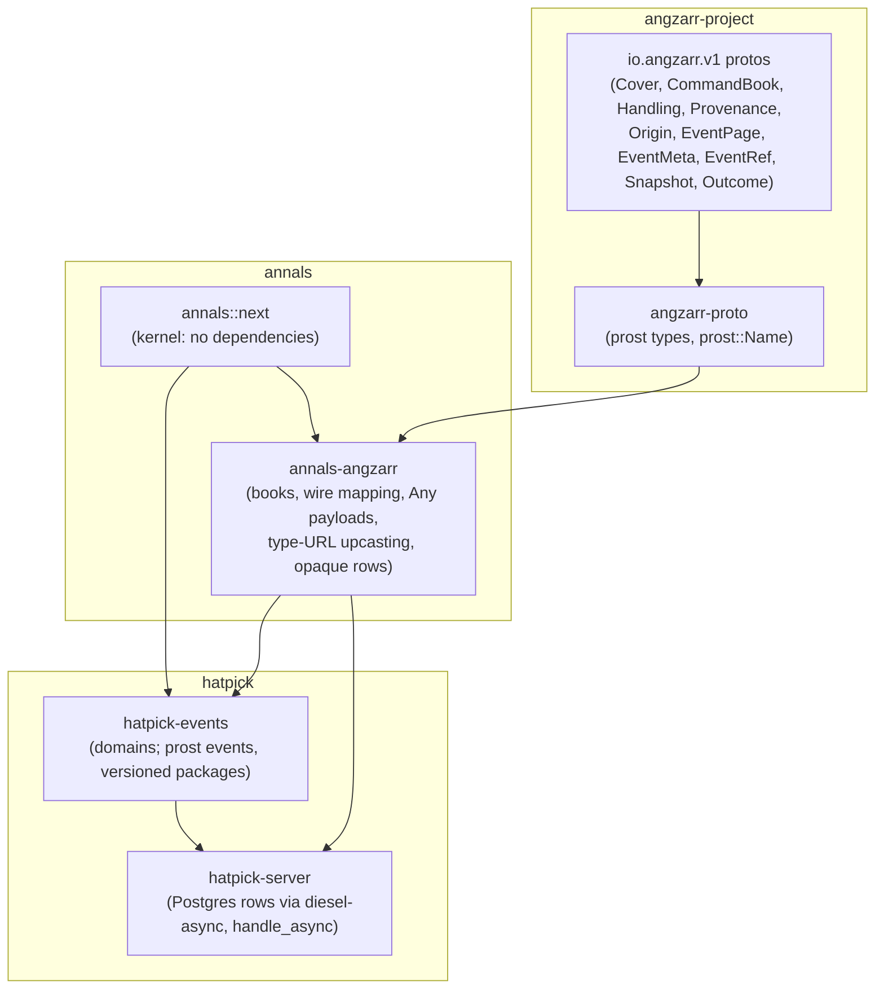

# The audited kernel on angzarr's wire: design proposal

Status: **proposal**. The kernel's signatures are in
`crates/annals/src/next/` and the adapter's in `crates/annals-angzarr/src/`,
with non-trivial bodies left as `todo!("proposal: ...")`. The behaviour is
pinned by ignored tests in `crates/annals/tests/next/` and
`crates/annals-angzarr/tests/angzarr/`. Nothing here is implemented until
this document has been reviewed.

This revision realigns the proposal to angzarr's final protos:
angzarr-project `feat/audit-meta` at **279bc89** (pass 7: the main timeline
is the unset edition), the contract recorded in angzarr's
`docs/design/audit-meta/` (`decision-log.md`, `annals-divergence.md`,
`critical-review-source.md`).

## Why

People choose event sourcing for different reasons; here the main reason is
**auditability**. Every change should answer who made it, when, in which
workflow, why (what caused it), against which version of the stream, and
under which rules. Replay should reproduce exactly what was seen at the
time. An architectural review of annals against CQRS/ES practice found gaps
in exactly those places:

| ID | Finding | Resolution here |
|---|---|---|
| A1 | `Envelope` holds only seq, cause and event, with no who, when or why. Consumers put metadata in the payload: hatpick's `Stamp`, annals-sim's `Ticked`. | The kernel stamps a `Meta` on every event, field for field angzarr's `EventMeta`. Business code emits payloads only. [Metadata](#metadata) |
| A2 | `cause` is only within a stream. `Injected` lacks the source stream's identity. There is no correlation id. | An event's origin is angzarr's `Origin` (request, causation or fact); a causation names its trigger as an `EventId` in any stream. Correlation is always set and propagated through every reaction. |
| A3 | `Header.rules` is a free string per stream that replay never checks. The fold code is unversioned. | The rules version is declared at registration, stamped per event and resolved by a `Rulebook` at replay. The caller cannot substitute rules. [Rules](#rules) |
| A5 | `Header.schema` is unused, and there is no upcasting. | A payload's type URL is its version. Old types are upcast by type URL at read time, strictly. Golden replay fixtures pin old logs. [Upcasting](#upcasting-by-type-url) |
| A6 | Events emitted before a rejection stay in the `Stream`. | Decide is pure and stages its events. A rejection leaves nothing behind. [Decide and ingest](#decide-and-ingest) |
| B1 | The "saga" is really a stateless policy. The target-contiguity invariant is undocumented. `backlog` replays the source once per target. | Policies (event → commands) share one base with projections. The invariant is documented and checked. Each backlog is one pass for all targets. [Reactions](#reactions) |
| B2 | `Projection::on` gets no stream identity or position. | Every reaction gets a `Committed`: the stream, the seq, the metadata, the event, and the state just after it. |
| B6 | The store port is synchronous, `&mut`, and whole-stream only. `read -> Option` hides I/O failure. `Conflict` is its only error. Its ids are `u64`. Its append checks nothing. | There are sync and async ports and a unit of work. `read_from` is added. Append returns the new length and checks seq continuity. Streams are keyed by (domain, edition, root). `StoreError` separates conflict, caller bug, duplicate, unreadable and infrastructure failure. [Store](#the-store-ports) |
| B8 | The only error channel is `Domain::Rejection`, so kernel faults are folded into business rejections. | `Failure` keeps the domain's rejection apart from kernel faults and from failures further down the chain. Each failure is classified for recovery. [Errors](#errors-and-recovery) |

## Layering



- **angzarr owns the wire contract.** Its protos (`io.angzarr.v1`, in
  angzarr-project) are what an event, a command, a stream and their
  provenance are on the wire. annals and hatpick import them, through
  angzarr-proto, angzarr's own prost crate. annals defines no wire schema of
  its own for events.
- **annals is the in-process runtime**, embedded in hatpick's server, one
  process. A chain's staged events across streams go into one database
  transaction. angzarr's distributed runtime is not used by hatpick.
- **annals is not angzarr.** They share the protos, some code and their
  intents. Where the execution models differ, annals' choice is deliberate
  and listed under [Divergences](#divergences-from-angzarr); the wire
  meaning is the same.
- **The kernel stays dependency-free.** It knows angzarr's shapes (a stream
  key is a `Cover`'s triple, `Meta` is an `EventMeta`, `Book` a
  `CommandBook`) but not its types. **annals-angzarr** is the one crate that
  knows both, and maps one onto the other.
- **Storage is opaque**: the type URL, the encoded page as written, and the
  metadata as typed columns. Typed views are projections; in hatpick they
  are replayed on read, not stored.

## Design constraints

- **annals does no I/O**, keeps no infrastructure and never retries. Its
  contract lets a runtime wrap it: failures say whether to retry
  (`Recovery`), origins are idempotency keys, and its metadata, keys and
  books have angzarr's wire form.
- **Pure and deterministic.** There is no clock, no randomness, no I/O and
  no hash-map iteration in the kernel. The application samples everything
  and passes it in (`Sampled { now, minted }`), including the fresh
  correlation a keyless request is given. The in-process conflict nonce is
  a counter, not a random value.
- **The kernel stays synchronous.** The only async parts are the async store
  port beside the sync one, and the command handler over it. Both use native
  `impl Future` in traits, with zero dependencies. The kernel's MSRV is 1.77;
  annals-angzarr's is 1.85, for prost 0.14.
- **annals and annals-angzarr build for `wasm32-unknown-unknown`.** `just
  wasm` checks it.
- **Must not preclude hash chaining** (deferred). Stored pages are never
  rewritten: upcasting happens at read time. Metadata is deterministic. The
  actor is a pseudonymous id, so erasing a person never edits history.

## The flow

```mermaid
sequenceDiagram
  participant App as Application (API handler)
  participant H as annals handle()
  participant C as Chain (in memory)
  participant U as Unit of work (one DB transaction, via annals-angzarr)
  App->>App: sample now, minted correlation, random values
  App->>H: handle(registry.store(tx), routes, book, sampled, rules, projections)
  H->>H: validate the book (body arm vs origin); resolve handling
  H->>U: read the origin stream (rows decoded, upcast, unpacked)
  H->>C: decide (command arm) or ingest (fact arm), staged
  loop every policy routed for each staged event, depth first
    C->>U: read the target stream (first touch only)
    C->>C: decide the policy's command against staged state, stage
  end
  alt anything failed anywhere
    H-->>App: Failure (path to the failing step, Recovery)
    Note over U: dropped uncommitted: nothing anywhere
  else the whole chain succeeded
    H->>U: append every staged stream as rows (each expects its loaded length)
    H->>U: record_command(origin stream, origin) if keyed
    H->>U: commit
    H->>H: run projections on committed events
    H-->>App: Recorded (every event; registry.event_books, outcome)
  end
```

1. **The application samples** the instant and a fresh correlation (a
   UUID's text) into `Sampled`, and any random values into the command, for
   example `Draw { roll }`. The book carries the actor, a correlation if the
   request had one, the origin (request id and index) and the handling.
2. **Validate and resolve, before business code.** The body arm and the
   origin must agree; `Handling` is resolved: an absent
   `expected_sequence` is the head, an absent resolution the domain's
   default, and STRICT refuses a stale one.
3. **Decide or ingest**, picked by the body arm. A command goes to the
   fallible, pure `decide`; a fact to the infallible `ingest`. Business code
   produces payloads only.
4. **React.** Policies routed for the source's domain run on the staged
   events, in the same `Chain`; their commands are decided in their targets,
   whose events set off their own policies, depth first. **Everything stays
   staged in memory**, across every stream involved.
5. **Append, atomically, or not at all.** If anything in the chain failed (a
   policy's command rejected, a gap, the depth limit, a store read), the
   failure goes back to the caller with the path to the failing step, and
   nothing is appended anywhere, not even the originating command's events.
   On success every staged stream is appended through the unit of work, each
   expecting the length it had when the chain loaded it (optimistic
   concurrency on **every stream touched**); the originating book's key is
   recorded if it has one; the unit of work is committed: one transaction.
6. **Project.** Projections run after the commit, on committed events only.
   They never see a failed chain, and a failing one never undoes the commit
   (`Recorded::projector_failures`).

`handle` is request/response. It returns `Recorded`: every event the chain
recorded, in every stream. An API handler answers with those events (a draw
command answers with its `Drawn`), or with them as `EventBook`s
(`Registry::event_books`) and an `Outcome` (`annals_angzarr::outcome`).

## Books: commands and facts

```rust
pub struct Book<C, F> {                  // angzarr's one-page CommandBook
    pub stream: StreamKey,               // cover
    pub handling: Handling,              // never persisted
    pub provenance: Provenance,          // page.provenance, as sent
    pub origin: Origin,                  // page.origin
    pub body: Body<C, F>,                // page.body
}
pub type BookOf<D> = Book<D::Command, D::Fact>;
pub enum Body<C, F> { Command(C), Fact(F) }
pub struct Handling { pub expected_sequence: Option<Seq>, pub conflict_resolution: Option<ConflictResolution> }
pub enum ConflictResolution { Strict /* default */, AggregateHandles, Commutative }
pub struct Provenance { pub actor: Option<Actor>, pub correlation: Option<Correlation> }
pub enum Origin { Request(RequestOrigin), Causation(Causation), Fact(FactOrigin) }
pub struct RequestOrigin { pub request: Option<RequestId>, pub index: u32 }   // None: keyless
pub struct Causation { pub event: EventId, pub component: String, pub index: u32 }
pub struct FactOrigin { pub external_id: String, pub description: String }
pub struct Sampled { pub now: Timestamp, pub minted: Correlation }
impl<C, F> Book<C, F> {
    pub fn validate(&self) -> Result<(), Malformed>;
    pub fn correlation(&self, minted: &Correlation) -> Correlation;
}
```

- **One command per book**, as angzarr's `CommandBook` holds one page. The
  body arm is the fact marker: `Body::Fact` goes to `ingest`, `Body::Command`
  to `decide` (angzarr's reflective dispatch on `CommandPage.body`).
- **Validation** (`Malformed`), before any business code, refused, never
  repaired (`Recovery::Bug`): a fact needs a fact origin
  (`FactWithoutFactOrigin`); a command never has one
  (`CommandWithFactOrigin`); a fact's external id is not empty
  (`EmptyExternalId`); a fact has no expected sequence
  (`FactWithExpectedSequence`); a causation carries no handling
  (`HandlingOnReaction`); COMMUTATIVE needs a domain that can say what
  changed (`CommutativeUnsupported`). angzarr answers these INVALID_ARGUMENT
  (or dead-letters a reactor's).
- **Correlation is always set**: the caller's, else derived from the key
  (`Correlation::derived`: a keyed request's id, a fact's external id),
  else `Sampled::minted`. A policy's commands carry their trigger's.
- **A keyless request is allowed** (`Origin::keyless()`), as angzarr
  records one: its correlation is minted and it is never deduplicated.
  (The plan's "refuse a request with no id" predates this; see open
  question 3.)

## Decide and ingest

```rust
pub trait Domain: Sized + 'static {
    type State: Default + Clone + Send + 'static;
    type Command: Send + 'static;
    type Fact: Send + 'static;            // Infallible for a domain that takes none
    type Event: Clone + Send + Sync + 'static;
    type Rejection: Diagnostic + Send + 'static;
    type Rules: Send + Sync + 'static;
    const NAME: &'static str;             // the domain of every StreamKey of this domain
    fn decide(cmd: &Self::Command, tx: &mut Tx<'_, Self>) -> Result<(), Self::Rejection>;
    fn ingest(state: &Self::State, fact: &Self::Fact, rules: &Self::Rules) -> Vec<Self::Event>;
    fn apply(state: &mut Self::State, event: &Self::Event, rules: &Self::Rules);
    fn conflict_resolution(cmd: &Self::Command) -> ConflictResolution { ConflictResolution::Strict }
    fn changed(before: &Self::State, after: &Self::State) -> Option<BTreeSet<String>> { None }
}
```

- **`ingest` is infallible by type.** It returns events and has no error to
  return: a fact already happened, so an awkward one is recorded (a payment
  for an unknown order becomes an event that says so), never refused. A
  panicking `ingest` is a bug; in process it aborts the chain and nothing is
  written (see [Divergences](#divergences-from-angzarr) on PARKED).
- **There is no `Ctx`.** Decide reads what the kernel stamps through `Tx`:
  `recorded_at()`, `actor()`, `correlation()`, `origin()`; random values come
  in the command. Decide copies what the domain's own rules need into the
  payload, such as `Drawn { roll, at }`, where `at` is business time read from
  `recorded_at()`. `apply` sees only the payload.
- **Business output is payloads only.** `Tx::emit(event)` takes a payload;
  the kernel builds each page: its seq and its `Meta`. There is no
  `emit_caused`: every event of one write shares one origin, as in angzarr.
- **A rejection leaves nothing behind (A6).** `Stream::decide(&self, ..)`
  takes `&self`, so it cannot touch the stream. A decide may reject at any
  point, even after emitting.
- **Decide sees its own staged events.** `Tx` folds each emitted event into
  a *copy* of the state, cloned at the first emit. Not a pure `decide(state,
  cmd) -> Vec<Event>`, because every multi-step decide would re-fold by hand
  (annals-sim's `advance` emits, reads the state the emit left, and emits
  again). The cost is `State: Clone` and one clone per command that emits
  anything. `ingest` is the plain function shape: facts are recorded, not
  reasoned over step by step.
- **Commit re-applies.** `Stream::commit` applies each staged event to the
  live state, so it can give each handler the state just after each event.

The single-stream steps stay public for in-memory use and tests:
`Stream::new(edition, root)`, `decide(book, sampled, rules)`, `commit`,
`execute`, `replay`, `resume`, `snapshot` and `dispatch`.

## Conflict resolution

`Handling.expected_sequence` is the stream length the sender issued the
command against. Absent, the kernel uses the head, and the command can never
be stale. Present, the resolution decides, and it is the book's, else the
domain's default for that command (`Domain::conflict_resolution`), else
STRICT. An expected sequence past the head is stale under every resolution.

| Resolution | What happens to a stale expected sequence |
|---|---|
| `Strict` (default) | `KernelError::Stale { stream, expected, actual }` before decide runs (angzarr's ABORTED; `Recovery::Retry`: re-read, re-issue). |
| `AggregateHandles` | decide runs against the head and is handed the **window** (the committed events from `expected_sequence` on) and a **nonce**: `tx.conflicts() -> Option<Conflicts { window, nonce }>`. It applies its own rule and acknowledges with `tx.resolve_conflicts(window, nonce)`. If it returns `Ok` without doing so, its events are discarded and the command fails as `KernelError::Unresolved` (stale, and a handler bug). An empty window is handed over too. |
| `Commutative` (opt-in) | Delivered as `AggregateHandles`, but the kernel resolves: it compares `Domain::changed(state at expected, state at head)` (what the window changed) with `Domain::changed(state at head, state after the command)` (what the command changes). Disjoint: kept. Overlapping: `Stale`. decide is never handed the window. |

**The in-process nonce (decided here).** angzarr's nonce is an opaque value
minted per delivery and checked by the client library, so a handler cannot
pass the check without having received it. annals' equivalent is a `Nonce`
token: minted by the chain per delivery (a counter, so the kernel stays
deterministic), handed to decide only inside `Conflicts`, neither
constructible nor clonable outside the kernel, and taken back by value in
`resolve_conflicts`. The kernel compares it after decide returns. The check
is local and costs nothing, as angzarr's is; Rust's ownership makes "pass
another delivery's nonce" impossible rather than merely detectable.

**COMMUTATIVE in annals (decided here).** angzarr's client libraries diff
the state by protobuf reflection, field by field. The kernel has no
reflection and its states are plain Rust types, so the domain says what a
change touched: `Domain::changed(before, after) -> Option<BTreeSet<String>>`,
`None` by default (COMMUTATIVE unsupported, refused as malformed). The
names are the domain's: a top-level field, or something finer such as
`item:42`, which suits hatpick's "content edits conflict only on overlap"
better than top-level fields would. The same caveat as angzarr's applies:
a structural diff cannot see an invariant that spans two fields, so it is
opt-in only.

**`base_sequence`** is the head decide saw, for every resolution: the version
the decision was made against, recorded on every event.

## Stream keys and editions

```rust
pub struct StreamKey { pub domain: String, pub edition: Option<EditionName>, pub root: Root }
pub struct EditionName(String);            // never empty
impl EditionName { pub fn new(name: &str) -> Result<EditionName, EmptyEditionName>; pub fn as_str(&self) -> &str; }
pub struct Root(pub u128);                 // a UUID's 16 bytes, big-endian
pub struct EventId { pub stream: StreamKey, pub seq: Seq }   // Seq = u64
```

- **A stream is the full (domain, edition, root)**, as an angzarr `Cover`
  names one. The same root in another domain or edition is another stream.
- **The main timeline has no name.** `edition: None` is main; `Some(name)` is
  a named edition, and a name is never empty (`EditionName::new("")` is
  refused). This is exactly angzarr's `optional string edition` since pass
  7: unset is main, and a set empty string is refused. There is no magic
  string for main, so the old `"angzarr"` and `""` spellings are gone.
- **A stream's domain is its type's.** `Stream::<D>::new(edition, root)`
  takes the domain from `D::NAME`. A key of another domain given to
  `handle` is `KernelError::WrongDomain`, and to `Stream::replay`
  `ReplayError::WrongDomain`.
- **A reaction never crosses timelines.** A target's key is
  `(Target::NAME, the source's edition, Reaction::root(target))`
  (`target_key`), so a chain started in edition `v2` touches only `v2`.
- **Editions are not created, branched or read through.** angzarr requires
  an edition to be created first (an administrative `CreateEdition`, which
  records its divergence point and store) and reads a named edition through
  to main up to that point. annals models none of it: a named edition's
  streams are separate streams that start empty, and annals accepts any
  well-formed name. It keeps refusing nothing more than an empty name until
  it models branching (a divergence, listed below). hatpick uses only main.

## Metadata

```rust
pub struct Meta {                          // angzarr's EventMeta; stamped, never set by business code
    pub actor: Option<Actor>,              // provenance.actor; None = the system
    pub correlation: Correlation,          // provenance.correlation_id; always set
    pub origin: Origin,                    // the producing command's, unchanged
    pub recorded_at: Timestamp,            // i64 µs; max(sampled.now, the stream's last)
    pub base_sequence: Seq,                // the head decide saw
    pub rules_version: RulesVersion,       // the rulebook's current version
}
```

| Field | Supplied by | Within a chain | angzarr |
|---|---|---|---|
| `actor` | the book's provenance | kept: a policy acts on the original actor's behalf | `EventMeta.provenance.actor` (empty = the system) |
| `correlation` | the book, else derived, else minted | kept | `EventMeta.provenance.correlation_id` |
| `origin` | the book (request or fact); the kernel (causation) | a policy's commands are `Causation { event, component, index }` | `EventMeta.origin` |
| `recorded_at` | the kernel, from `Sampled::now` | one instant for the chain, raised per stream to its last | `EventMeta.recorded_at` |
| `base_sequence` | the kernel | each stream's own head | `EventMeta.base_sequence` |
| `rules_version` | the kernel, from the registration | the target domain's | `EventMeta.rules_version` |

**Choices.**

- **`recorded_at` never goes backwards within a stream.** The kernel stamps
  `max(sampled.now, the stream's last recorded_at)`, so a clock step back
  never makes a later event look older and the events recorded by any time
  are a prefix. Replay refuses a log that goes backwards
  (`ReplayError::RecordedBackwards`).
- **No request on every event (angzarr's D2).** A reaction's event records its
  causation and its correlation; the request behind it is found by walking
  causation or by correlation. The earlier draft's `request` field on every
  event is dropped (it was a divergence with no consumer).
- **The event id is `EventId { stream, seq }`, derived and not stored**, as
  angzarr's `EventRef { stream, sequence }`. It is unique as long as stream
  keys are, never minted, the same on every replay, and what a causation
  points at.
- **Origins are idempotency keys.** A request is `(request, index)`; a
  causation `(event, component, index)`, deterministic, so a retried chain
  issues the same keys; a fact its `external_id`. Every `Reaction` has a
  stable `NAME` for this.
- **Business time stays in payloads.** `recorded_at` is audit time.
- **Actors are pseudonymous.** Erasing a person deletes the
  pseudonym-to-person mapping outside the log. The log is never rewritten.

## Reactions

Every kind of reaction takes the same input: `Committed<'_, D>`, which holds
the stream key, the envelope (seq, metadata, payload) and the state just
after the event, with `id()`, `seq()`, `meta()` and `event()`. They share one
position contract and one dispatch: each kind becomes a `Handler<D>`, a plain
callback (`FnMut(&Committed<D>)` is one).

| Trait | Output | Can the target refuse? |
|---|---|---|
| `Policy` | event → **commands** to targets | yes: the target decides, and may reject |
| `Projection<D>` | event → fold | produces nothing |

```rust
pub trait Reaction {                       // the base under Policy
    type Source: Domain; type Target: Domain; type TargetId: Ord + Clone;
    const NAME: &'static str;              // the component of every Causation it issues
    fn targets(source: &<Self::Source as Domain>::State) -> Vec<Self::TargetId>;
    fn root(target: &Self::TargetId) -> Root;   // keyed in the source's edition
    fn position(target: &<Self::Target as Domain>::State) -> Position;
}
pub trait Policy: Reaction {
    fn command(target: &Self::TargetId, c: &Committed<'_, Self::Source>) -> <Self::Target as Domain>::Command;
}
pub trait Projection<D: Domain> { fn project(&mut self, c: &Committed<'_, D>); }
pub struct Order<P: Policy> { pub target: P::TargetId, pub book: BookOf<P::Target> }
```

- **Reactions emit commands only.** `Translation` (event → facts injected
  into a target) is gone: facts come from outside the system only (angzarr's
  decision), so a reaction can never inject one, and `Domain::admit_fact`,
  `Stream::admit`, `inject`, `facts_owed` and `KernelError::FactRefused` go
  with it. A policy's command is a normal command: a book with a causation
  origin, the trigger's provenance and no handling, decided by its target.
- **`Policy::on_rejected` is gone.** It was a compensation hook for a
  wrapping runtime; angzarr removed compensation (domain refusal events and
  process-manager replies replace it), and in process a chain is all or
  nothing.
- **The contiguity invariant** is documented on `Reaction` and checked by
  the backlog as `KernelError::TargetReturned { left, returned }`. Once a
  target appears in `targets()`, it stays for every source event up to and
  including the one that retires it, and never comes back.
- **The backlog** (`orders_owed::<P>`) is **one fold of the source for all
  targets**, starting from each target's position, grouped by target, each
  group in source order. It is for a policy added to existing data, and a
  catch-up.
- **The in-memory delivery step** `deliver::<P>` places first (redelivery: a
  no-op; gap: `KernelError::Gap`), then decides. The chain uses the same
  steps.

### Propagating one aggregate into another

hatpick's list → draw-system propagation is a **policy**: `ListToDrawSystems`
commands each live draw system to apply a list change, and the draw system
records it in **its own events**. The test toy is `ClubToMembers`
(`tests/next/reactions.rs`): the club is the list, a member's copy a draw
system.

**The list-change command's refusals (decided here).** The command (hatpick:
`ApplyListChange { source_seq, change }`, the toy's `ApplyClubChange`) is a
normal command, but it should never be refused in practice:

- **Gap and redelivery are the kernel's, not the domain's.** The kernel
  places the command's source seq against the target's position before
  decide: a redelivery runs nothing, a gap is `KernelError::Gap`
  (`Recovery::Retry`: catch up from the backlog). Within an atomic chain
  neither can happen: the policy runs on every list event, in order, in the
  same transaction. They matter only for a catch-up outside a chain.
  `DrawSystemRejection::Gap` goes away, as before.
- **Retired and never-created stay domain refusals, and are bugs.** The list
  owns its set of draw systems (they are created and retired through list
  events), so `targets()` names a draw system from the event that creates it
  through the event that retires it, and never again. A command to a
  retired or never-created draw system therefore means the contiguity
  invariant was broken; decide refuses it, and in a chain that **fails the
  list edit whole**, loudly, with nothing written. That is the right answer
  for a bug, and it is why retiring a draw system must go through the list:
  a draw system retired only in its own stream would stay in `targets()`,
  and every later list edit would fail.

### The position contract

```rust
pub struct Position(Option<Seq>);   // the last seq handled; START = none
impl Position {
    pub const START: Position;
    pub const fn at(last: Seq) -> Position;
    pub fn next(self) -> Seq;                               // where a catch-up reads from
    pub fn place(self, seq: Seq) -> Result<Admit, Gap>;     // Next | Redelivery | Gap
    pub fn advance(&mut self, seq: Seq) -> Result<Admit, Gap>;
}
```

There is one contract for every reader: a projection, an application
handler, or a policy's target, whose position is a fold of its own stream.
The source seq travels in the command's payload, because `apply` never sees
metadata (it duplicates `Causation.event.seq`; that is the price of a pure
fold). Seqs are `u64` throughout.

- A **redelivery** does nothing. A **gap** is refused and does not move the
  position. For a target, `START` means **not created**: the delivery goes to
  decide, which creates the target or refuses.
- `Tracked<H>` wraps any handler with a position per stream key. It drops
  redeliveries and records the first gap, so a handler fed from anywhere
  sees each event once and in order, and catches up with
  `read_from(position.next())`.

**Read models replay the stream on every read, for now** (`Stream::dispatch`
from 0). No projection tables are persisted.

## The command chain

```rust
pub fn handle<D, U, Ps>(unit: U, routes: &Routes<'_, U>, book: &BookOf<D>, sampled: &Sampled,
    rules: &Rulebook<D::Rules>, projections: &mut Ps) -> Result<Recorded, Failure<D::Rejection>>
where D: Domain, U: UnitOfWork + EventStore<D::Event>, Ps: Project;
pub async fn handle_async<D, U, Ps>(/* same, with AsyncRoutes */) -> /* same */
where U: AsyncUnitOfWork + AsyncEventStore<D::Event>;

let routes = Routes::new()
    .policy::<ListToDrawSystems>(&list_rules, &draw_rules)
    .policy::<SomePolicy>(&source_rules, &target_rules);
```

- **The chain is atomic, and that is a deliberate divergence** (see
  [Divergences](#divergences-from-angzarr)): a policy's commands are decided
  in the same chain, and any rejection or fault anywhere fails the origin.
- **`Routes` is a table keyed by source domain**, not a static nesting of
  route types. A chain may come back to a stream it already touched
  (A → B → A). Routes name the unit of work's type, so they are built per
  unit of work: a few boxed closures (open question 6).
- **`Chain`** (`Chain::new(store, routes, sampled)`) holds every touched
  stream, by key, as a boxed `Stream<D>`, staged, with the length it was
  loaded at. **A later step sees the staged state of any stream an earlier
  step touched, including the origin's.**
- **Depth limit.** `Chain::limit`, default `DEFAULT_DEPTH_LIMIT = 8`,
  reported as `KernelError::ChainTooDeep { limit }`. Since a chain can
  legitimately revisit a stream, a depth limit is the cycle check.
- **The failure path.** `Failure::Downstream { path: Vec<Step>, error:
  StepError }`. Each `Step` is `{ stream, cause: EventId }`. The step's
  command is not carried: policies are pure, so the cause recomputes it.
- **Optimistic concurrency on every stream touched.** A conflict on any
  append is `Failure::Kernel(KernelError::Store(StoreError::Conflict {
  stream, .. }))`, and the unit of work is dropped.
- **Projector failures** are reported, not raised: `Recorded::
  projector_failures()` (angzarr's `Outcome.projector_failures`); each
  `ProjectionRoute` has a `name` for it.

## The store ports

```rust
pub trait EventStore<E> {
    fn append(&mut self, key: &StreamKey, expected: Seq, events: &[Envelope<E>]) -> Result<Seq, StoreError>;
    fn read_from(&mut self, key: &StreamKey, from: Seq) -> Result<Option<Slice<E>>, StoreError>;
    fn read(&mut self, key: &StreamKey) -> Result<Option<Slice<E>>, StoreError> { self.read_from(key, 0) }
}
pub trait UnitOfWork {                     // dropped = rolled back
    fn commit(self) -> Result<(), StoreError>;
    fn record_command(&mut self, stream: &StreamKey, origin: &Origin, from: Seq, to: Seq)
        -> Result<(), StoreError> { Ok(()) }
}
pub trait AsyncEventStore<E> { /* the same, each returning impl Future<Output = ..> + Send */ }
pub trait AsyncUnitOfWork { /* the same, async */ }
pub struct Slice<E> { pub key: StreamKey, pub len: Seq, pub events: Vec<Envelope<E>> }
```

- **The event store is the application's SQL database** (Postgres for
  hatpick) behind this port. There is no other event-store infrastructure.
- **A port value is a unit of work**, a database transaction, so its methods
  take `&mut self`. An opaque store (rows of type URL, page and metadata)
  implements `EventStore<Stored>`, and annals-angzarr's `Opaque` makes it an
  `EventStore<E>` for every registered domain at once.
- **`append`** refuses a stale `expected` (`Conflict`) and seqs that do not
  run on from `expected` (`Discontinuous`, checked for every event). It
  returns the new length.
- **`read_from`** returns `Ok(None)` for no such stream, `Err(Unavailable)`
  for an I/O failure, and `Err(Unreadable { stream, seq, reason })` for an
  event it holds but cannot give back (an unknown type URL). These are never
  confused, and an unreadable event is never skipped.
- **Idempotency: no key store, one optional record.** annals keeps no
  idempotency key store (a divergence; see below). The command handler calls
  `UnitOfWork::record_command` once, for the originating book, when its
  origin is keyed (`Origin::is_keyed`: a request with an id, or a fact), in
  the same unit of work as its events. A store that records keys answers a
  repeat with `StoreError::Duplicate { stream, origin, from, to }`
  (`Recovery::Done`: read the range; angzarr's DUPLICATE). The default
  records nothing. Only applied commands are recorded; a rejection writes
  nothing, so it may be retried (angzarr's "rejections are released").
  `InMemoryStore` records every keyed origin, for tests.
- **Async futures are `Send`.** tokio's multi-threaded runtime needs that.
  `Ready<S>` serves a sync store through the async port.

## Snapshots

```rust
pub struct Snapshot<S> { pub sequence: Seq, pub state: S, pub rules_version: RulesVersion, pub recorded_at: Timestamp }
impl<S> Snapshot<S> { pub fn usable<R>(&self, rules: &Rulebook<R>) -> bool; }
pub trait SnapshotStore<S> {
    fn read_snapshot(&mut self, key: &StreamKey) -> Result<Option<Snapshot<S>>, StoreError>;
    fn write_snapshot(&mut self, key: &StreamKey, snapshot: &Snapshot<S>) -> Result<(), StoreError>;
}
pub fn load<D, S>(store: &mut S, key: &StreamKey, rules: &Rulebook<D::Rules>) -> Result<Option<Loaded<D>>, KernelError>
where S: EventStore<D::Event> + SnapshotStore<D::State>;
```

- **A snapshot is used only under the rules version it was folded with**
  (`usable`: equal to the rulebook's current version) and only if its state
  decodes as `D::State` (the adapter answers `None` for a snapshot of another
  type, `wire::snapshot_from_wire`). On any mismatch it is **discarded**,
  never migrated, and `load` replays from seq 0 (angzarr's D8). A rules
  change or a state-schema change never needs a snapshot migration.
- annals folds each event with its own version's rules, so an old snapshot
  would usually still be right; it is discarded anyway, because the apply
  code that folded it may have changed with the version, and replay is the
  one fold annals trusts.
- `recorded_at` is the floor for the next event's; angzarr's `Snapshot` has
  no field for it, so an adapter reads it off the row at `sequence`.
- A stream resumed from a snapshot holds only the events after it
  (`Stream::first`); dispatching from before it is
  `KernelError::BeforeSnapshot`.
- **The chain does not load through snapshots yet**: it reads whole streams.
  When it does, AGGREGATE_HANDLES and COMMUTATIVE need the window as events,
  so a snapshot must be at or below `expected_sequence - 1` (angzarr's W12).
  Snapshot frequency and retention are the application's (default: keep the
  newest).

## Errors and recovery

`Failure<R>` is what a command returns.

| Variant | Meaning |
|---|---|
| `Rejected(R)` | The origin domain's own rejection, typed for the caller to render. |
| `Downstream { path, error }` | A step further down the chain failed. |
| `Kernel(KernelError)` | A fault at the origin or at commit. |

**No kernel fault is ever folded into a domain's rejection (B8).**

Every error has `.recovery() -> Recovery`:

| `Recovery` | Errors |
|---|---|
| `Retry` | `StoreError::Conflict` (re-read and re-decide); `KernelError::Stale` and `Unresolved` (re-read, re-issue against the new head; angzarr's ABORTED); `Unavailable` (only under a recorded key, since the commit may have landed); `KernelError::Gap` (catch up, then retry) |
| `Done` | `StoreError::Duplicate`: the command is already recorded |
| `Business` | `Rejected`, and `Downstream` with `StepError::Rejected` |
| `Bug` | `Malformed`, `Discontinuous`, `Unreadable`, `WrongDomain`, `ChainTooDeep`, `TargetReturned`, `BeforeSnapshot`, `Replay` |

`Recovery::Integrity` is gone with `FactRefused`.

The new errors become `Diagnostic`s when they are implemented, with
messages in each crate's `locales/en-US/` catalog and samples in
`diagnostic_samples()`. The proposed codes are:

- annals: `annals-store-conflict` (reused), `annals-store-discontinuous`,
  `annals-store-duplicate`, `annals-store-unavailable`,
  `annals-store-unreadable`; `annals-kernel-malformed-<variant>`,
  `annals-kernel-stale`, `annals-kernel-unresolved`, `annals-kernel-gap`
  (from `annals-policy-gap`), `annals-kernel-target-returned`,
  `annals-kernel-chain-too-deep`, `annals-kernel-wrong-domain`,
  `annals-kernel-before-snapshot`; `annals-replay-out-of-sequence`,
  `annals-replay-cause-not-earlier` (both reused),
  `annals-replay-recorded-backwards`, `annals-replay-unknown-rules`,
  `annals-replay-wrong-domain`.
- annals-angzarr: one code per `BookError`, `PayloadError`, `UpcastError`,
  `ChainProblem` and `ReadProblem` variant, named
  `annals-angzarr-<kind>-<variant>` (`annals-angzarr-payload-unknown-type`,
  whose args include `type_url`).

The proposal does not implement `Diagnostic` yet: the catalog parity check
scans for code literals and would demand samples of `todo!()`s.
annals-angzarr is listed in the check's `NO_CODES` until then.

## Rules

`Rulebook<R>` holds every rules version a log may name, plus the current
one: `Rulebook::new(v, r).with(old, r_old)`. **The current version is the
domain's registration**: declared by the application, never by business
code, and stamped by the kernel on every event as `rules_version` (angzarr's
`ComponentDescriptor.rules_version`). `Stream::replay(key, events,
&rulebook)` folds each event with the rules **its own metadata names**. A
version the rulebook lacks is `ReplayError::UnknownRules`; the caller cannot
substitute rules. A change in what `apply` does with the same payload must
bump the rules version, and the old rules must stay in the rulebook.

In angzarr `rules_version` is opaque, used only to explain a historical
decision. **In annals it is load-bearing**: replay resolves rules by it, and
snapshots are discarded by it.

## The adapter: annals-angzarr

annals-angzarr maps annals onto angzarr's types. It depends on
`angzarr-proto` (a git dependency pinned to angzarr-project rev
**279bc89**, `feat/audit-meta` pass 7; its build needs `protoc`), `prost`
and `prost-types` 0.14 (the versions angzarr-proto generates for, so the
types unify), and annals. It re-exports angzarr-proto's `io.angzarr.v1` as
`annals_angzarr::pb`, so an application names one pin.

### Mapping (annals ↔ angzarr 279bc89)

| annals | angzarr | Where |
|---|---|---|
| `StreamKey { domain, edition, root }` | `Cover { domain, root, optional edition }`: identity only | `wire::cover`, `wire::key` |
| `edition: None` | `Cover.edition` unset | `wire::edition`, `wire::edition_name` |
| `edition: Some(EditionName)` | `Cover.edition` set, non-empty; a set `""` refused (`BookError::EmptyEdition`) | `wire::edition_name` |
| `Root` (u128) | `UUID { value: 16 bytes, big-endian }`; any other length refused | `wire::uuid`, `wire::root` |
| `EventId { stream, seq }` | `EventRef { Cover stream; uint64 sequence }` | `wire::event_ref`, `wire::event_id` |
| `Seq` (u64) | `EventPage.sequence`, `EventRef.sequence`, `base_sequence`, `expected_sequence` (uint64) | |
| `Timestamp` (i64 µs) | `google.protobuf.Timestamp`, exact; a sub-µs value refused | `wire::timestamp`, `wire::micros` |
| `Book<C, F>` | a `CommandBook { cover, handling, page }`, one page | `command_book`, `book_from_wire::<D>` |
| `Handling { expected_sequence, conflict_resolution }` | `Handling { optional expected_sequence; conflict_resolution }`; `None` = UNSPECIFIED | `wire::handling`, `wire::handling_from_wire` |
| `ConflictResolution::{Strict, AggregateHandles, Commutative}` | `CONFLICT_RESOLUTION_{STRICT, AGGREGATE_HANDLES, COMMUTATIVE}` | `wire::conflict_resolution` |
| `Nonce` (in-process token) | `ContextualCommand.conflict_nonce` (never on a `CommandBook`) | not mapped: annals delivers in process |
| `Provenance { actor, correlation }` | `Provenance { actor, correlation_id }`; empty = not supplied | `wire::provenance`, `wire::provenance_from_wire` |
| `Origin::{Request, Causation, Fact}` | `Origin { RequestOrigin request \| Causation causation \| FactOrigin fact }`; keyless = empty `RequestOrigin`; no origin read as keyless | `wire::origin`, `wire::origin_from_wire` |
| `Body::{Command, Fact}` | `CommandPage.body { Command command \| Fact fact }`, each `{ Any payload }` | `command_book`, `book_from_wire` |
| `Envelope<E> { seq, meta, event }` | `EventPage { sequence, meta, payload }` | `event_page` |
| `Meta` | `EventMeta { provenance { actor, correlation_id }, origin, recorded_at, base_sequence, rules_version }` | `wire::event_meta`, `wire::meta` |
| `Snapshot<S> { sequence, state, rules_version, recorded_at }` | `Snapshot { sequence, state: Any, rules_version }`; `recorded_at` off the row | `wire::snapshot`, `wire::snapshot_from_wire` |
| what a chain recorded (`Recorded`) | one `EventBook` per stream, first-touched order, `next_sequence` = new length, no snapshot | `event_book::<D>`, `Registry::event_books` |
| `Ok(Recorded)` / `StoreError::Duplicate` | `Outcome { delivery: APPLIED \| DUPLICATE, projector_failures }`; never PARKED | `outcome` |
| `ProjectorFailure { projector, error }` | `ProjectorFailure { projector, code: INTERNAL, message }` | `outcome` |
| `Rulebook` current version | `ComponentDescriptor.rules_version`, stamped as `EventMeta.rules_version` | |
| an event, command or fact payload | `Any`, packed by `prost::Name` (`/pkg.vN.Type`) | `pack`, `Payload`, `Decoder` |
| a domain with no facts (`Fact = Infallible`) | refuses every fact payload as `UnknownType` | `impl Payload for Infallible` |
| a payload's version | its type URL | |
| upcasting | `UpcasterDispatch` semantics, mirrored | `Upcaster` |
| the stored form | `Stored { type_url, page }`, with `Meta` as columns | `Stored`, `Opaque` |

**One home per value.** At 279bc89 correlation lives only in `Provenance`
(`Cover.correlation_id` is gone), a command's cause only in its `Origin`
(`CommandMeta`, `PageHeader` and the deferred sequences are gone), and the
main timeline is the unset edition. The earlier draft's "one pair of
functions per contested value" collapses to one plain pair per value.

**Refused, never repaired.** A `CommandBook` with no cover (`NoCover`), page
(`NoPage`) or body (`NoBody`), for another domain (`WrongDomain`), with a
set empty edition (`EmptyEdition`), an unknown conflict resolution
(`UnknownConflictResolution`), or a payload its arm's type does not decode
(`Payload`) is refused by `book_from_wire`. Whether body and origin agree is
the kernel's check (`Malformed`), so a book built in Rust and one read off
the wire are refused the same way.

### Key signatures

```rust
pub trait Payload: Sized {
    fn to_any(&self) -> Any;
    fn from_any(any: &Any) -> Result<Self, PayloadError>;   // UnknownType for any other URL
    fn type_urls() -> Vec<String>;                          // the current types
}
pub fn pack<M: Message + Name>(message: &M) -> Any;
pub struct Decoder<E>;   // Decoder::new().on::<v3::Opened>(|_| Event::Opened)...decode(&any)

pub fn command_book<C: Payload, F: Payload>(book: &Book<C, F>) -> CommandBook;
pub fn book_from_wire<D: Domain>(book: &CommandBook) -> Result<BookOf<D>, BookError>
    where D::Command: Payload, D::Fact: Payload;
pub fn event_page<E: Payload>(envelope: &Envelope<E>) -> EventPage;
pub fn event_book<D: Domain>(recorded: &Recorded, key: &StreamKey) -> Option<EventBook>
    where D::Event: Payload;
pub fn outcome<R>(result: &Result<Recorded, Failure<R>>) -> Option<pb::Outcome>;

pub struct Upcaster;     // new(name, domain), on_event(source, thunk), rule::<From, To>(fn),
                         // upcast_event, upcast_page, dispatch, source_types, check
pub struct Registry;     // new().domain::<D>(upcaster), check(), event_books(&recorded), store(s)

pub struct Stored { pub type_url: String, pub page: Vec<u8> }
pub struct Opaque<'r, S>;    // EventStore<E> + UnitOfWork (and async) for S: EventStore<Stored>
pub fn store_event<E: Payload>(envelope: &Envelope<E>) -> Envelope<Stored>;
pub fn read_event<E: Payload>(registry: &Registry, key: &StreamKey, stored: Envelope<Stored>)
    -> Result<Envelope<E>, ReadError>;
pub fn replay_stored<D: Domain>(registry: &Registry, key: StreamKey,
    stored: Vec<Envelope<Stored>>, rules: &Rulebook<D::Rules>) -> Result<Stream<D>, KernelError>;
pub fn assert_replay_fixtures<D: Domain>(registry: &Registry, rules: &Rulebook<D::Rules>,
    fixtures: &[ReplayFixture<'_, D::State>]);
```

### The storage shape

The application's database implements the kernel's own port over opaque
rows: `EventStore<Stored>` (and `AsyncEventStore<Stored>`, `UnitOfWork`).
Each `Envelope<Stored>` is one row; it never decodes a payload.

| Column | From |
|---|---|
| `domain`, `edition`, `root` | the stream key; `edition` NULL for the main timeline |
| `sequence` | the seq, 64-bit |
| `type_url` | the payload's type URL as written, before any upcast: indexable, to find rows still at an old type |
| `page` | the `EventPage` bytes as written: `sequence`, `meta`, `payload` |
| `actor`, `correlation` | `Meta`'s provenance |
| `origin_kind`, `request_id`, `request_index`, `cause_domain`, `cause_edition`, `cause_root`, `cause_sequence`, `cause_component`, `cause_index`, `external_id` | `Meta::origin`, one set of columns per arm |
| `recorded_at`, `base_sequence`, `rules_version` | the rest of `Meta` |

`record_command` is backed by a commands table, (stream, origin key, first
sequence, count), unique on (stream, origin key): a command that emits no
events leaves no event row to index, so partial unique indexes on the
events table cannot cover every case. Rows are strictly append-only;
erasing a person deletes the pseudonym mapping, never a row.

`Registry::store(unit)` gives `Opaque`, which implements `EventStore<E>`
for every `E: Payload` with one blanket impl, so a chain across several
domains runs over one unit of work. It encodes on append (`store_event`)
and, on read, decodes the page, upcasts its payload with the stream
domain's upcaster and unpacks it (`read_event`).

### Upcasting by type URL

A new version of an event is a new message in a new package
(`pkg.v1.Foo`, then `pkg.v2.Foo`); its type URL is its version. Stored
pages are never migrated: upcasting runs on every read.

**`Upcaster` mirrors angzarr-router's `UpcasterDispatch`** over
angzarr-proto's types. Rules run in registration order; every rule whose
source matches the event's current type applies, and its output feeds the
next, so V1 → V2 → V3 composes; other types and other domains' requests
pass through. `upcast_page` keeps the page's `sequence` and `meta`.

- **Why a mirror, not the router crate.** angzarr-router generates its own
  `pb` types; until it is remapped onto angzarr-proto, its `EventPage` is not
  angzarr-proto's. With the names kept, moving onto the router's own is a
  change of import once it builds on angzarr-proto.
- **Typed rules.** `rule::<From, To>(fn(From) -> Result<To, Report>)`
  records the target type, so `Registry::check` can refuse a chain that
  cannot finish (`Duplicate`, `OutOfOrder`, `DeadEnd`, `WrongDomain`).
- **Strict replay.** After upcasting, a type URL no decoder knows is
  `ReadError` with `PayloadError::UnknownType { type_url }`, which reaches
  the kernel as `StoreError::Unreadable`, recovery `Bug`. An event is never
  skipped.
- **Golden replay fixtures.** `ReplayFixture { name, key, log, states }`
  pairs old rows, kept exactly as stored, with the states expected after
  given seqs. With `Registry::check`, CI catches a missing upcaster before a
  replay in production does.

## Divergences from angzarr

annals is **not** angzarr. This list matches angzarr's
`docs/design/audit-meta/annals-divergence.md`; the wire meaning is shared,
the execution model is not.

1. **The atomic in-process chain (intentional).** A command, its events and
   every policy reaction they set off are staged across streams and
   committed in one transaction; a reaction's rejection fails the origin.
   angzarr appends one stream per write and runs reactions asynchronously,
   each its own command, so the same domain behaves differently under the
   two runtimes. annals keeps the chain because it makes in-process Rust
   easy: one process, one transaction, no bus, no outbox, no retry loop, and
   no draw ever sees a draw system behind its list. (This is the CASCADE
   mode angzarr removed; multi-stream units of work are standard elsewhere:
   KurrentDB `MultiStreamAppend`, Marten and Wolverine.)
2. **No idempotency key store.** In process and atomic, with no
   at-least-once bus, nothing inside a chain is redelivered, so annals
   claims no keys for reactions and keeps no expiry. The two residual edges
   are answered by the optional `UnitOfWork::record_command`, called for the
   originating book only: **webhook facts** (unique on (stream,
   `external_id`)) and **HTTP retries** (unique on (stream, request id,
   index)), for a server that wants retry safety. Unlike angzarr's claim
   check, the duplicate is detected at commit, after business code ran (the
   transaction is then dropped); there is no payload fingerprint.
3. **No transient outbox.** Reactions commit in the same transaction as
   their trigger, so there is nothing to re-send.
4. **`rules_version` is load-bearing.** angzarr treats it as opaque, to
   explain a decision. annals replays each event under the rules its
   version names, and discards a snapshot folded under another version.
5. **Correlation only, no request on every event (D2).** annals drops its
   draft's per-event request; a reaction's event carries its causation and
   correlation only, as angzarr's. Not a divergence any more; listed because
   the draft diverged.
6. **No PARKED, no dead-letter queue.** `ingest` is infallible by type; a
   panicking one aborts the request with nothing written, and the source
   redelivers. annals never answers PARKED.
7. **No edition registry, no branching.** annals accepts any non-empty
   edition name without a `CreateEdition`, records no divergence point and
   does not read through to main; a named edition's streams start empty.
   Until it models branching, that is all it does with editions.
8. **COMMUTATIVE by domain-declared fields, not reflection**, and the
   conflict nonce is an in-process token, not bytes on a
   `ContextualCommand`. Same rule, different mechanism.
9. **`recorded_at` is sampled by the application**, once per chain, then
   raised per stream to keep it non-decreasing; angzarr's coordinator
   stamps it at persist. Same guarantee.

## Migration

**The annals root API.** At implementation, `annals::next` replaces the root
`Domain`, `Tx`, `Stream`, `Envelope`, `Header`, `EventStore`,
`InMemoryStore`, `Projection` and `policy`, and the `next` module goes away.
`policy::{Injected, admit, backlog, Gap}` are replaced: a target's command
carries its source seq, `Position::place` does the admitting, the backlog is
`orders_owed`, and `Gap` moves to the kernel.

**hatpick-events** (pinned to an annals rev, so nothing breaks until it
moves):

- Events become prost messages with `prost::Name` under versioned packages
  (`hatpick.list.v1`, `hatpick.draw_system.v1`), one message per event
  kind; each domain's `Event` enum implements `Payload` with a `Decoder`;
  commands too, for command books. Each domain registers an `Upcaster`
  (empty to start) in one `Registry`.
- Each domain gains `type Fact` (`Infallible` for both, today) and `ingest`.
- `Ctx` and `Stamp` go. `Stamp.actor` becomes the book's `Provenance.actor`
  (a pseudonymous id; the doc's "actor None after deletion" is wrong:
  erasure deletes the mapping, the id stays). `Stamp.at` becomes
  `Meta.recorded_at`, read in decide as `tx.recorded_at()` and copied into a
  payload only where the fold needs business time.
- Each domain's `Rules = ()` becomes `Rulebook::new("v1", ())`.
- `saga.rs`'s `ListToDrawSystems` becomes a **`Policy`**, with
  `Reaction::root` the draw system's UUID and `position` its checkpoint.
  `DrawSystemCommand::Instantiate` and `Inject` become the commands
  `Instantiate { source_seq, list }` and `ApplyListChange { source_seq,
  change }`, decided by the draw system, which records them as its own
  events (`Instantiated`, `ListChanged`); the list domain's `apply` is reused
  in the draw system's fold. `DrawSystemRejection::Gap` disappears (the
  kernel's `Gap`); `Retired` and `NotInstantiated` stay, as bugs (see
  [Propagating](#propagating-one-aggregate-into-another)).
- **Draw systems are created and retired through the list.** A mode change
  is a list event that retires one draw system and creates another, so
  `targets()` keeps the contiguity invariant.
- Content edits may use `ConflictResolution::Commutative` with `changed`
  naming items and columns (overlap-only staleness); draws keep STRICT.
- `ChangeColumns` must also emit `ItemsEdited` (value conversion), carried
  over from the earlier plan.
- **The draw lifecycle moves into the draw-system stream.** Draw is a
  command, `Draw { random }`, sampled by the API handler; its event is
  `Drawn`. Accept, skip and expiry are the events `Accepted`, `Skipped` and
  `Expired`. Draw history and stats replay from the stream on read.

**hatpick-server.**

- The Postgres store port uses **diesel-async**, not sqlx (the earlier
  proposal said sqlx; that was wrong): one table of opaque rows (the
  [storage shape](#the-storage-shape)) and a commands table, behind a
  diesel-async adapter implementing `AsyncEventStore<Stored>` and
  `AsyncUnitOfWork` (with `record_command`) over one transaction;
  `registry.store(tx)` and `handle_async`.
- Each HTTP request takes a request id (the client's idempotency key, or one
  minted per request), samples the instant and a minted correlation, and
  passes the pseudonymous actor and the client's correlation, if any, in
  the book's provenance. A retried request with the same id is answered from
  `StoreError::Duplicate`.

**annals-sim.** `schedule::advance(tx: &mut Tx<D>, ..)` and `Clock::run`
move to `next::Tx` unchanged in shape. The test domain drops `type Ctx = ()`
and gains `type Fact = Infallible`. `Ticked<K>` is business time in the
payload, and stays.

**annals-log.** `Writer` and `Reader` keep reading `annals.log.v1` for the
root API. annals has no wire schema for `next`: its wire form is angzarr's.

## Open questions, each with a recommendation

1. **Correlation derivation across runtimes.** angzarr says a missing
   correlation is "derived deterministically from the command's key" but
   does not say how. annals uses the key's text verbatim (request id, or
   external id). I recommend angzarr specify exactly that, so the same
   request gets the same correlation under either runtime.
2. **`ingest`'s signature.** The plan says `ingest(state, fact) -> events`;
   this proposal adds `rules`, for symmetry with `decide` and `apply`. I
   recommend keeping `rules`: a fact's interpretation may depend on
   reference data (a currency table), and leaving it out would push that
   into the fact.
3. **Keyless requests.** The plan said annals refuses a request with no id;
   angzarr records a keyless request and mints its correlation, and this
   proposal follows angzarr. I recommend allowing keyless requests in the
   kernel and having hatpick's server always set a request id, so its
   retries are safe.
4. **Duplicates detected after business code.** `record_command` runs at
   commit, so a duplicate's business code runs and is thrown away. I
   recommend accepting that (in process it costs one decide); if a server
   needs it earlier, a `UnitOfWork::claimed(stream, origin)` pre-check can be
   added without changing the contract.
5. **No fingerprint.** angzarr refuses a request key reused for a different
   payload (FAILED_PRECONDITION). I recommend deferring it: hatpick's request
   ids are minted per request, so reuse with another payload is a client
   bug it would not catch either way.
6. **Routes are per unit of work**, because their type names the unit's
   type. I recommend accepting this; revisit with a store-family trait if
   hatpick's handlers find it noisy.
7. **The workspace build needs `protoc` and github.com** (angzarr-proto is a
   git dependency with a protoc build). I recommend keeping annals-angzarr a
   workspace member and installing `protoc` in CI.
8. **The upcaster: a mirror or the router's.** I recommend the mirror, and
   switching when angzarr remaps the router onto angzarr-proto.
9. **Snapshots through the chain.** The chain reads whole streams. I
   recommend keeping it so until replay latency matters; then `load` with
   W12's bound for a stream whose book has an `expected_sequence`.
10. **Old `annals.log.v1` logs.** I recommend leaving them: hatpick is
    pre-launch and stores none.
11. **The default depth limit of 8.** I recommend 8. hatpick's deepest chain
    is two levels.
12. **`Tx`'s staged copy, or a pure `(state, cmd, rules) -> Vec<Event>` for
    decide?** I recommend `Tx`, for the reasons under
    [Decide and ingest](#decide-and-ingest).

## Not now

| Deferred | Why | What revives it |
|---|---|---|
| Hash chaining | Not asked for yet. The design keeps it possible: immutable stored pages, upcast on read, deterministic meta, pseudonymous actors. | A tamper-evidence requirement. |
| Snapshot loading inside the chain; snapshot frequency and retention | Folding is cheap at these sizes; `load` and the discard rule are specified. | Replay-on-read latency that matters. |
| Persisted projections | Replay on read. | Read latency. `Tracked` and the handler abstraction are ready for it. |
| Edition registry, branching, read-through | hatpick uses only main. | A what-if feature in hatpick. |
| A `!Send` async store port | No browser store exists. | A wasm adapter over IndexedDB. |
| Reading `EventBook`s from angzarr into annals | annals writes books; nothing yet feeds it angzarr's. | An angzarr runtime delivering to annals. |
| `Diagnostic` impls and catalog entries for the new errors | They would make the catalog check sample `todo!()`s. | The implementation, in the same change. |

## The proposal tests

All ignored (`#[ignore = "proposal: ..."]`), each failing on a `todo!` when
run with `--ignored`, except three kernel tests that already pass (a UUID is
a root, rulebook lookup, an unavailable store is not a missing stream).

**`crates/annals/tests/next/`** (51 tests, 48 ignored)

- **kernel.rs**: the main timeline is no edition and an edition name is
  never empty; a rejection leaves nothing behind (A6); decide stages and
  commit applies; commit refuses a stale decision (`Retry`); the kernel
  stamps one meta on every event of a write (A1); correlation is given,
  else derived from the key, else minted; `base_sequence` is the head and
  `recorded_at` never goes backwards (replay refuses one that does); a
  malformed book (body arm and origin disagree, empty external id, a fact
  with an expected sequence, a reaction with handling) is refused before
  business code; a fact is ingested, never decided and never refused, the
  arm picking the pipeline; STRICT refuses a stale expected sequence before
  decide; AGGREGATE_HANDLES hands decide the window and demands the nonce
  back; COMMUTATIVE accepts disjoint changes, refuses overlapping ones, and
  is malformed for a domain that cannot say what changed; replay resolves
  rules by each event's version (A3); replay refuses a log of another
  domain; replay checks causations within the stream only.
- **snapshot.rs**: a snapshot under another rules version is discarded and
  the stream replayed (a poisoned snapshot shows when one is used); a stream
  snapshots under the current rules version.
- **handlers.rs**: handlers receive identity, position, metadata and state
  after (B2); dispatch from a seq in one pass; a position places next,
  redelivery and gap; a tracked handler drops redeliveries, records gaps and
  catches up; positions place sequences above `u32::MAX`.
- **reactions.rs**: one dispatch serves a projection and policies; a
  policy's command carries the trigger's provenance and a causation (one
  index per command for the event); a propagated change is placed by
  position, then decided (redelivery a no-op, a never-created copy and a
  retired one refused, a gap before decide); a policy's command may be
  rejected; a backlog serves every target from its own position in one pass
  (B1); a backlog refuses a target that comes back (B1); a reaction never
  crosses timelines.
- **chain.rs**: a successful chain commits every stream atomically, with
  causation, correlation, one instant and each stream's own base; **a
  rejection three levels deep fails the origin and leaves every stream
  untouched, returning the path**; **projections never see events from a
  failed chain**; a conflict on any stream fails the chain, as `Retry`; a
  chain that comes back sees its own staged state; a chain deeper than its
  limit is refused; failures are classified; the command handler returns
  what it recorded; a chain in an edition touches only that edition; a
  command for a key of another domain is refused; a redelivered webhook fact
  is a duplicate; a retried keyed request is a duplicate, a rejection is
  released, and a keyless request is never deduplicated.
- **store.rs**: append returns the new length and refuses a stale
  `expected`; append refuses discontinuous seqs; the same root in another
  domain or edition is another stream; `read_from` returns the tail and a
  missing stream is `None`; a unit of work lands at commit or not at all; a
  unit of work records a keyed origin once per stream, at commit; the async
  port has the same contract.

Dropped with `Translation`: "a fact is refused only for integrity" (facts no
longer come from reactions; its position and refusal cases moved to "a
propagated change is placed, then decided") and the `FactRefused`
recovery case.

**`crates/annals-angzarr/tests/angzarr/`** (17 tests, all ignored)

- **books.rs**: a book round-trips through a one-page `CommandBook`
  (request, causation above `u32::MAX`, fact, keyless); a `CommandBook`
  annals cannot read is refused (no cover, page or body, another domain, a
  set empty edition, an unknown resolution, a payload its arm does not
  decode); a malformed book off the wire is refused by the kernel; every
  recorded page's correlation is set (derived, minted, a fact's key); a
  chain becomes `EventBook`s with `EventMeta` on every page and causations as
  `EventRef`s, answered APPLIED; a cover is a stream key, main the unset
  edition and `""` refused; sequences above `u32::MAX` survive every
  mapping; a recorded key is answered DUPLICATE and a rejection is no
  outcome.
- **payload.rs**: payloads are `Any` packed by their `prost::Name`.
- **upcast.rs**: upcasting by type URL runs v1 → v2 → v3 with the router's
  semantics; an upcaster is checked whole.
- **store.rs**: the store keeps opaque rows as written (the causation on the
  columns and in the page's `EventMeta`); old rows are upcast on read and
  never rewritten; an unknown type URL is refused, naming it; golden replay
  fixtures still replay; a drifted fixture fails, naming itself; the async
  port reads and writes the same rows.
