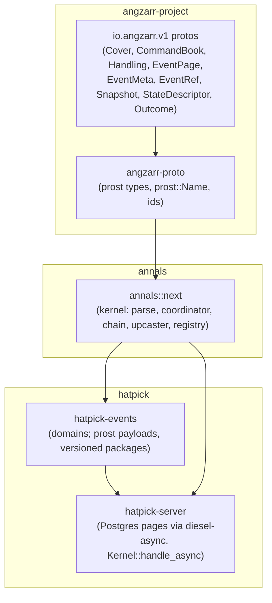

# The audited kernel on angzarr's proto types: design

Status: **implemented** in `crates/annals/src/next/`, pinned by the tests
beside it (`*.test.rs`). It is annals' one kernel.

The wire contract is angzarr's protos on angzarr-project's spec line
(`spec/20261019-draft`, the crate pinned at **4be6a68**): `EventMeta.causation`
is the event's direct cause, with one arm, `command_id` (a process manager
is a domain whose inputs are commands and facts, so no event is caused by
another event); one `command_id` per command, deduplication on the events,
no actor, `StateOptions`/`StateDescriptor`, commands may be upcast;
and the record in angzarr's `docs/design/audit-meta/` (`decision-log.md`,
`idempotency.md`, `annals-divergence.md`) and
`docs/guide/state-and-conflicts.md`.

**Causation is the direct cause** (angzarr decisions 13.1 and 13.3). An
event's `EventMeta.causation` names what produced it: its command
(`command_id`, every command's event, a policy's and a fact's included).
A policy's command still names its trigger in
`CommandPage.causation_id`, the command's own causation (transport and
trace metadata, and the input its derived id hashes), but that is never
copied onto its events: the trigger-to-command edge belongs in tracing and
logs. There is no re-run switch: a reaction's id never names a rules
version, so a re-run deduplicates, and repairs are new commands (decision
13.4; see [Reactor re-runs](#reactor-re-runs)).

## Why

People choose event sourcing for different reasons; here the main reason is
**auditability**. Every change should answer when it was made, in which
workflow, why (which command, and what caused it), and under which rules.
Replay should reproduce exactly what was seen at the time. Who made it is a
security question, answered by a separate security log, not by the events.
An architectural review of the root kernel found gaps in exactly those
places:

| ID | Finding | Resolution here |
|---|---|---|
| A1 | `Envelope` holds only seq, cause and event: no when, no why. Consumers put metadata in the payload (hatpick's `Stamp`). | Every event carries angzarr's `EventMeta`, stamped by the kernel. Business code emits payloads only. [Metadata](#metadata) |
| A2 | `cause` is only within a stream; there is no correlation id. | Every event names its direct cause, its command; a reaction command names its trigger as its own `causation_id`; correlation is always set and kept through every reaction. [Identification](#step-2-identification), [Metadata](#metadata) |
| A3 | `Header.rules` is a free string replay never checks. | The rules version is registered, stamped per event, resolved by a `Rulebook` at replay, and invalidates snapshots. [Rules versions](#rules-versions) |
| A5 | `Header.schema` is unused; there is no upcasting. | A payload's type URL is its version. Old types are upcast by type URL, strictly, events at read and (discouraged) commands before decode. [Decode](#step-5-decode-then-decide-or-ingest) |
| A6 | Events emitted before a rejection stay in the `Stream`. | Decide is pure and stages its events; a rejection leaves nothing. |
| B1 | The "policy" is a stateless policy; the target-contiguity invariant is undocumented; `backlog` replays the source once per target. | Policies and projections share one base; the invariant is documented and checked; the backlog is one pass. [Reactions](#reactions-and-the-chain) |
| B2 | `Projection::on` gets no stream identity or position. | Every reaction gets a `Committed`: the cover, the sequence, the metadata, the event, the state just after. |
| B6 | The store port is synchronous, whole-stream, `u64`-keyed; `read -> Option` hides I/O failure. | Sync and async ports over opaque pages keyed by `Cover`, a unit of work, `read_from`, `find_command`, continuity checks; `StoreError` separates conflict, caller bug, unreadable and unavailable. [The store port](#the-store-port) |
| B8 | Kernel faults are folded into business rejections. | `Failure` keeps the rejection apart from malformed input, kernel faults and failures down the chain, each classified for recovery. [Errors](#errors-and-recovery) |

## Layering



- **angzarr owns the wire contract.** annals defines no wire schema of its
  own for the kernel's events: its types are angzarr-proto's.
- **annals operates on the proto types directly.** The kernel depends on
  angzarr-proto and handles `v1::Cover`, `CommandBook`, `EventPage`,
  `EventMeta`, `EventRef`, `Snapshot`, `Uuid`, `ConflictResolution`,
  `StateDescriptor` and `AngzarrDeadLetter` as generated. There is no
  parallel stream key, event id, book, metadata, provenance, origin or UUID
  type, and so no mapping layer. Dependency-freeness was given up for this,
  deliberately: a mapping layer is a second home for every value, and every
  second home is a place for the two to disagree.
- **annals-angzarr is folded into the kernel.** What it held that was more
  than mapping lives on in `annals::next`: the `Payload` trait, `pack`,
  `type_name` and `Decoder`; the `Upcaster` (a mirror of angzarr-router's
  `UpcasterDispatch`), now also for commands; the `Registry`, now also the
  mirror of `ComponentDescriptor.state`; and the golden replay fixtures. The
  opaque-row store adapter (`Opaque`, `Stored`) is gone: the store port
  itself is opaque now. The id helpers are angzarr-proto's own
  (`angzarr_proto::ids`, re-exported as `annals::next::ids`). One crate, not
  two, because with no mapping left the adapter would be a crate of
  re-exports.
- **annals is the in-process runtime**, embedded in hatpick's server. A
  chain's staged events across streams go into one database transaction.
  hatpick calls annals directly, in process: there is no HTTP or gRPC layer
  into annals, so no caller outside the process can deliver a reaction.
- **annals is not angzarr.** They share the protos, some code and their
  intents. Where the execution models differ, annals' choice is deliberate
  and listed under [Divergences](#divergences-from-angzarr).
- **Storage is opaque**: the encoded page as written and the metadata as
  typed columns. Typed views are projections; in hatpick they are replayed
  on read.

## Design constraints

- **annals does no I/O**, keeps no infrastructure and never retries. Its
  failures say whether to retry (`Recovery`), and a retry is always safe
  (it starts at the deduplication lookup).
- **Pure and deterministic.** No clock, no randomness, no I/O and no
  hash-map iteration in the kernel (maps keyed by `Cover` are lookup only,
  since prost types have no ordering). The application samples the instant
  and mints the UUIDv7 a client's command without an id is given
  (`Sampled { now, command_id }`). UUIDv5 derivations are angzarr-proto's.
  The conflict nonce is a counter.
- **The kernel stays synchronous.** The only async parts are the async store
  port and the handler over it, with native `impl Future` in traits.
- **MSRV 1.85** (prost 0.14). **annals builds for
  `wasm32-unknown-unknown`**, angzarr-proto included; `just wasm` checks it.
- **Must not preclude hash chaining** (deferred). Stored pages are never
  rewritten; upcasting happens on read; metadata is deterministic; no
  personal data is in an event.

## The pipeline

One command, end to end, in angzarr's normative order (`types.proto`, the
`handling` region). Each step's output type is the next step's only input,
so the order cannot be skipped or reordered:

```text
CommandBook ─check──▶ Checked ─identify──▶ Identified ─deduplicate──▶ Deduplicated
                                                         ├─ Duplicate { events }            (answer: DUPLICATE)
                                                         └─ Novel ─load──▶ Contextual
                                                                     ─decode::<D>──▶ Prepared<D> ─decide──▶ Decision<D>
```

1. **Validate** (`check`): domain-blind, everything at once.
2. **Identify** (`Checked::identify`): command id, correlation, causation.
3. **Load, then deduplicate** (`deduplicate`): the conflict
   resolution, the snapshot and events are loaded **first**; then, does the
   stream already hold events with this command id? They are the answer.
4. **Resolve** (`load`): the expected sequence stamped or
   checked against the head step 3 loaded (STRICT's stale refusal is
   here), the window and nonce.
5. **Decode, then decide or ingest** (`prepare`, `Prepared::decide`):
   typed, upcast, strict; the body arm picks decide or
   ingest; the kernel stamps the events.

Steps 3 to 5 are the kernel's own (`pub(crate)`): the chain runs them, and
`Kernel::handle` is the one entry.

**The load comes before the lookup**, so a concurrent commit of the same
command cannot slip between them (see *Races* below). **Deduplication
comes before the sequence check**, so a retry of an applied
command whose expected sequence is now stale is answered DUPLICATE, never
stale. **Validation comes before deduplication**, so a malformed retry of an
applied command is still malformed. **Decoding comes after both**, so an
unknown command type is refused only for a command that is new and current.

## Step 1: one check

```rust
pub fn check(book: CommandBook, registry: &Registry) -> Result<Checked, Malformed>;

impl Checked {
    pub fn cover(&self) -> &Cover;            pub fn domain(&self) -> &str;
    pub fn root(&self) -> &Uuid;              // present, 16 bytes
    pub fn edition(&self) -> Option<&str>;    // None: main; never Some("")
    pub fn body(&self) -> &Body;              // Command { payload } | Fact { payload, source }
    pub fn payload(&self) -> &Any;
    pub fn command_id(&self) -> Option<&Uuid>;       // the sender's, 16 bytes if set
    pub fn correlation_id(&self) -> Option<&Uuid>;
    pub fn expected_sequence(&self) -> Option<u64>;
    pub fn conflict_resolution(&self) -> Option<ConflictResolution>;   // supported if set
    pub fn is_policy_command(&self) -> bool;
    pub fn identify(self, sampled: &Sampled) -> Identified;
}
```

`check` is **the one place a `CommandBook` is checked**. It takes the book
apart once; what it returns holds the required parts outside their prost
`Option`s, so nothing downstream unwraps one. The accessors that stay
`Option` are the sender's genuine choices. `Body` attaches `fact_origin` to
the fact arm, so a fact's source is never optional.

**Domain-blind.** `check` knows no domain's types. It asks the `Registry`
only what angzarr's coordinator reads off a `StateDescriptor`: is
`cover.domain` registered, and which resolutions does its state support.

**Malformed**, in the order tried (the first that applies is the answer):
no cover; an unregistered domain; no root; a root that is not 16 bytes; a
set empty edition; no page; no body; no payload; a set command or
correlation id that is not 16 bytes; a causation from a client
(`CausationFromOutside`); for a policy's book, ids of its own
(`IdOnPolicyCommand`), a fact (`FactFromPolicy`) or handling
(`HandlingOnPolicyCommand`), or a trigger that cannot name an id (`BadTrigger`);
a fact without `fact_origin`; an empty `external_id`; a command with a
`fact_origin`; a fact whose `command_id` is not its derivation; a fact with
**any** handling field (`HandlingOnFact`); a `conflict_resolution` value the
build does not know; a resolution the domain's state does not support
(COMMUTATIVE on a state without conflict units, above all). **An empty
`Handling` is unset**: the same as none.

**No causation from outside.** `check` is the client entry. The kernel's
chain builds its policies' books itself and checks them through a
crate-private entry (`check_policy_command`) that applies the same checks plus
the reaction rules and derives the command id from the trigger. annals
needs no authentication for this: no one outside the process can call it.

## Step 2: identification

```rust
pub struct Sampled { pub now: Timestamp, pub command_id: Uuid }   // the application's v7

impl Identified {
    pub fn command_id(&self) -> &Uuid;            // never absent
    pub fn correlation_id(&self) -> &Uuid;        // never absent
    pub fn causation_id(&self) -> Option<&EventRef>; // the command's (CommandPage), never its events'
    pub fn meta(&self, recorded_at: Timestamp, rules_version: &str) -> EventMeta;
    pub fn to_book(&self) -> CommandBook;         // ids filled: for a dead letter or an audit line
    // and the Checked accessors
}
```

| Kind | `command_id` | `correlation_id` | `causation_id` |
|---|---|---|---|
| a client's command | as sent, else `Sampled::command_id` (a UUIDv7 the application minted) | as sent, else the command id | none |
| a fact | `ids::fact_command_id(external_id)` (UUIDv5; a sent one must equal it) | as sent, else the same value (`ids::fact_correlation`) | none |
| a policy's command | `ids::reaction_command_id(trigger, component, index)` (UUIDv5) | the trigger's | the trigger's `EventRef` |

`component` is `Policy::NAME`; `index` is the order's place among those
the trigger set off for that policy. The `causation_id` column is the
command's own (`CommandPage.causation_id`); `Identified::meta` stamps the
events with `causation.command_id` only. Identification is infallible: the
check refused everything that could make it fail. Text forms of ids exist
only at display and input (`Display`/`FromStr` on `v1::Uuid`).

## Step 3: deduplication

**By `command_id`, on the events.** There is no key store, no claim, no
fingerprint and no commands table. "Already applied?" means "the addressed
stream holds events whose `EventMeta.command_id` is this one":
`EventStore::find_command(stream, command_id)`, over a non-unique index on
(stream, command_id). On a hit the answer is `Handled::Duplicate` with those
events, in sequence order (angzarr's DUPLICATE), and nothing below runs.
Because the id is written with the events, the record of having applied a
command is atomic with its effects, with nothing else to keep consistent.
(KurrentDB deduplicates appends by event id the same way, and Equinox keeps
processed ids in the stream.)

**Accepted costs** (the first two are angzarr's decision 12.2, the same in
both runtimes; the third is annals' own, divergence 10):

- **A decision that produced no events leaves nothing to find**, so a
  redelivery of it is decided again, against the stream as it is then
  (Equinox-style), and answered APPLIED. Pinned by
  `a_zero_event_decision_is_decided_again`.
- **A command id reused for a different command goes undetected**: it is
  answered DUPLICATE with the first command's events. Payloads are not
  fingerprinted; a client mints a new id for every new command.
- **Deduplication lasts as long as the stream.** There is no expiry or
  retention window, but a store that opts in can purge a stream (see
  [Purging a stream](#purging-a-stream)), and a purge deletes its command
  ids with its events. A command redelivered after its stream is purged
  finds nothing, so it is decided again against the stream as it is then;
  a creating command re-creates the stream, from sequence 0. An
  application that purges bounds this by purging only streams quiet for
  longer than any redelivery it expects to see. Pinned by
  `a_creating_command_redelivered_after_a_purge_creates_its_stream_again`.

Rejections leave nothing, so a rejected command's retry runs again. Within
a chain, each policy command takes step 3 too (cheap, and uniform);
the chain's staged events count, so a chain never applies one command
twice.

**Races.** Two deliveries of one command race on the append's sequence
check: one commits; the other's commit fails `StoreError::Conflict`
(`Recovery::Retry`). Run again with the same command id in a fresh unit of
work, it starts at step 3 and finds the winner's events. **This needs the
load before the lookup**, under READ COMMITTED: had the lookup run first, the
original could commit between it and the load, and the retry, finding
nothing and loading the new head, would append after the original's events
with no conflict: applied twice. Loading first, a commit after the load is
either seen by the lookup or makes this delivery's append fail its expected
head. Pinned by `a_retry_racing_its_original_commit_is_never_applied_twice`
(a store that lets a commit land after the first read).

## Step 4: load and conflict resolution

```rust
pub(crate) struct Contextual {          // angzarr's ContextualCommand, in process
    resolution: ConflictResolution,     // never UNSPECIFIED
    expected: u64,                      // the book's, or the head
    head: u64,
    snapshot: Option<Snapshot>,
    pages: Vec<EventPage>,              // the window is expected .. head
    nonce: Option<Nonce>,
    /* the command, the last recorded_at */
}
```

The **in-process coordinator** is the chain's steps 3 and 4, over the
application's unit of work, domain-blind like angzarr's: they see covers,
pages and the registry. There is no service and nothing is sent.

**The resolution** (`Registry::resolve`, angzarr's precedence, highest
first): the book's `Handling.conflict_resolution`; the domain's
configuration for the command's type (`Domain::CONFLICT_RESOLUTION_BY_COMMAND`,
by full type name, looked up by the command's current type after upcasting,
so an old command type has its current type's setting; a payload whose
upcast fails is looked up as sent, and decoding reports the failure); the
domain's own (`Domain::CONFLICT_RESOLUTION`); the
built-in default, **COMMUTATIVE where the state declares conflict units,
otherwise STRICT**. Configuration a state does not support is refused at
registration (`Misconfigured::UnsupportedResolution`); a book's request, at
step 1.

**The load.** The newest snapshot, if usable (its state's type URL is the
registered state's and its rules version the current one; otherwise it is
discarded and the stream replayed from 0, never migrated), then the events
after it to the head. Under AGGREGATE_HANDLES and COMMUTATIVE the snapshot
used is **at or below expected−1**, so no part of the window is hidden in
snapshot state; a newer one is not used.

**The expected sequence.** Absent: stamped with the head, and the command
can never be stale. Present:

- **STRICT**: it must equal the head, else `KernelError::Stale` (angzarr's
  ABORTED), before anything is decoded.
- **AGGREGATE_HANDLES**: the events from it to the head are the window;
  decide receives them with a `Nonce` and must give the nonce back
  (`Tx::resolve_conflicts`), or the command fails as stale
  (`KernelError::Unresolved`).
- **COMMUTATIVE**: the same window and nonce; the kernel itself resolves
  (below).
- Past the head: stale under every resolution.

**COMMUTATIVE.** decide runs on the head, so every invariant it checks
holds against the window's effects. Then `window = changed(state at
expected, head)` and `mine = changed(head, head with the command's
events)`, both by the state's generated `State::changed`; the events are
kept iff the two do not overlap (`Units::overlaps`: equal units or a prefix
at a `.`/`[` boundary; a wildcard overlaps any non-empty set; an empty set
nothing), else the command is stale. Unmarked fields conflict with
everything (the fail-safe wildcard), so an unmarked change only makes
COMMUTATIVE stricter.

**The `State` trait** is what angzarr's generator emits for a state message
from its `(io.angzarr.v1.state)` option and `(io.angzarr.v1.conflict)` field
markers:

```rust
pub trait State: Default + Clone + Send + 'static {
    type Snapshot: prost::Message + prost::Name + Default;   // the wire form a snapshot carries
    fn to_snapshot(&self) -> Self::Snapshot;
    fn from_snapshot(snapshot: Self::Snapshot) -> Result<Self, Report>;  // a wire value need not be a valid state
    fn descriptor() -> StateDescriptor;     // type URL (the snapshot form's) + the full resolved list of resolutions
    fn changed(before: &Self, after: &Self) -> Units { Units::everything() }
}
```

The state is a domain type and its snapshot form the prost message: a
snapshot that decodes but is not a valid state (`from_snapshot` refuses it)
is unreadable, `PayloadError::Invalid`. A state that is itself a prost
message is its own snapshot form. `Registry::register::<D>` fills its entry
from `D::State::descriptor()`, as angzarr's `registry.register::<D>()` fills
`ComponentDescriptor.state`, and refuses a descriptor whose type URL is not
the snapshot form's. angzarr's generator (backlog CR-1, CR-4) emits the impl;
the test fixtures write it by hand (`src/next/toys.test.rs`).

**The risk of COMMUTATIVE.** No structural diff sees a value derived from,
or meaningful only together with, another unit: a total over items, two
fields that must change together. A stale caller's intent can then merge
when it should not. That is a modelling failure: put dependent data in one
unit (mark the containing message without `descend`), derive the value in
decide or a projection rather than storing it, or configure that command
type STRICT. angzarr's `docs/guide/state-and-conflicts.md` shows the
failures and their fixes; it applies to annals unchanged.

## Step 5: decode, then decide or ingest

```rust
pub trait Domain: Sized + 'static {
    type State: State;
    type Command: Payload + Send + 'static;
    type Fact: Payload + Send + 'static;           // Infallible: none
    type Event: Payload + Clone + Send + Sync + 'static;
    type Rejection: Diagnostic + Send + 'static;
    type Rules: Send + Sync + 'static;
    const NAME: &'static str;                      // the Cover.domain; the registry key
    const CONFLICT_RESOLUTION: Option<ConflictResolution> = None;
    const CONFLICT_RESOLUTION_BY_COMMAND: &'static [(&'static str, ConflictResolution)] = &[];
    fn decide(cmd: &Self::Command, tx: &mut Tx<'_, Self>) -> Result<(), Self::Rejection>;
    fn ingest(state: &Self::State, fact: &Self::Fact, ctx: &IngestCtx<'_, Self>) -> Vec<Self::Event>;
    fn apply(state: &mut Self::State, event: &Self::Event, rules: &Self::Rules);
}
```

**Decode.** The snapshot's state, every event and the command's payload go
through the domain's `Upcaster` by type URL, then through `Payload::from_any`.
Strict: an event type nothing upcasts or decodes is
`StoreError::Unreadable` naming its type URL (never skipped); a command or
fact type is `KernelError::UnknownType` naming its type URL (angzarr's
INVALID_ARGUMENT). Golden replay fixtures (`ReplayFixture`,
`assert_replay_fixtures`) and `Registry::check` catch a missing upcaster in
CI first.

**Commands may be upcast**, through the same chain (`Upcaster::upcast_command`).
**Discouraged**: it hides stale clients (they keep working, so nobody
upgrades them) and is machinery for data that is never stored. Prefer an
additive change, or decoding both versions in the domain for a transition;
upcast a command only as a migration aid with a planned removal. Event
upcasters are permanent.

**Decide** is pure, in a staging `Tx`: it reads `state()`, `rules()`,
`rules_version()`, `stream()`, `recorded_at()`, `command_id()`,
`correlation_id()`, `causation_id()`, `conflicts()` (AGGREGATE_HANDLES
only), emits through `emit`, and its events are kept only if it returns
`Ok`. It may reject at any point; nothing staged is kept. No `Ctx`: random
values are sampled by the caller into the command.

**Ingest** is infallible by type: a fact already happened, so an awkward
one is recorded (a payment for an unknown order becomes an event that says
so), never refused. It reads a **read-only context**:

```rust
impl IngestCtx<'_, D> {
    pub fn stream(&self) -> &Cover;            pub fn recorded_at(&self) -> Timestamp;
    pub fn command_id(&self) -> &Uuid;         pub fn correlation_id(&self) -> &Uuid;
    pub fn source(&self) -> &FactOrigin;       // external_id, description
    pub fn rules(&self) -> &D::Rules;          pub fn rules_version(&self) -> &str;
}
```

A fact is never checked against a sequence nor conflict-resolved: it is
always stamped at the head. A panicking ingest is a bug: the kernel catches
it, fails the chain (`KernelError::IngestPanicked`, `Recovery::Bug`),
writes nothing and logs a [dead letter](#dead-letters-a-logger). On a
`panic = "abort"` target the process aborts instead; nothing is written
either way.

**Business output is payloads only.** The kernel builds the pages: their
sequences and their `EventMeta` (`Identified::meta`).

## Metadata

Every event carries angzarr's `EventMeta`, the same in both runtimes:

| Field | annals stamps |
|---|---|
| `causation` | the event's direct cause, `command_id`: the producing command's (step 2: a client's, a fact's or a policy's), its deduplication key |
| `fact` | the fact's `FactOrigin`, for a fact; unset otherwise |
| `correlation_id` | the producing command's; never unset |
| `recorded_at` | `max(Sampled::now, the stream's last recorded_at)`: non-decreasing per stream, one instant per chain, so as-of-time reads are prefixes |
| `rules_version` | the registered rulebook's current version |

**No trigger on a reaction's events**: a policy's command names its trigger
(`CommandPage.causation_id`), its events name the command. The edge from
trigger to command is the command's own causation, for tracing. Readers find a reaction's events by
correlation and group them by `command_id`.

**No actor**, anywhere: who did it belongs in the deployment's separate
security log, written by the application with the command id, so erasing
or rotating personal data never touches an event. **No base sequence**: the
events of one command are grouped by `command_id`, and the version decided
against is the first one's sequence. Business time (a deadline, a draw's
instant) belongs in the payload, where `apply` sees it; decide copies
`tx.recorded_at()` there when the domain needs it.

A decoded event is an `Envelope<E>`: a checked `EventPage`, its metadata's
required fields outside their `Option`s (`causation()`, the generated
`v1::event_meta::Causation`; `correlation_id()`, `recorded_at()`,
`rules_version()`; `command_id()`, the one arm of `causation()`), its
payload decoded. A stored page
whose meta lacks one is `ReplayError::IncompleteMeta`.

## Process managers

A process manager is a domain (angzarr decision 14.31). Its inputs are
commands, which policies send it, and facts (timeouts, webhooks); it never
subscribes to another domain's events. So annals needs nothing of its own
for one: its commands and facts take the five steps like any domain's, its
events name the command or the fact's derived id as their cause, and its
deduplication is `find_command`'s, by command id and fact id.

## Rules versions

A rules version is a short label the domain's author chooses (`"v3"`) and
bumps whenever decide, ingest or apply semantics change. The domain
registers a `Rulebook` (the current version and every older one its logs
name); the current version is stamped on every event. In annals it is
**load-bearing**: replay folds each event with the rules its version names
(`ReplayError::UnknownRules` if the rulebook lacks it), and a snapshot
folded under another version is discarded. A rules change therefore never
needs a snapshot migration.

## Reactions and the chain

```rust
pub trait Policy {
    type Source: Domain; type Target: Domain; type TargetId: Ord + Clone;
    const NAME: &'static str;           // the component its command ids derive from
    fn targets(committed: &Committed<'_, Self::Source>) -> Vec<Self::TargetId>;   // event + state
    fn root(target: &Self::TargetId) -> Uuid;   // covered in the source's edition
    fn command(target: &Self::TargetId, c: &Committed<'_, Self::Source>) -> <Self::Target as Domain>::Command;
}
pub trait Projection<D: Domain> { fn project(&mut self, c: &Committed<'_, D>); }

let routes = Routes::new().policy::<ListToDrawSystems>();   // built once, no store type
let kernel = Kernel::new(&registry, &dead_letters);          // .limit(n), default 8
kernel.handle::<List, _, _>(unit, &routes, book, &sampled, &mut projections)?;   // -> Handled
```

- **Reactions emit commands only.** Facts come from outside the system, so
  there is no reaction-injected fact and no `Translation`. A policy's
  command is a `CommandBook` the kernel builds (the target's cover, the
  command packed as `Any`, no ids, no handling), checked and identified
  from its trigger, then taken through steps 3 to 5 in its target.
- **The atomic chain.** Every policy routed for a source domain runs on the
  staged events, depth first; a later step sees the staged state (and
  command ids) of any stream an earlier step touched. Nothing is appended
  until the whole chain has succeeded; then every staged stream is
  appended, each against the length it was loaded at, and the unit of work
  committed: one transaction. **A reaction's rejection fails the origin**
  (`Failure::Downstream { path, error }`, the path a list of
  `Step { stream, cause }`). Projections run on committed events only;
  their failures are reported (`Recorded::projector_failures`), never
  raised.
- **`Routes` names no store type**: each entry owes and checks a policy's
  orders, purely, and the chain reaches the target's typed step through the
  registry by the target's domain name. So routes are built once and serve
  the sync and the async handler alike.
- **Depth limit** (`Kernel::limit`, default 8): `KernelError::ChainTooDeep`,
  the cycle check for a chain that may legitimately revisit a stream.
- **Fan-out**: several policies routed for one source domain each run for
  every event the chain stages in it, in the order they were registered,
  in the one chain and unit of work.
- **Targeting from the event**: `targets()` receives the committed event
  (and the state after it), so a policy may forward only some events to a
  target. A target is owed exactly the events it was targeted for, each
  with its trigger, in the same chain, so a target is never behind its
  source and there is no catch-up: a policy always runs inside the chain.
- **Reactor re-runs always deduplicate** (see
  [below](#reactor-re-runs)).
- **Propagating one aggregate into another** (hatpick's list into its draw
  systems) is a policy whose target records the change in its own events.
  A command to a retired or never-created target is a policy bug: decide
  refuses it, and the list edit fails whole, loudly. So retiring a draw
  system goes through the list, and the policy targets from the event.
- **Read models are replayed on read** (`Stream::dispatch` from 0); none is
  persisted.

### Reactor re-runs

There is no switch (angzarr decision 13.4). A reaction's command id is
UUIDv5(trigger, `Policy::NAME`, index) and names nothing else: not a
rules version, not the policy's code. So:

- **A re-run deduplicates.** Re-delivering a trigger re-derives the same
  ids, and
  every target answers DUPLICATE with the events the first run wrote, even
  if the policy would now decide differently (the "reused id with another
  payload" cost, applied to reactions).
- **Repairs are new commands.** To fix what a buggy policy did, issue new
  commands, with new ids, that make the corrections; their events append
  after the buggy-era ones. **History is never rewritten.** angzarr plans
  standard re-drive commands (its backlog RD-1); annals would adopt them
  as ordinary commands.
- **Inside a chain** a reaction runs exactly once per trigger, atomically
  with it, so the question does not arise there.

## The store port

```rust
pub trait EventStore {
    fn append(&mut self, stream: &Cover, expected: u64, pages: &[EventPage]) -> Result<u64, StoreError>;
    fn read_from(&mut self, stream: &Cover, from: u64) -> Result<Option<Slice>, StoreError>;
    fn read(&mut self, stream: &Cover) -> Result<Option<Slice>, StoreError>;      // from 0
    fn find_command(&mut self, stream: &Cover, command_id: &Uuid) -> Result<Vec<EventPage>, StoreError>;
    fn covers(&mut self, domain: &str) -> Result<Vec<Cover>, StoreError>;   // a domain's streams: main first, then by edition, each by root
    fn read_snapshot(&mut self, stream: &Cover) -> Result<Option<Snapshot>, StoreError>;  // none by default
    fn write_snapshot(&mut self, stream: &Cover, snapshot: &Snapshot) -> Result<(), StoreError>;
}
pub trait UnitOfWork: EventStore { fn commit(self) -> Result<(), StoreError>; }
pub trait Store: EventStore { type Unit<'s>: UnitOfWork + Send where Self: 's; fn begin(&mut self) -> Self::Unit<'_>; fn commit_position(&mut self) -> Result<u64, StoreError>; }
pub trait AsyncStore: AsyncEventStore { type Unit<'s>: AsyncUnitOfWork + Send where Self: 's; fn begin(&mut self) -> impl Future<Output = Self::Unit<'_>> + Send; fn commit_position(&mut self) -> impl Future<Output = Result<u64, StoreError>> + Send; }
pub struct Slice { pub stream: Cover, pub next_sequence: u64, pub last_recorded_at: Option<Timestamp>, pub pages: Vec<EventPage> }
// AsyncEventStore / AsyncUnitOfWork: the same, Send futures; Ready<S> serves a sync store async.
```

**`commit_position`** is the store's commit position: global (one for the
whole store, every stream and every handle on its database) and monotonic.
Every event committed before it is answered lies below it and every event
committed after it at or above it, so it rises with every commit that
appends an event and never falls, a purge included. It is commit order, not
`recorded_at`: an event sampled before the position was read but committed
after lies above it. It is what an edition's create records, so the edition
reads exactly main's events committed before the create (angzarr's EA-3;
the registry itself is not built yet, see *Not now*). A SQL store keeps it
in a one-row table raised inside each append's transaction and stamps every
event row with the position it landed at.

**`covers`** enumerates a domain's streams: what a projector reads, with the store as the collection's scope (an application keeps
one store per collection, as ctxloom keeps one per project). It promises no
order across streams beyond its listing order; a projector numbers its own
changes. **The store contract** (`annals::next::contract`, feature
`contract`) is every store's tests, its checks written once over the async
port: `store_contract!(fresh_store)` runs them on a synchronous store through
`Ready`, `async_store_contract!(#[tokio::test], fresh_store)` under the
caller's runtime; one test per check. `InMemoryStore` runs it in annals'
own tests. A store that purges also runs the opt-in purge section:
`store_contract!(purge, fresh_store)`,
`async_store_contract!(purge, #[tokio::test], fresh_store)`. A store that
reads one moment (below) also runs the opt-in read section:
`store_contract!(read, fresh_pair)` on a synchronous store, and an async
store calls each read check with its pair itself. A store that answers a
change token (below) also runs the opt-in watch section:
`store_contract!(watch, fresh_store, fresh_pair)`, or
`async_store_contract!(watch, #[tokio::test], fresh_store)` with the pair
check called by the store's tests. The commit position is held to a check
in the base section and one in the purge section, and a store with two
handles on one database calls the two-handle check itself.

**Opaque.** A store holds angzarr's pages as written and never decodes a
payload; upcasting is the kernel's, on every read. The Postgres shape:

| Column | From |
|---|---|
| `domain`, `edition`, `root` | the cover; `edition` NULL for main; `root` a `uuid` |
| `sequence` | `EventPage.sequence` (`bigint`; u64 in range) |
| `type_url` | the payload's type URL as written, before any upcast |
| `page` | the `EventPage` bytes as written |
| `command_id` | `EventMeta.causation.command_id`, `uuid` |
| `correlation_id` | `EventMeta`'s, `uuid` |
| `external_id` | `EventMeta.fact.external_id`; NULL unless a fact produced it |
| `recorded_at`, `rules_version` | the rest of `EventMeta` |

Unique on (`domain`, `edition`, `root`, `sequence`); a **non-unique index on
(`domain`, `edition`, `root`, `command_id`)** for `find_command`. The columns
and the page's `EventMeta` hold the same metadata; the page is what an
angzarr reader is served. A store answers the stream, `None` (no such
stream), a refusal it is sure of (`Conflict`, `Discontinuous`) or a failure
(`Unavailable`, `Unreadable`); an I/O failure is never "no such stream".
Snapshots live beside the events, the newest per stream. The async port's
futures are `Send`; a single-threaded adapter implements the sync port.

### Purging a stream

```rust
pub trait Purge: EventStore { fn purge(&mut self, stream: &Cover) -> Result<u64, StoreError>; }
pub trait AsyncPurge: AsyncEventStore { fn purge(&mut self, stream: &Cover) -> impl Future<Output = Result<u64, StoreError>> + Send; }
```

A purge deletes a stream's events, its snapshot, and the command ids
recorded with its events, in one unit of work: all of it or, failing, none.
It answers how many events it deleted (0 for no such stream). Afterwards
the stream does not exist: it reads `None`, is in no `covers`, and an
append starts it again at expected 0. It is the one deletion annals has,
so it is opt-in: a store implements `Purge` (or `AsyncPurge`) beside its
other traits, on the store and on its unit of work, and a store that does
not stays append-only by type, nothing in `EventStore` reaching a delete.
`Ready` serves a synchronous `Purge` as an `AsyncPurge`. On a unit of work
a purge lands at commit, like an append, and reads through the unit see it
at once; an append after it in the same unit starts the stream again.

A purge and an append to the same stream serialize like two appends: the
one that commits second sees the first. An append committed before the
purge is purged with the rest; an append whose expected length was read
before the purge committed fails `StoreError::Conflict` against the empty
stream, and run again it starts a new stream from sequence 0. A purge
undoes deduplication for the stream (step 3's accepted costs).

### Reading one moment

```rust
pub trait ReadUnit {
    fn covers(&mut self, domain: &str) -> Result<Vec<Cover>, StoreError>;
    fn read_from(&mut self, stream: &Cover, from: u64) -> Result<Option<Slice>, StoreError>;
    fn read(&mut self, stream: &Cover) -> Result<Option<Slice>, StoreError>;   // from 0
}
pub trait ReadStore { type Reads<'s>: ReadUnit + Send where Self: 's; fn begin_read(&mut self) -> Self::Reads<'_>; }
pub trait AsyncReadUnit {
    fn covers(&mut self, domain: &str) -> impl Future<Output = Result<Vec<Cover>, StoreError>> + Send;
    fn read_from(&mut self, stream: &Cover, from: u64) -> impl Future<Output = Result<Option<Slice>, StoreError>> + Send;
}
pub trait AsyncReadStore { type Reads<'s>: AsyncReadUnit + Send where Self: 's; fn begin_read(&mut self) -> impl Future<Output = Self::Reads<'_>> + Send; }
```

Each read a store answers is one moment: a `read_from` never gives a
length its pages do not reach, whatever commits while it runs. A run of
reads is not: a reader that lists `covers(domain)` and then reads each
stream would show each stream as of its own read, and a stream purged
between the listing and its read would be listed and then missing. A
reader that shows several streams together takes a **read-only unit of
work** instead: `begin_read` opens one, and every read through it sees the
store as it stood when it began. A write or a purge committed after,
through any handle on the database, is not seen; a stream purged after is
read whole. The unit writes nothing and takes no write lock, so it waits
on no writer and no writer waits on it, and a store opened only for
reading can open one. Dropping it ends it.

It is opt-in, like purging, and needs no other store trait. `Ready`
serves a synchronous `ReadStore` as an `AsyncReadStore`. `InMemoryStore`'s
unit borrows the store, so nothing changes under it. The contract's read
checks take a reader and a writer on one store and write through the
writer while the reader's unit is open, after it began and between its
reads, so a unit that reads live fails them.

A store's units, read-only and of work, are where a stream in an edition
the store never created is refused (angzarr's EA-2):
`StoreError::UnknownEdition`, NOT_FOUND, and such a stream is not listed.
No store keeps an edition registry yet, so none has created an edition:
every read unit reads main alone, and every unit of work reads, appends and
snapshots main alone, so a command naming an edition is refused rather than
given a stream with no main history. The store's own operations, outside a
unit, take any edition. The contract checks a read unit's refusal in the
read section and a unit of work's in the base one.

On SQLite a store's file is kept in WAL: without it a read of one moment,
or a read-only unit of work, would wait on a writer and hold one up. So
reading a store needs a directory the reader can write, even though it
writes nothing: SQLite reads a WAL file through its `-wal` and `-shm`
files beside it and makes them if they are absent. In a directory the
reader cannot write, `open_existing` opens the file only while a writer
holds it open; once the last writer closes it, the open fails. A store on
a read-only mount is the caller's to arrange with its own tooling (a copy
somewhere writable, say); annals does not read one.

### Watching for commits

```rust
pub struct ChangeToken(/* opaque */);   // Copy + Eq + Hash + Debug; ChangeToken::new([u64; 2]) for a store
pub trait Watch { fn change_token(&mut self) -> Result<ChangeToken, StoreError>; }
pub trait AsyncWatch { fn change_token(&mut self) -> impl Future<Output = Result<ChangeToken, StoreError>> + Send; }
```

A watcher (a view kept live as a store changes) would otherwise read every
stream on every poll to learn whether anything moved, which costs as much
as the store is big. Instead it keeps the store's **change token** and asks
for a new one each poll: two equal tokens from one handle mean nothing was
committed between them, through that handle or any other on the store's
database (no append, no unit of work, no purge), so there is nothing new to
read. A changed token says only that something may be new: a token may
also change when nothing a reader sees did (a snapshot, a purge of no such
stream, a unit rolled back), and the watcher reads and finds nothing. It
never errs the other way, so a watcher never misses a commit. Tokens are
compared for equality only, and only from one handle: two connections to
one database may answer different tokens for the same moment.

Asking reads no stream, writes nothing and takes no write lock, so a store
opened only for reading answers it and no writer waits on it. It is
opt-in, like purging, and needs no other store trait; `Ready` serves a
synchronous `Watch` as an `AsyncWatch`. `InMemoryStore` counts its
commits. The contract's watch checks commit through the store itself, and
through a second handle between two of a watcher's reads, and require the
token to change after each and to hold with nothing committed; a store
whose token never changes fails both, and one whose token changes on every
read fails them too.

On SQLite the token is the connection's `PRAGMA data_version` with its
`total_changes()`, read in one statement. `data_version` changes when
another connection commits and never for this connection's own commits;
`total_changes()` counts the rows this connection's own statements
changed. Together they change on every commit from anywhere. Not the
events table's largest rowid: a purge of any stream but the newest leaves
it as it was, and it says nothing of a snapshot.

## Snapshots

A snapshot is angzarr's `Snapshot { sequence, state: Any, rules_version }`,
a framework optimisation, never business data. `Stream::snapshot` makes one
under the current rules version; the application writes it
(`write_snapshot`) when it likes. On load the coordinator uses it only if
`Registry::snapshot_usable` (the state's type URL and the rules version
match the registration), its sequence is below the head (one at or past it
claims events the stream does not hold: a purge left it, or it was written
ahead of them) and, under AGGREGATE_HANDLES and COMMUTATIVE, its sequence
is at or below expected−1. Otherwise it is discarded and the stream
replayed from 0. A snapshot written through a unit of work lands at its
commit, like an append. The floor for the next `recorded_at` comes from the
store (`Slice::last_recorded_at`), not the snapshot.

## Dead letters: a logger

angzarr dead-letters what it cannot deliver and cannot refuse to a caller.
annals is in process and atomic: there is no queue, no store and no replay.
Whatever angzarr would dead-letter fails the chain back to its caller with
nothing written, and the kernel writes one line to the application's
`DeadLetterLog`:

```rust
pub const DEAD_LETTER_PREFIX: &str =
    "DEAD LETTER (almost certainly a bug; nothing was written and nothing will retry):";
pub trait DeadLetterLog: Send + Sync { fn write(&self, line: &str); }
pub fn dead_letter_line(letter: &AngzarrDeadLetter) -> String;   // prefix, component, reason, command
```

Cases: a panicking ingest; a policy's book the kernel built malformed; a
decide under AGGREGATE_HANDLES that never acknowledged its window. **Every
line starts with the prefix**: anything arriving there almost certainly
indicates a problem, so an operator alerts on it. The line is built from
angzarr's own `AngzarrDeadLetter`, so it says what an angzarr DLQ entry
would. annals never answers PARKED.

**Trigger edges are tracing.** No event records the edge from a trigger
to the reaction command it set off (angzarr decision 13.3; angzarr sends it
to OpenTelemetry, its backlog PS-6). In annals the edge is the reaction
command's own causation (`Identified::causation_id`), and its derived id
names the trigger; annals has no tracing dependency and reports it nowhere.

## Errors and recovery

| Error | Meaning | `Recovery` |
|---|---|---|
| `Failure::Rejected(R)` | the domain refused the command | `Business` |
| `Failure::Downstream { path, error }` | a step down the chain failed; nothing appended anywhere | by `StepError`: a rejection `Business`, a malformed policy book `Bug`, else by `KernelError` |
| `KernelError::Malformed` | step 1 refused the book | `Invalid` |
| `KernelError::UnknownType` | a command or fact type the domain does not decode, after upcasting | `Invalid` |
| `KernelError::InvalidPayload` | a command or fact that decodes but is not a valid domain value (`WireError`: a required field absent, an undefined enum value) | `Invalid` |
| `KernelError::Stale`, `Unresolved` | re-read and re-issue | `Retry` |
| `StoreError::Conflict`, `Unavailable` | run again with the same command id (step 3 makes it safe) | `Retry` |
| `IngestPanicked`, `Upcast`, `WrongDomain`, `ChainTooDeep`, `BeforeSnapshot`, `UnregisteredDomain` (a stored stream of a domain the application did not register; an incoming book for one is `Malformed`), `Replay(..)`, `StoreError::Discontinuous`, `Unreadable` | a bug or a misconfiguration | `Bug` |

A duplicate is not an error: it is `Handled::Duplicate`. Each error becomes
a `Diagnostic` with the implementation (codes under `annals-next-*`,
messages in `locales/en-US/annals.ftl`).

## Mapping: identity

There is no mapping left. What annals means by each concept is the proto
type itself:

| Concept | Type |
|---|---|
| stream identity | `v1::Cover { domain, root: Uuid, optional edition }`; main is the unset edition |
| an event's identity; a reaction command's causation | `v1::EventRef { stream: Cover, sequence }` |
| a command or a fact | `v1::CommandBook { cover, page: CommandPage { body: Command \| Fact, command_id, correlation_id, causation_id, fact_origin }, handling }` |
| how to handle it | `v1::Handling { optional expected_sequence, conflict_resolution }` |
| a conflict resolution | `v1::ConflictResolution` |
| a state's capabilities | `v1::StateDescriptor { type_url, StateOptions { conflict_resolutions } }` |
| an event, stored | `v1::EventPage { sequence, meta: EventMeta, payload: Any }` |
| an event's metadata | `v1::EventMeta { oneof causation { command_id }, fact, correlation_id, recorded_at, rules_version }` |
| an event's direct cause | `v1::event_meta::Causation::{CommandId(Uuid), TriggeringEvent(EventRef)}` (`Envelope::causation()`) |
| every id | `v1::Uuid` (16 bytes); text through `ids` at the boundary |
| derived ids | `ids::{compute_root, reaction_command_id, fact_command_id, fact_correlation}` |
| a snapshot | `v1::Snapshot { sequence, state: Any, rules_version }` |
| the answer | `Handled::outcome() -> v1::Outcome { delivery: APPLIED \| DUPLICATE, projector_failures }`; `Handled::books() -> Vec<EventBook>` |
| a dead letter | `v1::AngzarrDeadLetter`, as a log line |
| a payload's version | its type URL (`pkg.v1.Foo` then `pkg.v2.Foo`) |

annals' own types are the ones angzarr has no message for, because they
are execution, not wire: `Checked`, `Identified`, `Contextual`, `Prepared`,
`Envelope` (a checked, decoded page), `Stream`, `Tx`, `IngestCtx`, `Nonce`,
`Rulebook`, `Registry`, `Routes`, `Kernel`.

## Key signatures

```rust
// step 1-2
pub fn check(book: CommandBook, registry: &Registry) -> Result<Checked, Malformed>;
impl Checked { pub fn identify(self, sampled: &Sampled) -> Identified; }
// step 3-5: the chain's own, pub(crate)
async fn deduplicate(port, registry, command: Identified) -> Result<Deduplicated, KernelError>;
fn load(command: Novel, nonces: &mut u64) -> Result<Contextual, KernelError>;
fn prepare<D: Domain>(contextual: Contextual, staged, registry) -> Result<Prepared<D>, KernelError>;
impl<D: Domain> Prepared<D> { fn decide(..) -> Result<Decision<D>, Failure<D::Rejection>>; }
// the whole loop
impl Kernel<'_> {
    pub fn handle<D: Domain, U: UnitOfWork, Ps: Project>(&self, unit: U, routes: &Routes,
        book: CommandBook, sampled: &Sampled, projections: &mut Ps) -> Result<Handled, Failure<D::Rejection>>;
    pub async fn handle_async<D: Domain, U: AsyncUnitOfWork, Ps: Project>(/* the same */);
}
// in memory, no store
impl<D: Domain> Stream<D> {
    pub fn execute(&mut self, book: CommandBook, registry: &Registry, sampled: &Sampled,
        dead_letters: &dyn DeadLetterLog, handlers: &mut [&mut dyn Handler<D>])
        -> Result<Executed<'_, D::Event>, Failure<D::Rejection>>;
    pub fn replay(cover: Cover, pages: &[EventPage], registry: &Registry) -> Result<Stream<D>, KernelError>;
}
// registration
impl Registry {
    pub fn register<D: Domain>(&mut self, rules: Rulebook<D::Rules>, upcaster: Upcaster) -> Result<(), Misconfigured>;
    pub fn resolve(&self, domain: &str, command_type_url: &str, requested: Option<ConflictResolution>)
        -> Option<ConflictResolution>;
    pub fn snapshot_usable(&self, domain: &str, snapshot: &Snapshot) -> bool;
}
```

## Divergences from angzarr

annals is **not** angzarr; the wire meaning is shared, the execution model
is not. This list matches angzarr's `docs/design/audit-meta/annals-divergence.md`.

1. **The atomic in-process chain (intentional).** A command, its events and
   every policy reaction are staged across streams and committed in one
   transaction; **a reaction's rejection fails the origin**. angzarr appends
   one stream per write and runs reactions asynchronously. annals keeps the
   chain because it makes in-process Rust easy: one transaction, no bus, no
   outbox, no retry loop. (Multi-stream units of work are standard
   elsewhere: KurrentDB `MultiStreamAppend`, Marten, Wolverine.)
2. **No transient outbox.** Reactions commit with their trigger; nothing is
   re-sent. Their command ids are still the derived ones, so the audit
   record is identical.
3. **Causation is never accepted from outside**, because nothing outside
   the process can call annals; angzarr needs mTLS-identified framework
   components for the same guarantee. (This is the command's
   `causation_id`; it is never persisted on events, in either runtime.)
4. **The dead-letter queue is a logger**, every line prefixed with its
   warning; there is no PARKED and no replay.
5. **`rules_version` is load-bearing**: replay resolves rules per event, and
   snapshot validity is checked by the domain-blind coordinator through the
   registry (in angzarr, by the client library).
6. **COMMUTATIVE and AGGREGATE_HANDLES resolve in the kernel**, which is
   both coordinator and client library; the nonce is an in-process token,
   not bytes on a `ContextualCommand`.
7. **Configuration lives on the domain** (`CONFLICT_RESOLUTION`,
   `CONFLICT_RESOLUTION_BY_COMMAND`), checked at registration; there is no
   configuration that forbids a `Handling` override.
8. **No edition registry or branching.** A store's own appends accept any
   non-empty edition name without `CreateEdition`, and its streams start
   empty, with no read-through to main; its units, read-only and of work,
   refuse every edition, none having been created, so no command reaches
   one.
9. **`recorded_at` is sampled by the application** once per chain, then
   raised per stream; same guarantee as angzarr's stamp at persist.
10. **A stream can be purged** where its store opts in
    ([Purging a stream](#purging-a-stream)). angzarr's events are
    permanent and its deduplication forever; in annals deduplication lasts
    as long as the stream, and a redelivery after a purge is decided again.

Not divergences (pass 13): `EventMeta` is the same in both runtimes
(`causation`, the event's direct cause; no trigger on a reaction's events,
no actor), and reactor re-runs deduplicate in both, with no switch.

## hatpick changes

**hatpick-events** (pinned to an annals rev; nothing breaks until it moves):

- Events, commands and facts are prost messages with `prost::Name` under
  versioned packages (`hatpick.list.v1`, `hatpick.draw_system.v1`), one
  message per kind; each domain's enums implement `Payload` with a
  `Decoder`. Each domain registers an `Upcaster` (empty to start) and a
  `Rulebook::new("v1", ())` in one `Registry`.
- Each domain gains `type Fact` (`Infallible` today) and `ingest`.
- **`Stamp` goes, and with it every actor.** Who did what is written by the
  server to its security log, keyed by the command id; events record no
  person. `Stamp.at` becomes `EventMeta.recorded_at`, copied into a payload
  (`tx.recorded_at()`) only where a fold needs business time.
- **`ListState` becomes a prost message** with `option (io.angzarr.v1.state)
  = { conflict_resolutions: [CONFLICT_RESOLUTION_COMMUTATIVE] }` and
  `(io.angzarr.v1.conflict)` markers on every field (items per key, columns
  whole or keyed and ordered, settings whole), so content edits default to
  COMMUTATIVE. Until angzarr's generator exists, its `State` impl is written
  by hand, against the same markers, with a test that names it a stand-in.
  Draws are STRICT, via `CONFLICT_RESOLUTION_BY_COMMAND` (or the draw-system
  state lists no COMMUTATIVE). Every map field is a `btree_map`, so encoding
  is deterministic.
- `policy.rs`'s `ListToDrawSystems` becomes a **`Policy`**; `Instantiate` and
  `Inject` become the commands `Instantiate { source_seq, list }` and
  `ApplyListChange { source_seq, change }`, recorded by the draw system as
  its own events; `DrawSystemRejection::Gap` disappears (the kernel's `Gap`);
  `Retired` and `NotInstantiated` stay, as bugs. Draw systems are created
  and retired through list events; the policy targets from the event.
- **The draw lifecycle is events in the draw-system stream**: `Draw {
  random }` (sampled by the API handler) → `Drawn`; `Accepted`, `Skipped`,
  `Expired`. History and stats replay on read.
- Roots keyed by a business key use `ids::compute_root(domain, key)`.

**hatpick-server**:

- One Postgres events table in the [store shape](#the-store-port) with its
  (stream, command_id) index, behind a diesel-async adapter implementing
  `AsyncEventStore` and `AsyncUnitOfWork` over one transaction. **No
  commands table.**
- Per request: build the `CommandBook` (the cover, the command packed with
  `Payload::to_any`, the client's `command_id` if it sent one, parsed at the
  boundary with `Uuid::from_str` and refused 400 otherwise, its correlation
  if any, `Handling` from `If-Match`-style headers if any); sample the
  instant and mint a UUIDv7 (`uuid` with `v7`, in the server only) into
  `Sampled { now, command_id }`; call `kernel.handle_async::<D, _, _>`.
  `Handled::Duplicate` is answered as the original response. A client
  sending several commands gives each its own command id and one shared
  correlation.
- `Malformed` and `UnknownType` (`Recovery::Invalid`) are 400s; `Stale` and
  `Unresolved` 409/412; `Rejected` 422; `Retry` store failures are retried
  once with the same book; `Bug` is a 500 and is already in the
  dead-letter log, which the server routes to `tracing` at error level and
  alerts on by its prefix.
- `Routes`, the `Registry` and the `Kernel` are built once at start-up.

## Open questions, each with a recommendation

1. **Re-drive commands.** Repairs are new commands; angzarr may ship
   standard ones (its backlog RD-1, undecided). I recommend annals adopt
   whatever angzarr ships as ordinary commands, and hand-build any it needs
   before then.
2. **Snapshot validity in the coordinator**, not the typed step. The
   registry holds the state's type URL and the rules version, so the
   domain-blind coordinator can discard early and load from 0 in one read.
   I recommend keeping it there (divergence 5).
3. **Dedup for policy commands inside a chain.** Uniform with the origin,
   cheap with the index, and it makes a chain that revisits a stream
   idempotent by construction. I recommend keeping it.
4. **Configuration on the domain as consts** (by command full name),
   checked at registration, rather than registration options. The compiler
   keeps it beside the types it names. I recommend consts; revisit if
   hatpick needs per-deployment configuration.
5. **`Envelope` holds the checked metadata fields**, not the `EventMeta`,
   so its accessors need no unwrap (`meta()` rebuilds the message). I
   recommend it: it is the read-side twin of `Checked`.
6. **A panicking ingest on `panic = "abort"` targets** (wasm32 by default)
   aborts the process instead of failing the chain. Nothing is written
   either way. I recommend documenting it and not adding unwind
   requirements.
7. **`Recovery::Invalid`** is new: a malformed book or an unknown command
   type is the caller's to fix, not a bug. I recommend keeping it distinct
   from `Bug` so the server can answer 400 without alerting.
8. **`Stream::execute`** runs the whole pipeline in memory with no store.
   I recommend keeping it, for tests and in-browser use.
9. **The upcaster: a mirror or the router's.** I recommend the mirror, and
    switching when angzarr remaps the router onto angzarr-proto.
10. **Old `annals.log.v1` logs.** I recommend leaving them: hatpick stores
    none.
11. **The default depth limit of 8.** I recommend 8; hatpick's deepest
    chain is two levels.

Decided: every annals user builds angzarr-proto (no feature gate; the
workspace `CLAUDE.md` says so); there is no re-run switch; a trigger edge
is the reaction command's own causation, for tracing.

## Not now

| Deferred | Why | What revives it |
|---|---|---|
| Hash chaining | Not asked for. Kept possible: immutable pages, upcast on read, deterministic meta, no personal data. | A tamper-evidence requirement. |
| Generated `State` impls, and angzarr's golden conflict-unit parity suite run here | The generator is angzarr's backlog CR-1; until then a hand-written fixture stands in. | CR-1 landing: annals generates from the same markers and runs every fixture pair through `Units::overlaps`. |
| Snapshot frequency and retention configuration | `write_snapshot` is the application's; the load and discard rules are specified. | Replay latency that matters. |
| Persisted projections | Replay on read. | Read latency: a projector's position goes to angzarr-ports' `PositionStore`. |
| Edition registry, branching, read-through (EA-1 to EA-3) | The commit position an edition's create records is in the contract; the `Editions` port waits on the decision about the shared ports' shape (sync, async, or both). | That decision. |
| Configuration that forbids a `Handling` override | No hatpick command needs it. | A command type whose resolution a client must not choose. |
| A `!Send` async store port | No browser store exists. | A wasm adapter over IndexedDB. |
| Reading angzarr `EventBook`s into annals | annals writes books; nothing feeds it angzarr's. | An angzarr runtime delivering to annals. |

## The tests

Beside the module each contract is about, in its `*.test.rs` under
`crates/annals/src/next/`, over the toy domains in `toys.test.rs`. Tests in
`check.test.rs` also pin what only the kernel can reach: a policy's book is
checked through the reaction entry (no ids, no fact, no handling, a trigger
that names an id) and identified from its trigger, and a reaction's events
carry `causation.command_id` and nothing of its trigger, while its book
keeps the trigger as `causation_id`.

- **parse.rs**: a checked command's accessors are non-optional where
  the book had to say something; a fact carries its source in its body; the
  sender's ids and handling are kept; an empty handling is unset; a fact
  may name its derived id and nothing else; COMMUTATIVE is accepted where
  the state declares units, AGGREGATE_HANDLES everywhere; **every malformed
  case is refused, the first malformation the answer** (no cover, unknown
  domain, no root, a 15-byte root, an empty edition, no page, body or
  payload, short ids, a causation from outside, a fact without its origin
  or with an empty external id or a non-derived id, a command with a fact
  origin, a fact with any handling, an unknown resolution, COMMUTATIVE on a
  state without conflict units).
- **identify.rs**: a client's command without ids gets the minted
  v7 as both ids; sent ids are kept, an absent correlation is the command
  id; a fact's ids are the UUIDv5 of its external id (types.proto's worked
  example); every event's `EventMeta` carries its command as causation and
  no actor; an
  identified book re-checks and re-identifies the same; `recorded_at` is
  raised, never lowered.
- **registry.rs**: registration fills the state descriptor;
  **COMMUTATIVE is the default where the state declares units, else STRICT**,
  under the precedence; misconfiguration is refused at registration; a
  configured resolution the state lacks is refused; a snapshot is usable
  only under the current rules and state type.
- **payload.rs**: payloads are `Any` packed by `prost::Name`; the
  type URL is the version; an old type is refused, never decoded as
  current.
- **dead_letter.rs**: a dead-letter line starts with the warning prefix
  and names the command; **a panicking ingest aborts the chain,
  writes nothing and logs a prefixed line**.
- **dedup.rs**: a retried command is DUPLICATE with its events, nothing
  re-stamped; **a zero-event decision is decided again**; a creating
  command redelivered after a purge creates its stream again; a reused id with
  another payload goes undetected; dedup is per stream; a redelivered fact
  is found by its derived id; a rejection leaves nothing and its retry
  runs.
- **pipeline.rs**: **an applied STRICT retry is DUPLICATE, never stale**,
  while a new stale command is stale; a malformed retry of an applied
  command is still malformed; an unknown command type is refused at decode,
  after the sequence check and after dedup; the coordinator's steps take
  only the previous step's output, and a windowed command gets its window
  and a nonce.
- **conflict.rs**: COMMUTATIVE by default for a state with units (disjoint
  kept, overlapping stale); STRICT by default without units; a command type
  configured STRICT on a COMMUTATIVE state; an unmarked field conflicts with
  everything; AGGREGATE_HANDLES demands the nonce back; an expected sequence
  past the head is stale everywhere; unit-path syntax; the overlap rule.
- **snapshot.rs**: **a snapshot under another rules version is discarded**
  (a poisoned one shows when used); one of another state type is
  discarded; a snapshot never hides part of the window; a stream snapshots
  under the current version.
- **upcast.rs**: upcasting runs the chain as the router does; old events
  replay through the upcaster and are never rewritten; an unknown event
  type fails replay naming it; **an old command is upcast then decided**,
  and refused naming its type URL without an upcaster; an upcaster is
  checked whole (duplicates, rules out of order, dead ends; untyped rules
  not followed); a rule's own failure and unreadable bytes are reported.
- **ingest.rs**: **ingest reads a read-only context** (recorded instant,
  ids, source, rules version); a fact is never refused; a fact is stamped
  at the head.
- **chain.rs**: a policy's events carry the derived reaction id as their
  causation, the trigger's correlation, and no trigger; **a rejection downstream fails
  the whole chain, the origin included, with the path**, and its retry
  runs again; a chain deeper than its limit is refused; a command to an
  edition is refused with nothing written, and a reaction's target is in
  its source's edition; a book for another domain is refused; a chain sees
  its own staged events and streams; every policy on a source runs for each
  of its events, in registration order, in one unit of work; a filtered
  policy reaches its target only for the events it targets; projections run after commit, a duplicate
  runs none; the async handler has the same contract and a `Send` future;
  a policy book for an unregistered target is a dead-lettered bug.
- **handlers.rs**: handlers receive the cover, sequence, meta and state
  after.
- **store.rs**: append checks the expected length and continuity; a cover
  is (domain, edition, root); **`find_command` answers the dedup lookup from
  the events**, per stream; a unit of work lands at commit or not at all;
  the async port has the same contract; a unit of work checks and reads
  its pending appends; an empty append creates nothing; a store keeps the
  newest snapshot per stream; a unit of work's snapshot lands at commit or
  not at all; a unit of work refuses an edition never created; the commit
  position rises with every commit,
  and is the store's across handles. The opt-in purge section: **a purge deletes
  a stream's events, snapshot and command ids**, and no other stream's; it
  deletes a snapshot with no events; a purged stream starts again from
  nothing, a stale append refused; a purge in a unit of work lands at
  commit or not at all; a unit purges its own appends and appends after;
  a purge never lowers the commit position. The opt-in read section: a
  read unit sees the store as it began, keeps a stream purged after, and
  refuses an edition never created.
  **Every check fails a store broken in the way it exists to catch** (an
  in-memory store with one bug: a gap accepted, an edition ignored, a unit
  blind to its own appends or writing through, an empty append that creates
  a stream, a past-the-end read that forgets the end, the first snapshot
  kept, a unit that drops its snapshot or takes any edition, a commit position that stands still, counts events, or is the
  handle's), and passes the same store with none.
- **replay.rs**: replay folds each event with the rules it names, and
  refuses a log that does not hold together (sequence, metadata, instant,
  rules, domain); a stream resumes from a
  snapshot and dispatches only after it; a decision commits only to its
  own stream and head; golden fixtures replay through the upcaster and
  name every failure; every failure says how to recover; errors render
  their English, and wrappers their cause.
